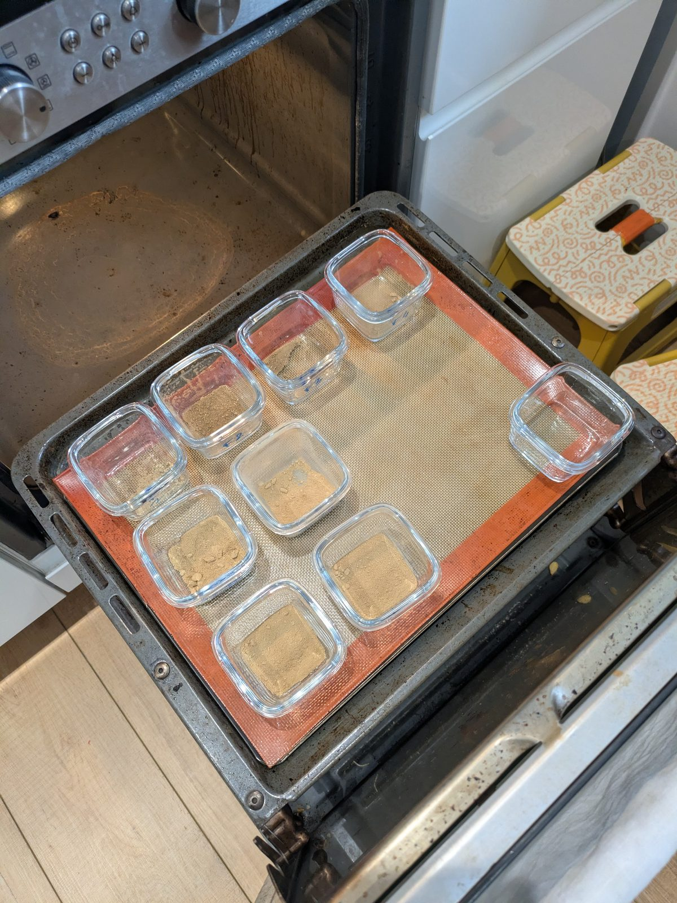
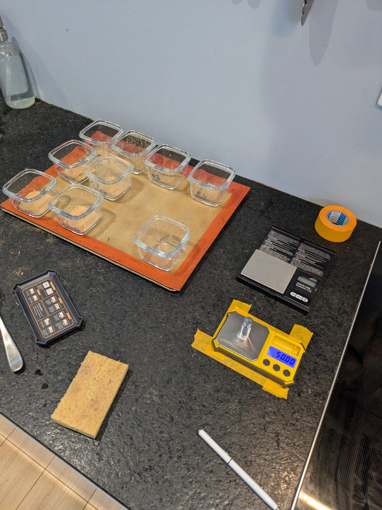
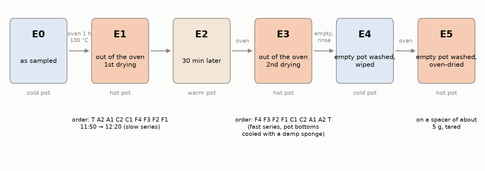
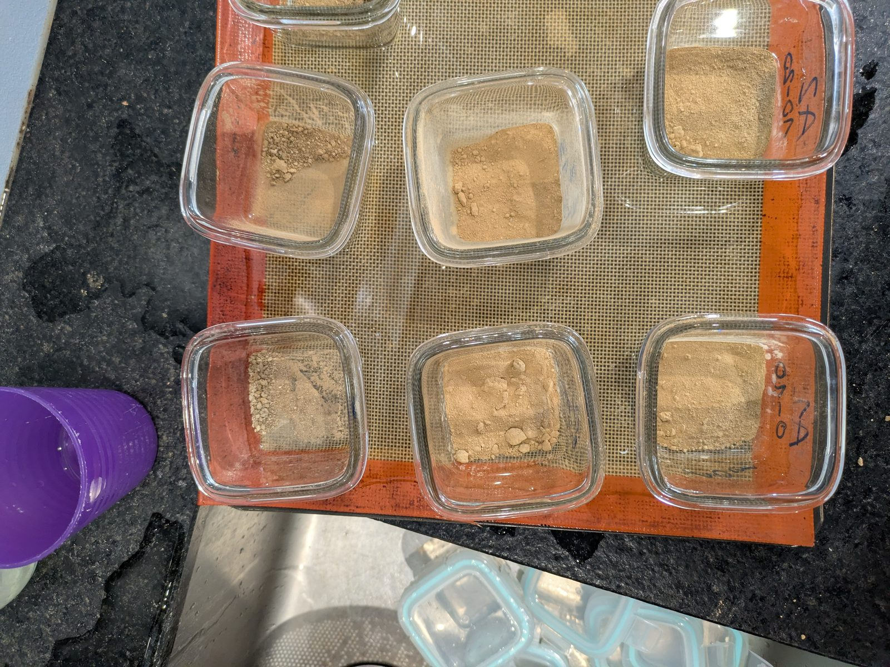
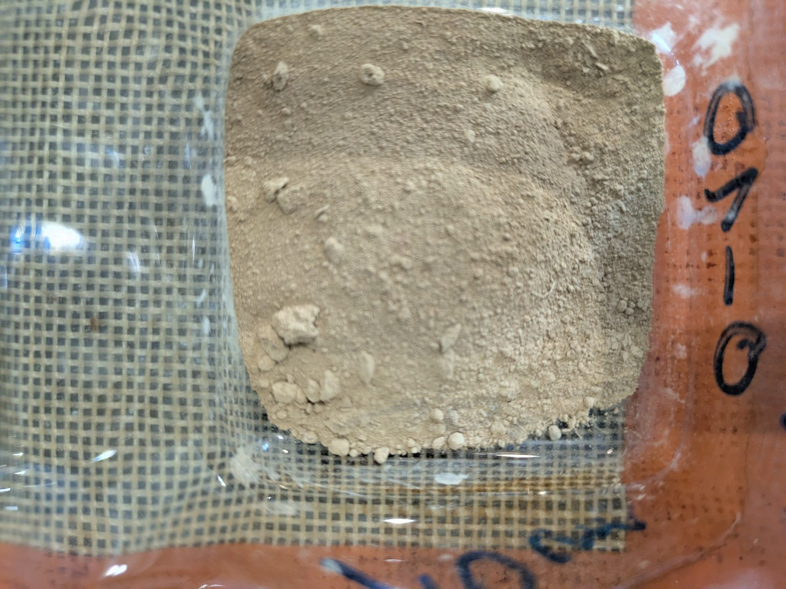
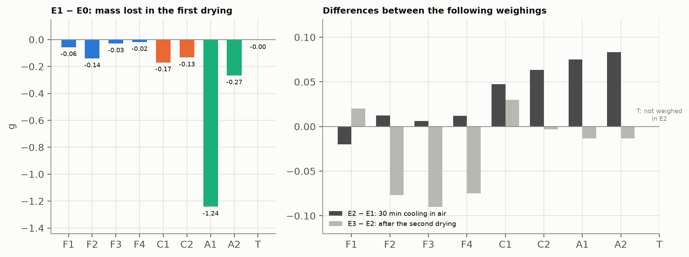
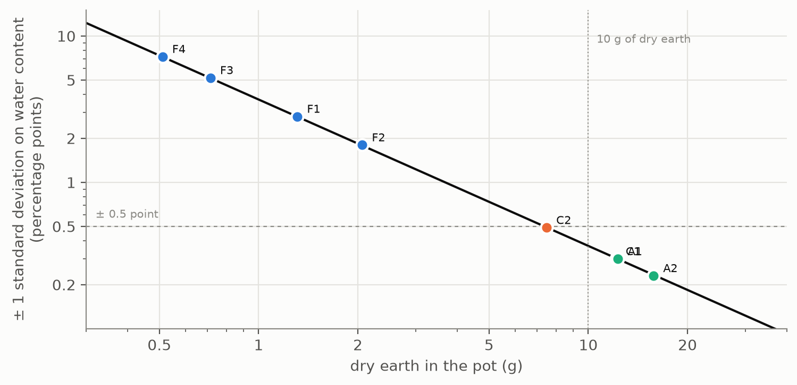
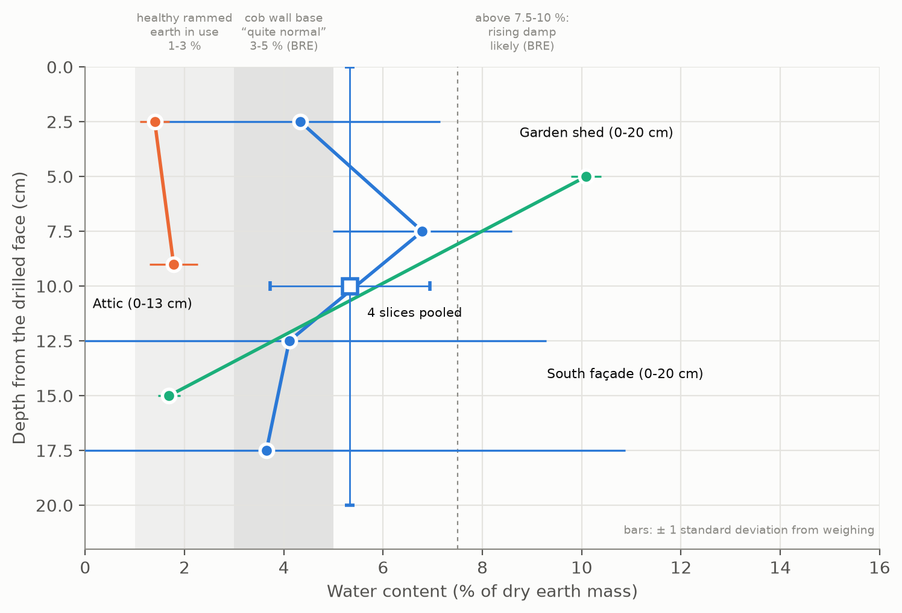
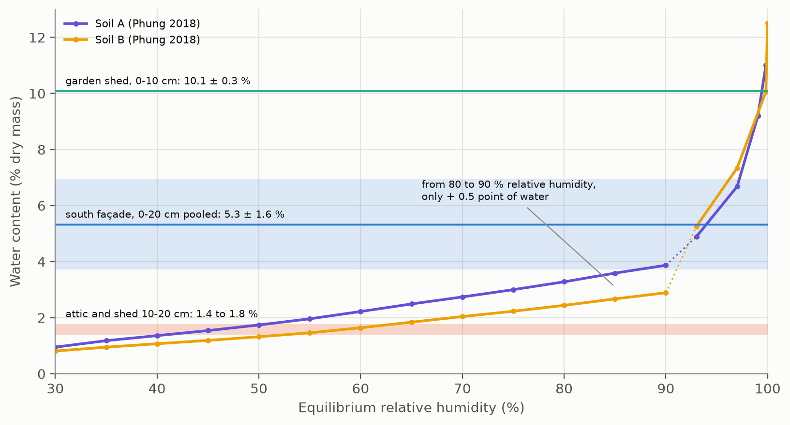

Identifier: Zenodo DOI assigned to each version, see the repository page. Readings, photos, figures and calculations:
<https://github.com/Remi-C/renovation-terre-crue>, website <https://remi.cura.info/renovation-terre-crue/>. Text, data and
figures under the CC BY 4.0 licence. Feedback: the GitHub repository's “issues”.

# In short

- **The question.** Does an old cob wall, dry to the touch, hold water? How much, and where? We took earth from three
  walls of a cob house near Rennes (17 November 2026), weighed each sample as taken, then after drying in a kitchen oven
  (18 November): the water is the difference.
- **A dry core, a wet skin.** In the wall of a garden shed, the first 10 cm hold 10.1 % water (± 0.3 point), the next
  10 cm 1.7 %. The attic partition wall is dry (1.4 and 1.8 %). The shed is unheated and very well ventilated; no leak is
  known.
- **A façade that cannot be read slice by slice.** The façade cores gave 0.5 to 2 g of earth per slice: the
  uncertainty runs from ± 2 to ± 7 points. The four slices (0 to 20 cm) pooled give 5.3 ± 1.6 %.
- **Almost every sampling bias makes the earth look drier than it is** (stones, heating while drilling): these values
  are more likely minimums.
- **What this changes for insulating.** A water content is not a relative humidity: going from one to the other needs
  the sorption isotherm of the wall's own earth, which was not measured. On two published earths, the façade is worth 87
  to 97 % relative humidity; the same 3 % water content is worth 75 % on one and 90 % on the other. A damp skin
  amounts to some 12 to 15 kg of water per m² of wall, which will have to leave. The author's own moisture
  calculations are not published: the paper draws no conclusion about any insulation system.
- **Limits.** One day, one sample per place, no repetition, a façade with too little earth, no isotherm measured on
  these earths.

# Why this paper

Before insulating a cob wall, we would like to know what water it holds: it is the starting state of any moisture
calculation, and what a measurement should confirm or contradict. The literature gives reference points (see 2.6), but
almost nothing measured in an old cob wall in service: in the sources we read, the only in-place measurement in western
France is a new wall still drying [5], and the reference point we found for an old wall is an opinion of a British
research body reported by an association [1].

So we measured, with kitchen equipment: an oven, a balance reading to the hundredth of a gram, glass pots. The method is
simple (weigh, dry, weigh); what takes care is the weighing noise and the sampling. This paper sets out both, with
the numbers.

It is written in **three parts that do not mix**:

- **Part 1 — the measurement**: what was sampled, how, and what the balance showed. No calculation choice, no judgement.
- **Part 2 — interpreting the measurement**: how the weighings become a water content (choices, noise, bias) and what
  these contents say about the walls, compared with the literature. It relies on Part 1 only.
- **Part 3 — what this changes for insulating a cob wall**: what needs models from outside the test (the sorption
  isotherm of a published earth) and general considerations. It relies on Parts 1 and 2.

We distinguish what is **measured** (read on the balance), **calculated** from the measurements, **observed** by the
author (by eye), and **assumed** (a probable explanation, not checked). This is a homeowner's field report, not a
laboratory test: one day, ordinary equipment, no repetition.

# Part 1 — The measurement

> **Contains**: places, tools, depths, the weighing sequence and the masses read, as recorded on 17 and 18 November
> 2026. **Does not contain**: any water content, any choice of series, any judgement on the quality of a weighing
> (Part 2).

## 1.1 Samples

Samples taken by the author on 17 November 2026, by drilling; drying and weighing on 18 November. Each sample is the
earth of one depth slice, collected in a glass pot. Pot T is a control: empty, it goes through every step like the
others.

| Pots | Place | Depths (cm) | Tool |
|---|---|---|---|
| F1 to F4 | south façade of the house, cob part, 1.20 m above ground | 0-5 / 5-10 / 10-15 / 15-20 | hammer drill, Ø 16 hollow bit |
| C1, C2 | interior partition wall of the attic (ventilated); the wall of the first screw test, 10/10/2026 | 0-5 / 5-13 | screw gun, Ø 10 bit |
| A1, A2 | wall of the garden shed (unheated, very well ventilated), drilled from the inside; the wall of the screw tests of 30/10 and 07/11/2026 | 0-10 / 10-20 | hammer drill, ordinary Ø 10 bit |
| T | empty pot, control | — | — |

Table: The nine pots.

Field observations (by the author):

- **Façade**: the drilling stopped on something hard at about 20 cm; no deeper slice.
- **Cores**: the core is not continuous; the earth of one slice may contain earth from another, and contamination
  (render, dust).
- **Stones**: flint-type stones are in the earth; one piece was removed from one of the samples, the other pots were not
  sorted.
- **Look of the earth**: by eye, the façade earth forms small aggregates; the attic earth forms none at all and looks
  rather like sand. After drying, the façade earth stays darker than the others.
- **Shed**: a water leak there is unlikely (the author's observation).
- **Not noted**: the face from which the façade was drilled (inside or outside), what stopped the drilling, and the pot
  the stone was removed from.

## 1.2 Weighing sequence

Each pot is weighed six times, in chronological order on 18 November: as taken (E0), out of the oven after one hour at
130 °C (E1), thirty minutes later (E2), out of the oven after a second drying (E3), emptied and washed (E4), emptied,
washed and oven-dried (E5). Figure 3 sums it up; Table 2 gives the conditions of each weighing.

Equipment: fan-assisted kitchen oven; a balance reading to the hundredth of a gram, checked with a 50 g weight; glass
pots on a silicone mat; a damp sponge to cool the bottom of hot pots. Several weighings were read several times: all
readings are kept.

{#photo_pots_au_four}

{#photo_poste_de_pesee}

{#fig_protocole}

| Code | Step | Conditions of the weighing |
|---|---|---|
| E0 | as taken | room temperature, about 15 °C |
| E1 | out of the oven, first drying (1 h at 130 °C) | 30-minute series (11:50-12:20) in the order T A2 A1 C2 C1 F4 F3 F2 F1; the pots cool and may take up moisture during the series; their heat disturbs the balance |
| E2 | 30 min after E1, before going back in the oven | whole series reweighed quickly, to have weighings close in time; pots cooled (order not noted) |
| E3 | out of the oven, second drying | fast series: pot bottoms cooled with a damp sponge, very brief weighings, balance recalibrated often, pan wiped with a damp sponge; order F4 F3 F2 F1 C1 C2 A1 A2 T |
| E4 | empty pot washed, wiped | pots emptied, rinsed, dried with paper towel; cold |
| E5 | empty pot washed then oven-dried | weighed on a spacer of about 5 g, tared, to insulate the balance from the heat of the pot |

Table: The steps of the test.

{#photo_pots_apres_sechage}

{#photo_cabanon_0_10}

## 1.3 Masses read

| Pot | E0 | E1 | E2 | E3 | E4 | E5 |
|---|---|---|---|---|---|---|
| F1 | 172.867 (3) | 172.810 (4) | 172.79 | 172.810 (2) | 171.557 (3) | 171.500 (2) |
| F2 | 174.248 (4) | 174.108 (4) | 174.12 | 174.043 (3) | 172.113 (3) | 172.047 (3) |
| F3 | 172.163 (3) | 172.134 (5) | 172.14 | 172.050 (7) | 171.48 | 171.420 (2) |
| F4 | 171.207 (3) | 171.188 (5) | 171.20 | 171.125 (2) | 170.72 | 170.677 (3) |
| C1 | 184.583 (4) | 184.413 (4) | 184.46 | 184.490 (2) | 172.36 | 172.273 (3) |
| C2 | 179.190 (4) | 179.057 (3) | 179.12 | 179.117 (3) | 171.630 (3) | 171.585 (2) |
| A1 | 181.317 (3) | 180.075 (2) | 180.15 | 180.137 (3) | 167.81 | 167.763 (3) |
| A2 | 187.133 (3) | 186.867 (3) | 186.95 | 186.937 (3) | 171.165 (4) | 171.100 (3) |
| T | 172.038 (4) | 172.033 (3) | — | 172.061 (7) | 172.093 (3) | 172.070 (3) |

Table: Mass of the pot (g), mean of the readings; in brackets, the number of readings when there are several. All readings: `donnees/pesees.csv`.

Two facts of reading, with no interpretation:

- **Spread between repeated readings** of the same weighing: 41 weighings read several times, maximum spread 0.05 g,
  median 0.01 g.
- **The control** weighs 172.037 g in E0, then 172.033, 172.061, 172.093 and 172.070 g in weighings E1, E3, E4 and E5
  (differences from E0: − 0.004, + 0.024, + 0.056 and + 0.033 g).

{#fig_ecarts}

- **E2 − E1** (30 minutes of cooling in air): + 0.048 g (C1), + 0.063 (C2), + 0.075 (A1), + 0.083 g (A2); from
  − 0.020 to + 0.012 g for F1 to F4.
- **E3 − E2**: F4, F3 and F2, weighed one after the other at the start of the series, lose − 0.075, − 0.090 and − 0.077 g;
  the other pots between − 0.013 and + 0.030 g.

# Part 2 — Interpreting the measurement

> **Contains**: the choices that turn masses into a water content, the quality of each value (noise, bias), what these
> contents say about the walls, set in the literature. **Does not contain**: any relative humidity or consequence for
> insulation, which need models from outside the test (Part 3).

## 2.1 From mass to water content: the choices

The water content *w* is the mass of water divided by the mass of dry earth, as a percentage:
*w* = (E0 − E1) / (E1 − E5). This is the gravimetric method: weigh, dry, weigh. Each series plays a role, and each
choice can be argued:

| Role | Series used | Reason |
|---|---|---|
| wet mass | E0 | weighed before any heating, in room air (about 15 °C) |
| dry mass | E1 | out of the oven, before moisture is taken up again (2.3). The control, weighed first and hottest, loses only 0.004 g: no measurable heat bias |
| mass of the empty pot | E5 | last series: pots washed then oven-dried, weighed insulated from the pan |
| discarded | E3 | F4, F3 and F2, weighed one after the other, all lose about 0.08 g against E2 whatever their earth (0.5 to 2 g): a shared shift of the balance, three times the noise (2.2), not a loss of water |
| not used | E2, E4 | E2: the pots have already taken up water again; E4: pots rinsed, glass still damp (the control weighs 0.056 g more than in E0) |

Table: Role of each series in the calculation.

## 2.2 Weighing noise

| Component | Standard deviation | Estimated from |
|---|---|---|
| repeatability | 0.012 g | the repeated readings of one weighing |
| between series | 0.023 g | the drift of the control over the dry series E1, E3, E5: balance drift, heat, water on the glass, position on the pan, which cannot be told apart |
| used per weighing | 0.026 g | quadratic sum of the two |

Table: Weighing noise budget.

A water content combines three weighings; its uncertainty depends almost only on the mass of dry earth in the pot:
± 0.2 point with 16 g of earth, ± 7 points with 0.5 g (Figure 7). **At least 10 g of earth per slice are needed** to stay
under ± 0.5 point: the façade did not give enough.

{#fig_bruit}

## 2.3 Moisture taken up again while cooling

Between E1 and E2, the attic and shed pots gain 0.05 to 0.08 g in about thirty minutes in air, i.e. 0.4 to 0.8 % of
their dry earth, and the gain follows their mass of earth. The control, weighed hot and first, shows no heat effect: this
gain is water taken up again by the dry earth, not a balance artefact (calculated). For the façade (0.5 to 2 g of earth)
the uptake stays under the noise. The control not having been reweighed in E2, this point rests on E1 alone (not checked).
Laboratory practice (cooling the pot closed, weighing it with its lid on) removes both the uptake and the heat effect.

## 2.4 Sampling biases

| Bias (observed) | Effect on the water content of the earth | Order of magnitude |
|---|---|---|
| stones (flint) in the weighed earth | underestimates: the stone counts as dry mass with no water | *w*earth = *w*measured / (1 − *f*), *f* = share of stone; × 1.25 for 20 % stone |
| heating of the earth while drilling | underestimates: water leaves before weighing | not quantified |
| discontinuous core, mixing, contamination | both ways; mainly blurs the depth | not quantified |
| time between sampling and weighing E0 | underestimates if the pot was not closed (not checked) | not quantified |

Table: Sampling biases and their direction.

Almost all biases go the same way: the water contents below are more likely low values.

## 2.5 Water contents

| Pot | Wall | Depth | Dry earth | w | ± 1 σ |
|---|---|---|---|---|---|
| F1 | South façade | 0-5 cm | 1.31 g | 4.3 % | 2.8 |
| F2 | South façade | 5-10 cm | 2.06 g | 6.8 % | 1.8 |
| F3 | South façade | 10-15 cm | 0.71 g | 4.1 % | 5.2 |
| F4 | South façade | 15-20 cm | 0.51 g | 3.7 % | 7.2 |
| **F pooled** | **South façade** | **0-20 cm** | **4.60 g** | **5.3 %** | **1.6** |
| C1 | Attic | 0-5 cm | 12.14 g | 1.4 % | 0.3 |
| C2 | Attic | 5-13 cm | 7.47 g | 1.8 % | 0.5 |
| A1 | Garden shed | 0-10 cm | 12.31 g | 10.1 % | 0.3 |
| A2 | Garden shed | 10-20 cm | 15.77 g | 1.7 % | 0.2 |

Table: Water content per pot (calculated). ± 1 σ: weighing noise alone, in percentage points; the biases of 2.4 come on top, mostly downwards. File: `donnees/resultats_calcules.json`.

{#fig_profils}

## 2.6 What these contents are worth for cob: the literature

| Reference point | Water content | Source |
|---|---|---|
| base of a cob wall “quite normal” | 3 to 5 % | Building Research Establishment (BRE), cited by the Devon Earth Building Association [1] |
| rising damp likely | above 7.5 to 10 % depending on the earth | same [1] |
| normal water content of a cob wall at equilibrium | 4 % | Harries et al. 1995, reported by Phung [3, 4] |
| healthy, lived-in rammed earth, after drying | 1 to 3 % (0.5 to 3 elsewhere in the same article) | Heitz et al. 2015 [2] |
| visible pathology of rammed earth (it darkens) | from 5 to 7 % | Heitz et al. 2015 [2] |
| compressive strength of cob | 0.8 MPa at 4 %, 0.6 at 10 %, 0.36 at 15 %, 0.12 at 18 % | Harries et al. 1995, reported by Phung [3, 4] |
| old cob measured in place | no data found in the sources read | — |

Table: Published reference points. Rammed earth (earth tamped in formwork) is not cob: its values are neighbouring reference points, not transferable without reservation.

The BRE statement, as reported [1]: “The Building Research Establishment advises that a moisture content of between 3
and 5% at the base of a cob wall is quite normal. However, moisture levels in excess of 7½ to 10%, depending on soil
type, could indicate the presence of rising damp.” The leaflet dates from 2008 (year read from the file name); the BRE
text itself was not read.

## 2.7 What the measurement says about the walls, and what it does not

- **Attic partition wall and core of the shed wall: dry.** C1, C2 and A2 between 1.4 and 1.8 %, to ± 0.5 point at most:
  within the range of a sound earth in service. The attic partition gives the content of a sheltered interior cob.
- **Inner skin of the shed wall: wet.** A1 (0 to 10 cm from the inner face) at 10.1 ± 0.3 %, the most reliable value of
  the test, at the literature's threshold for water ingress (7.5 to 10 %); ten centimetres further, A2 is dry. All the
  water is in a skin of 10 cm at most, on the side of a space open to outside air.
- **The author's reading (assumed)**: no leak; given the season, moisture taken up from the autumn air. It fits the shape
  of the profile (a wet skin on a dry core: what a recent uptake through the surface gives, not an old water ingress
  that would have reached the core). But the air humidity was not measured in the shed; Part 3 shows that air alone
  explains a 10 % content poorly.
- **South façade: one average value, no profile.** Slice by slice, the uncertainty runs from ± 1.8 to ± 7.2 points: no
  profile can be read. Pooled, 5.3 ± 1.6 %: at the top of the “normal” range for the base of a cob wall (3 to 5 %), but
  at 1.20 m above ground, where less is expected than at the base. The first two slices alone (0 to 10 cm): 5.8 ± 1.6 %.
- **Look of the earth (observed).** The aggregates of the façade earth and the sandy look of the attic earth point the
  same way as the measured contents (façade wetter). But the darker colour persists once the earth is dry: it does not
  come from water. The façade earth is of another nature (more clay, organic matter or oxides: assumed). Another earth
  has another isotherm (Part 3): the attic's does not hold for the façade.

# Part 3 — What this changes for insulating a cob wall

> **Contains**: the measured value against the literature; why going from a water content to a relative humidity needs
> the isotherm of the wall's earth; why a damp skin matters before closing a wall. **Relies on**: published curves for
> two other earths [3] and on orders of magnitude. **Does not contain**: the author's moisture calculations for specific
> insulation systems, which are not published; no conclusion about an insulant or a build-up is drawn from them here.

## 3.1 The measured value against the literature

The attic partition and the core of the shed wall are in the healthy range. The pooled façade (5.3 %) is at the top of the
“normal” range for the base of an English cob wall (3 to 5 %), at 1.20 m above ground; its uncertainty bar (± 1.6) runs
from “normal” towards the rising-damp threshold (7.5 to 10 %) without reaching it, and the known biases pull the true value
upwards. The shed skin (10.1 %) touches that threshold with no known leak. None of these values can be compared with old
cob measured in place: there is none, in our sources.

## 3.2 Why the isotherm of the real earth is needed

Moisture calculations for an insulated wall reason in **relative humidity** in the pores of the earth; a weighing gives a
**water content**. The bridge is the **sorption isotherm**: the water content an earth takes at each relative humidity of
the air. It depends on the earth (clay, organic matter, fibres, compaction). We did not measure it for these walls. For
lack of better, Figure 9 shows it for two laboratory cob soils (Phung, 2018 [3]: two Normandy earths, 1 % straw; points in
`donnees/isotherme_phung_2018.csv`, with the annex of the thesis each comes from): on drying, desorption from 5 to 90 %
relative humidity, then the retention curve from 93 % to saturation; the dotted line joins two different series of
specimens.

{#fig_isotherme}

| Sample | w | Soil A: RH (± 1 σ of w) | Soil B: RH (± 1 σ of w) | Between the two soils |
|---|---|---|---|---|
| C1 (attic, 0-5 cm) | 1.4 % | 41 % (33-49) | 53 % (41-62) | 41-53 % |
| C2 (attic, 5-13 cm) | 1.8 % | 51 % (38-61) | 64 % (49-76) | 51-64 % |
| A2 (garden shed, 10-20 cm) | 1.7 % | 49 % (43-54) | 61 % (55-67) | 49-61 % |
| A1 (garden shed, 0-10 cm) | 10.1 % | 99.4 % (99.3-99.6) | 99.8 % (99.5-99.8) | 99.4-99.8 % |
| South façade 0-10 cm (F1 + F2) | 5.8 % | 95 % (91-98) | 94 % (92-97) | 94-95 % |
| **South façade 0-20 cm pooled** | **5.3 %** | **94 % (87-97)** | **93 % (91-96)** | **93-94 %** |

Table: Equilibrium relative humidity (RH, in %) equivalent to each water content, read on each of the two published soils; in brackets, the value for *w* − 1 σ and *w* + 1 σ; “—” when the bound falls off the curve. Calculated by linear interpolation: an indicative reading, neither a measurement nor a design value.

Three lessons, which do not depend on the details of these curves:

- **Two soils, two humidities for the same water.** A 3 % water content is worth about 75 % relative humidity on soil A and
  about 90 % on soil B. The conversion does not transfer from one earth to another.
- **The conversion is ill-conditioned between 80 and 90 %.** From 80 to 90 % relative humidity, the water content gains
  only about 0.5 point (0.6 on soil A, 0.45 on soil B). An error of 1 point on *w*, or another earth, moves the result
  by tens of points of relative humidity. That is the façade's case: 5.3 ± 1.6 % reads between 87 and 97 % relative
  humidity depending on the earth and on the uncertainty. A starting state fixed by convention at a given relative
  humidity cannot be recovered from a weighing.
- **The shed skin (10 %) is close to saturation on both soils** (99.4 to 99.8 %). If that reading holds, autumn air alone,
  even very humid, explains it poorly: either the shed earth holds much more water at a given humidity than these two
  soils, or liquid water adds to it (condensation on a surface colder than the air). Inferred, not checked; the retention
  curve above 93 % comes from compacted specimens.

Measuring the **relative humidity directly** (a probe in a plugged hole, read at equilibrium, or the equilibrium humidity
of the earth in a closed jar) bypasses the isotherm; a weighing alone cannot.

## 3.3 Why a damp skin matters before closing a wall

- **This water will have to leave.** Between the shed skin and its core there are about 8.4 points of water content. Over
  10 cm of wall, with an assumed dry density of 1,500 to 1,800 kg/m³ (not measured; the specimens in [3] range from
  1,460 to 1,840), that makes 12 to 15 kg of water per square metre of wall (calculated, `grandeurs.py`). Closing the
  wall with a layer less open to vapour slows this departure; by how much depends on the build-up, and we do not
  calculate it here.
- **The state at the time of closing is what counts, not today's.** The shed shows that a 10 cm skin carries 10 % water
  with no known leak, in November, while its core is dry. A measurement of the first centimetres depends on the season
  and on what came before: it must be redone when closing.
- **Wet earth is weaker.** According to Harries et al. (reported by Phung [3, 4]), the compressive strength of cob falls
  from 0.8 MPa at 4 % water to 0.6 MPa at 10 % and 0.36 MPa at 15 %. What is fixed into a damp skin is anchored in
  weaker earth: this is one of the reservations on the screw tests made on the same shed wall (topic “Screws in cob” of the
  same repository, <https://remi.cura.info/renovation-terre-crue/en/vis-dans-la-bauge/>).
- **What to ask of a moisture calculation**: the relative humidity the interface between earth and insulation will see,
  and for how long, from a measured starting state, with an isotherm measured on the wall's earth. The author's
  calculations on specific insulation systems are not published; this paper draws no conclusion from them about an
  insulant, a bonding or an air gap.

## 3.4 What to measure in order to decide

- **The isotherm of the wall's earth**: on façade earth (which seems different from the attic's) and on the dry samples
  from the attic and the shed (7 to 16 g); jars with saturated salts (magnesium chloride 33 %, sodium chloride 75 %,
  potassium chloride 85 %, potassium sulphate 97 % relative humidity), weighed to constant mass.
- **More earth**: at least 10 g of dry earth per slice (several neighbouring holes, or a larger diameter).
- **Weighings without uptake**: pots closed at the oven exit, weighed cold; control weighed in every series.
- **A full profile**: drill from the inside too, at the same height, and reach the core of the wall.
- **The stones**: weigh separately the stone removed from each pot.
- **At the right time**: redo the measurement of the outer skin when the wall is closed.

# Limits and open points

- **One day, one sample per place, no repetition.** The uncertainties given are those of the weighings alone; sampling
  biases come on top, mostly downwards.
- **The façade has too little earth** for a profile; only its pooled value can be read.
- **Series E3 was discarded**; series E1 serves as dry mass, with a moisture uptake of at most 0.8 % of the dry earth
  for the most heavily loaded pots.
- **No isotherm was measured** on these earths: the relative humidities in the paper are readings on other earths,
  indicative.
- **Open points**: the face from which the façade was drilled (it tells which side of the wall the 20 measured cm
  are on); what stopped the drilling at about 20 cm; the pot the stone was removed from.

# References

The full references, with their address and date of access, are in the
[reference list on the GitHub repository](../references.md) (folder `humidite-de-la-bauge/papier/`).

1. Devon Earth Building Association, *Cob Dwellings: Compliance with the Building Regulations 2000 (as amended)*, leaflet, 2008, section on moisture.
2. Heitz P., Morel J.-C., Fabbri A., Soudani L., Champiré F., Meunier N., “L'isolation du pisé : pertinence et principes” [Insulating rammed earth: relevance and principles], TransLettre (LGCB-LTDS, ENTPE-CNRS), August 2015.
3. Phung T. A., *Formulation et caractérisation d'un composite terre-fibres végétales : la bauge* [Formulation and characterisation of an earth and plant-fibre composite: cob], thesis, Université de Caen Normandie, 2018 (HAL tel-01938827).
4. Harries R., Saxton B., Coventry K., 1995, paper reported by [3] (not read directly).
5. Azil A., *Étude des performances mécanique et hygrothermique des matériaux en terre et fibre végétale : application dans un bâtiment pilote* [Study of the mechanical and hygrothermal performance of earth and plant-fibre materials: application in a pilot building], thesis, Université de Caen Normandie, 2022 (HAL tel-03969291).
