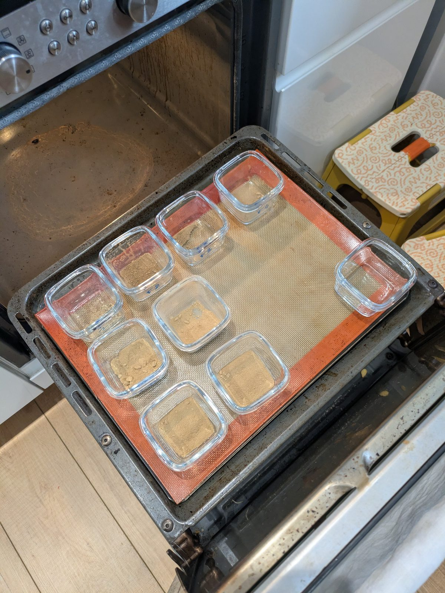
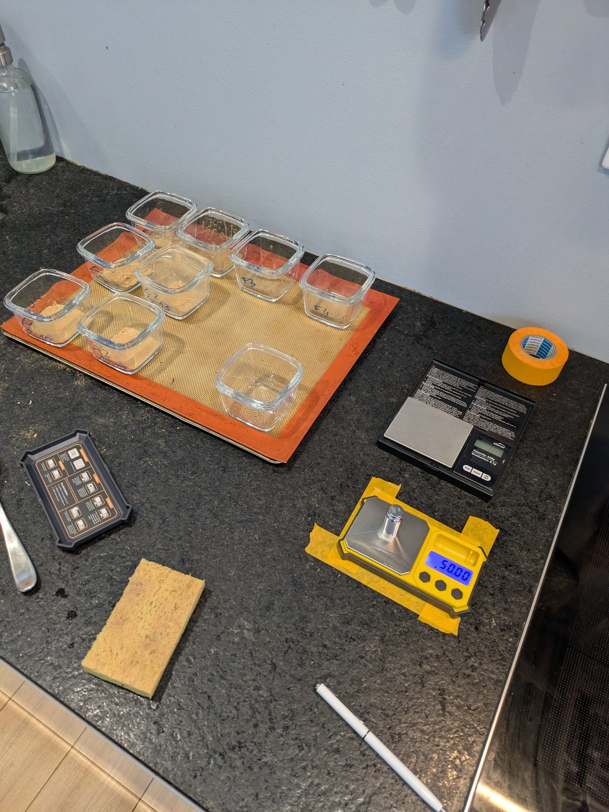
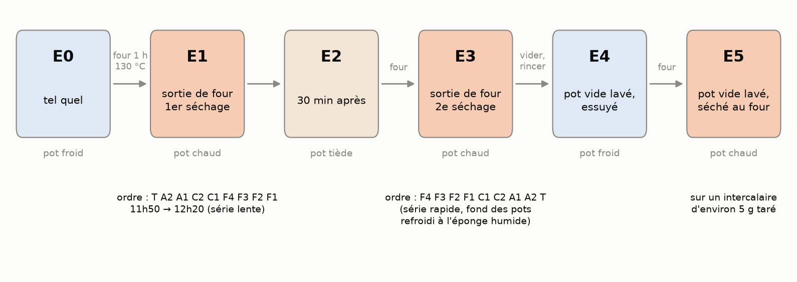
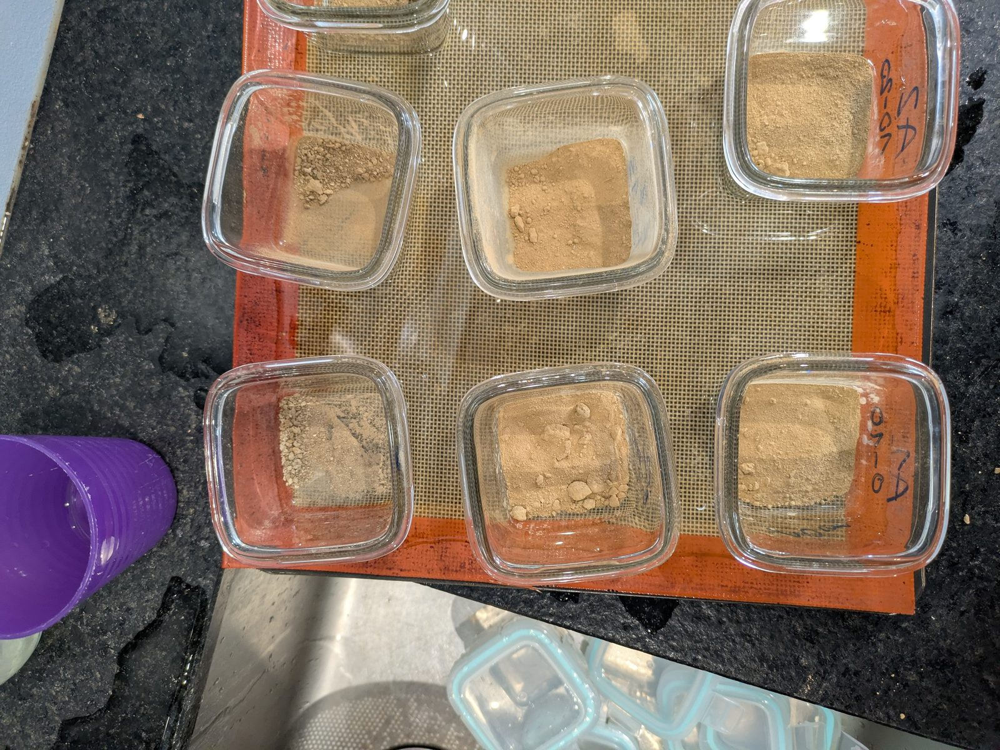
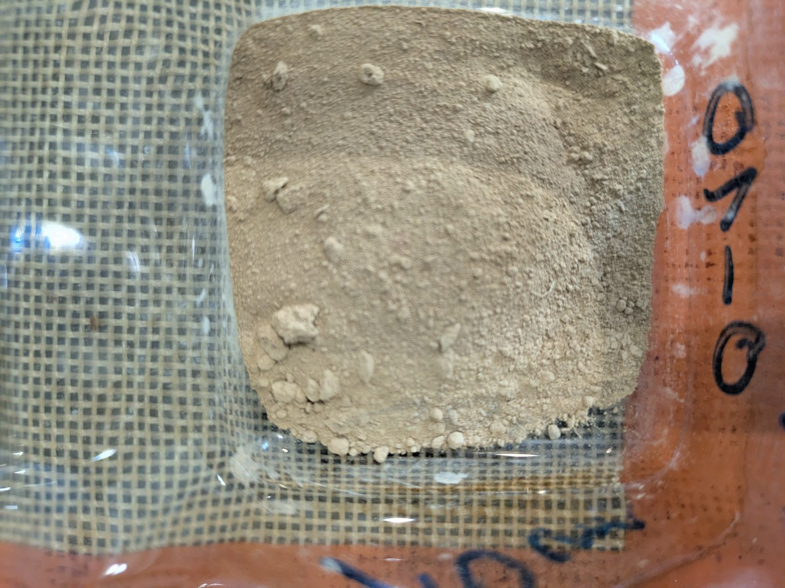
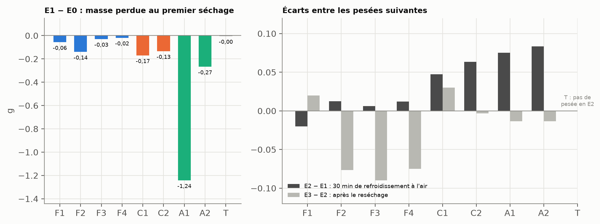
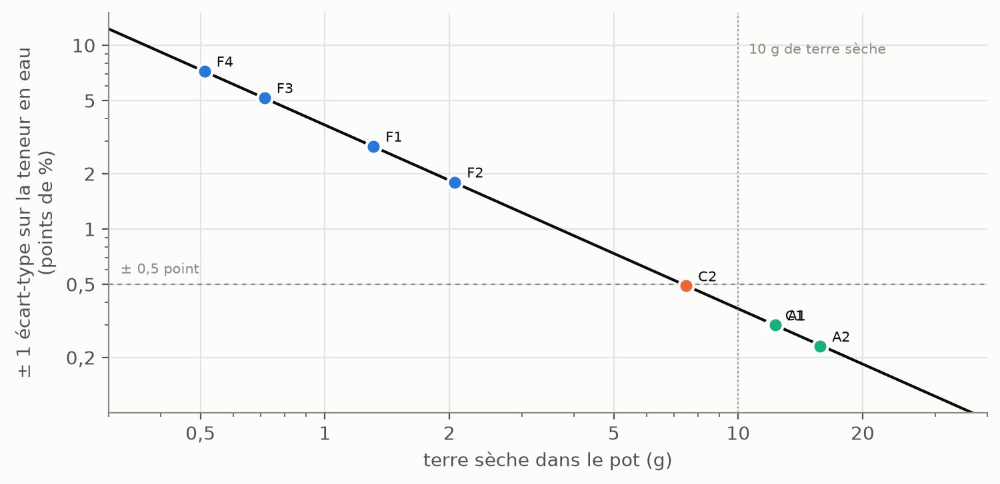
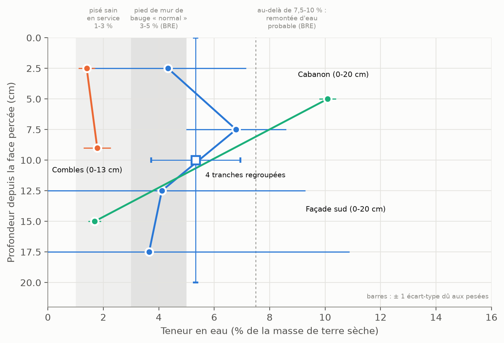
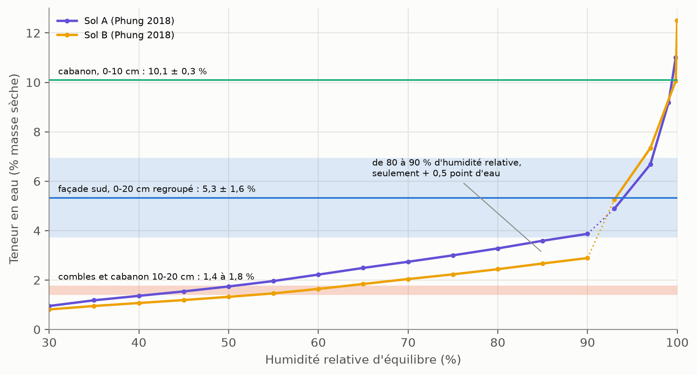

Identifiant : DOI Zenodo attribué à chaque version, voir la page du dépôt. Relevés, photos, figures et calculs :
<https://github.com/Remi-C/renovation-terre-crue>, site <https://remi.cura.info/renovation-terre-crue/>. Texte, données et
figures sous licence CC BY 4.0. Retours : les « issues » du dépôt GitHub.

# En bref

- **La question.** Un vieux mur de bauge, sec au toucher, contient-il de l'eau ? Combien, et où ? Nous avons prélevé de la
  terre dans trois murs d'une maison en bauge près de Rennes (17 novembre 2026), pesé chaque prélèvement tel quel, puis
  après séchage au four de cuisine (18 novembre) : l'eau est la différence.
- **Un cœur sec, une peau mouillée.** Dans le mur d'un cabanon de jardin, les 10 premiers centimètres contiennent 10,1 %
  d'eau (± 0,3 point), les 10 suivants 1,7 %. Le mur de refend des combles est sec (1,4 et 1,8 %). Le cabanon n'est pas
  chauffé et il est très ventilé ; aucune fuite n'est connue.
- **Une façade qu'on ne peut pas lire tranche par tranche.** Les carottes de façade ont donné 0,5 à 2 g de terre par
  tranche : l'incertitude va de ± 2 à ± 7 points. Les quatre tranches (0 à 20 cm) regroupées donnent 5,3 ± 1,6 %.
- **Presque tous les biais de prélèvement font paraître la terre plus sèche qu'elle n'est** (pierres, échauffement au
  perçage) : ces valeurs sont plutôt des minimums.
- **Ce que cela change pour isoler.** Une teneur en eau n'est pas une humidité relative : le passage de l'une à
  l'autre demande l'isotherme de sorption de la terre du mur, qui n'a pas été mesurée. Sur deux terres publiées, la
  façade vaut 87 à 97 % d'humidité relative ; une même teneur de 3 % vaut 75 % sur l'une et 90 % sur l'autre. Une peau
  humide représente de l'ordre de 12 à 15 kg d'eau par m² de mur, qui devront sortir. Les calculs d'humidité propres à
  l'auteur ne sont pas publiés : le papier ne conclut sur aucun système d'isolation.
- **Limites.** Une seule journée, un seul prélèvement par endroit, pas de répétition, une façade trop peu fournie en
  terre, aucune isotherme mesurée sur ces terres.

# Pourquoi ce papier

Avant d'isoler un mur de bauge, on voudrait savoir quelle eau il contient : c'est l'état de départ de tout calcul
d'humidité, et ce que la mesure doit confirmer ou infirmer. La littérature donne des repères (voir 2.6), mais presque
rien de mesuré dans une bauge ancienne en service : dans les sources que nous avons lues, la seule mesure en place de
l'Ouest de la France est un mur neuf en séchage [5], et le repère que nous avons trouvé pour un mur ancien est un avis d'un
organisme britannique rapporté par une association [1].

Nous avons donc mesuré, avec du matériel de cuisine : un four, une balance au centième de gramme, des pots en verre. La
méthode est simple (peser, sécher, peser) ; ce qui demande du soin, c'est le bruit de pesée et le prélèvement. Ce papier
expose les deux, avec les chiffres.

Il est écrit en **trois parties qui ne se mélangent pas** :

- **Partie 1 — la mesure** : ce qui a été prélevé, comment, et ce que la balance a affiché. Aucun choix de calcul, aucun
  jugement.
- **Partie 2 — l'interprétation de la mesure** : comment les pesées deviennent une teneur en eau (choix, bruit, biais) et
  ce que ces teneurs disent des murs, comparées à la littérature. Elle ne s'appuie que sur la partie 1.
- **Partie 3 — ce que cela change pour isoler un mur de bauge** : ce qui demande des modèles extérieurs à l'essai
  (l'isotherme de sorption d'une terre publiée) et des réflexions générales. Elle s'appuie sur les parties 1 et 2.

Nous distinguons ce qui est **mesuré** (lu à la balance), **calculé** à partir des mesures, **observé** par l'auteur (à
l'œil), et **supposé** (explication probable, non vérifiée). Ce papier est un retour d'expérience de particulier, pas un
essai de laboratoire : un seul jour, du matériel courant, aucune répétition.

# Partie 1 — La mesure

> **Contient** : les lieux, les outils, les profondeurs, le déroulé des pesées et les masses lues, tels que relevés les
> 17 et 18 novembre 2026. **Ne contient pas** : de teneur en eau, de choix de série, de jugement sur la qualité d'une
> pesée (partie 2).

## 1.1 Prélèvements

Prélèvements faits par l'auteur le 17 novembre 2026, par perçage ; séchage et pesées le 18 novembre. Chaque prélèvement
est la terre d'une tranche de profondeur, recueillie dans un pot en verre. Le pot T est un témoin : vide, il suit toutes
les étapes comme les autres.

| Pots | Lieu | Profondeurs (cm) | Outil |
|---|---|---|---|
| F1 à F4 | façade sud de la maison, partie en bauge, à 1,20 m du sol | 0-5 / 5-10 / 10-15 / 15-20 | perforateur, mèche creuse Ø 16 |
| C1, C2 | mur de refend intérieur des combles (ventilés) ; le mur du premier essai de vis, 10/10/2026 | 0-5 / 5-13 | visseuse, mèche Ø 10 |
| A1, A2 | mur du cabanon de jardin (local non chauffé, très ventilé), percé depuis l'intérieur ; le mur des essais de vis du 30/10 et du 07/11/2026 | 0-10 / 10-20 | perforateur, mèche Ø 10 classique |
| T | pot vide, témoin | — | — |

Table: Les neuf pots.

Observations de terrain (de l'auteur) :

- **Façade** : le perçage s'est arrêté sur quelque chose de dur vers 20 cm ; aucune tranche plus profonde.
- **Carottes** : la carotte n'est pas continue ; la terre d'une tranche peut contenir de la terre d'une autre, et des
  contaminations (enduit, poussière).
- **Pierres** : des pierres de type silex sont dans la terre ; un morceau a été retiré d'un des échantillons, les autres
  pots n'ont pas été triés.
- **Aspect de la terre** : à l'œil, la terre de la façade forme de petits agrégats ; celle des combles n'en forme pas
  du tout et ressemble plutôt à du sable. Après séchage, la terre de la façade reste plus sombre que les autres.
- **Cabanon** : une fuite d'eau y est peu probable (observation de l'auteur).
- **Non notés** : la face depuis laquelle la façade a été percée (intérieure ou extérieure), ce qui a arrêté le
  perçage, et le pot d'où la pierre a été retirée.

## 1.2 Déroulé des pesées

Chaque pot est pesé six fois, dans l'ordre chronologique du 18 novembre : tel quel (E0), à la sortie du four après une
heure à 130 °C (E1), trente minutes plus tard (E2), à la sortie du four après un second séchage (E3), vidé et lavé (E4),
vidé, lavé et séché au four (E5). La figure 3 le résume ; la table 2 donne les conditions de chaque pesée.

Matériel : four de cuisine en chaleur tournante ; balance qui affiche le centième de gramme, vérifiée avec un poids de
50 g ; pots en verre posés sur un tapis de silicone ; une éponge humide pour refroidir le fond des pots chauds. Plusieurs
pesées ont été lues plusieurs fois : toutes les lectures sont conservées.

{#photo_pots_au_four}

{#photo_poste_de_pesee}

{#fig_protocole}

| Code | Étape | Conditions de la pesée |
|---|---|---|
| E0 | tel quel | température ambiante, environ 15 °C |
| E1 | sortie de four, premier séchage (1 h à 130 °C) | série de 30 minutes (11h50-12h20) dans l'ordre T A2 A1 C2 C1 F4 F3 F2 F1 ; les pots refroidissent et peuvent reprendre de l'humidité pendant la série ; leur chaleur dérègle la balance |
| E2 | 30 min après E1, avant de remettre au four | toute la série repesée rapidement, pour avoir des pesées proches dans le temps ; pots refroidis (ordre non noté) |
| E3 | sortie de four, second séchage | série rapide : fond des pots refroidi à l'éponge humide, pesées très brèves, balance recalibrée souvent, plateau essuyé à l'éponge humide ; ordre F4 F3 F2 F1 C1 C2 A1 A2 T |
| E4 | pot vide lavé, essuyé | pots vidés, rincés, séchés au papier absorbant ; froids |
| E5 | pot vide lavé puis séché au four | pesé sur un intercalaire d'environ 5 g, taré, pour isoler la balance de la chaleur du pot |

Table: Les étapes de l'essai.

{#photo_pots_apres_sechage}

{#photo_cabanon_0_10}

## 1.3 Masses lues

| Pot | E0 | E1 | E2 | E3 | E4 | E5 |
|---|---|---|---|---|---|---|
| F1 | 172,867 (3) | 172,810 (4) | 172,79 | 172,810 (2) | 171,557 (3) | 171,500 (2) |
| F2 | 174,248 (4) | 174,108 (4) | 174,12 | 174,043 (3) | 172,113 (3) | 172,047 (3) |
| F3 | 172,163 (3) | 172,134 (5) | 172,14 | 172,050 (7) | 171,48 | 171,420 (2) |
| F4 | 171,207 (3) | 171,188 (5) | 171,20 | 171,125 (2) | 170,72 | 170,677 (3) |
| C1 | 184,583 (4) | 184,413 (4) | 184,46 | 184,490 (2) | 172,36 | 172,273 (3) |
| C2 | 179,190 (4) | 179,057 (3) | 179,12 | 179,117 (3) | 171,630 (3) | 171,585 (2) |
| A1 | 181,317 (3) | 180,075 (2) | 180,15 | 180,137 (3) | 167,81 | 167,763 (3) |
| A2 | 187,133 (3) | 186,867 (3) | 186,95 | 186,937 (3) | 171,165 (4) | 171,100 (3) |
| T | 172,038 (4) | 172,033 (3) | — | 172,061 (7) | 172,093 (3) | 172,070 (3) |

Table: Masse du pot (g), moyenne des lectures ; entre parenthèses, le nombre de lectures quand il y en a plusieurs. Toutes les lectures : `donnees/pesees.csv`.

Deux faits de lecture, sans interprétation :

- **Écart entre lectures répétées** d'une même pesée : 41 pesées lues plusieurs fois, écart maximal 0,05 g, médian 0,01 g.
- **Le témoin** pèse 172,037 g en E0, puis 172,033, 172,061, 172,093 et 172,070 g aux pesées E1, E3, E4 et E5 (écarts à
  E0 : − 0,004, + 0,024, + 0,056 et + 0,033 g).

{#fig_ecarts}

- **E2 − E1** (30 minutes de refroidissement à l'air) : + 0,048 g (C1), + 0,063 (C2), + 0,075 (A1), + 0,083 g (A2) ; de
  − 0,020 à + 0,012 g pour F1 à F4.
- **E3 − E2** : F4, F3 et F2, pesés à la suite au début de la série, perdent − 0,075, − 0,090 et − 0,077 g ; les autres pots
  entre − 0,013 et + 0,030 g.

# Partie 2 — L'interprétation de la mesure

> **Contient** : les choix qui transforment les masses en teneur en eau, la qualité de chaque valeur (bruit, biais), ce
> que ces teneurs disent des murs, situées dans la littérature. **Ne contient pas** : d'humidité relative ni de
> conséquence pour l'isolation, qui demandent des modèles extérieurs à l'essai (partie 3).

## 2.1 De la masse à la teneur en eau : les choix

La teneur en eau *w* est la masse d'eau rapportée à la masse de terre sèche, en pourcentage :
*w* = (E0 − E1) / (E1 − E5). C'est la méthode gravimétrique : peser, sécher, peser. Chaque série joue un rôle, et chaque
choix est discutable :

| Rôle | Série retenue | Raison |
|---|---|---|
| masse humide | E0 | pesée avant tout chauffage, à l'air ambiant (environ 15 °C) |
| masse sèche | E1 | sortie du four, avant la reprise d'humidité (2.3). Le témoin, pesé le premier et le plus chaud, n'y perd que 0,004 g : pas de biais de chaleur mesurable |
| masse du pot vide | E5 | dernière série : pots lavés puis séchés au four, pesés isolés du plateau |
| écartée | E3 | F4, F3 et F2, pesés à la suite, perdent tous environ 0,08 g par rapport à E2 quelle que soit leur terre (0,5 à 2 g) : un décalage commun de la balance, trois fois le bruit (2.2), pas une perte d'eau |
| non utilisées | E2, E4 | E2 : les pots ont déjà repris de l'eau ; E4 : pots rincés, verre encore humide (le témoin y pèse 0,056 g de plus qu'en E0) |

Table: Rôle de chaque série dans le calcul.

## 2.2 Bruit des pesées

| Composante | Écart-type | Estimée par |
|---|---|---|
| répétabilité | 0,012 g | les lectures répétées d'une même pesée |
| entre séries | 0,023 g | la dérive du témoin sur les séries sèches E1, E3, E5 : dérive de la balance, chaleur, eau sur le verre, position sur le plateau, sans pouvoir les séparer |
| retenu par pesée | 0,026 g | somme quadratique des deux |

Table: Budget de bruit de pesée.

Une teneur en eau combine trois pesées ; son incertitude ne dépend presque que de la masse de terre sèche du pot :
± 0,2 point avec 16 g de terre, ± 7 points avec 0,5 g (figure 7). **Il faut au moins 10 g de terre par tranche** pour
rester sous ± 0,5 point : la façade n'en a pas donné assez.

{#fig_bruit}

## 2.3 Reprise d'humidité au refroidissement

Entre E1 et E2, les pots des combles et du cabanon gagnent 0,05 à 0,08 g en une trentaine de minutes à l'air, soit 0,4 à
0,8 % de leur terre sèche, et le gain suit leur masse de terre. Le témoin, pesé chaud en premier, ne montre pas d'effet de
chaleur : ce gain est une reprise d'eau de la terre sèche, pas un artefact de balance (calculé). Pour la façade (0,5 à
2 g de terre), la reprise reste sous le bruit. Le témoin n'ayant pas été repesé en E2, ce point s'appuie sur E1 seul
(non vérifié). La pratique de laboratoire (refroidir le pot fermé, le peser couvercle mis) supprime la reprise et l'effet
de la chaleur.

## 2.4 Biais du prélèvement

| Biais (observé) | Effet sur la teneur en eau de la terre | Ordre de grandeur |
|---|---|---|
| pierres (silex) dans la terre pesée | sous-estime : la pierre compte comme masse sèche sans eau | *w*terre = *w*mesuré / (1 − *f*), *f* = part de pierre ; × 1,25 pour 20 % de pierre |
| échauffement de la terre au perçage | sous-estime : de l'eau part avant la pesée | non chiffré |
| carotte discontinue, mélange, contamination | dans les deux sens ; brouille surtout la profondeur | non chiffré |
| temps entre prélèvement et pesée E0 | sous-estime si le pot n'était pas fermé (non vérifié) | non chiffré |

Table: Biais du prélèvement et leur sens.

Presque tous les biais vont dans le même sens : les teneurs en eau ci-dessous sont plutôt des valeurs basses.

## 2.5 Teneurs en eau

| Pot | Mur | Profondeur | Terre sèche | w | ± 1 σ |
|---|---|---|---|---|---|
| F1 | Façade sud | 0-5 cm | 1,31 g | 4,3 % | 2,8 |
| F2 | Façade sud | 5-10 cm | 2,06 g | 6,8 % | 1,8 |
| F3 | Façade sud | 10-15 cm | 0,71 g | 4,1 % | 5,2 |
| F4 | Façade sud | 15-20 cm | 0,51 g | 3,7 % | 7,2 |
| **F regroupé** | **Façade sud** | **0-20 cm** | **4,60 g** | **5,3 %** | **1,6** |
| C1 | Combles | 0-5 cm | 12,14 g | 1,4 % | 0,3 |
| C2 | Combles | 5-13 cm | 7,47 g | 1,8 % | 0,5 |
| A1 | Cabanon | 0-10 cm | 12,31 g | 10,1 % | 0,3 |
| A2 | Cabanon | 10-20 cm | 15,77 g | 1,7 % | 0,2 |

Table: Teneur en eau par pot (calculé). ± 1 σ : le bruit de pesée seul, en points de pourcentage ; les biais de 2.4 s'y ajoutent, surtout vers le bas. Fichier : `donnees/resultats_calcules.json`.

{#fig_profils}

## 2.6 Ce que valent ces teneurs pour une bauge : la littérature

| Repère | Teneur en eau | Source |
|---|---|---|
| pied de mur de bauge « tout à fait normal » | 3 à 5 % | Building Research Establishment (BRE), cité par la Devon Earth Building Association [1] |
| remontée d'eau probable | au-delà de 7,5 à 10 % selon la terre | idem [1] |
| teneur normale d'un mur de bauge en équilibre | 4 % | Harries et coll. 1995, rapporté par Phung [3, 4] |
| pisé sain, habité, après séchage | 1 à 3 % (0,5 à 3 ailleurs dans le même article) | Heitz et coll. 2015 [2] |
| pathologie visible du pisé (il fonce) | dès 5 à 7 % | Heitz et coll. 2015 [2] |
| résistance en compression de la bauge | 0,8 MPa à 4 %, 0,6 à 10 %, 0,36 à 15 %, 0,12 à 18 % | Harries et coll. 1995, rapporté par Phung [3, 4] |
| bauge ancienne mesurée en place | aucune donnée trouvée dans les sources lues | — |

Table: Repères publiés. Le pisé (terre damée) n'est pas la bauge : ses valeurs sont des repères voisins, non transposables sans réserve.

La citation du BRE, telle que rapportée [1] : « The Building Research Establishment advises that a moisture content of
between 3 and 5% at the base of a cob wall is quite normal. However, moisture levels in excess of 7½ to 10%, depending
on soil type, could indicate the presence of rising damp. » (Le BRE, organisme britannique de recherche sur le
bâtiment, juge normal 3 à 5 % au pied d'un mur de bauge ; au-delà de 7,5 à 10 % selon la terre, une remontée d'eau est
probable.) La plaquette date de 2008 (année lue dans le nom du fichier) ; le texte du BRE lui-même n'a pas été lu.

## 2.7 Ce que la mesure dit des murs, et ce qu'elle ne dit pas

- **Refend des combles et cœur du mur du cabanon : secs.** C1, C2 et A2 entre 1,4 et 1,8 %, à ± 0,5 point au plus :
  dans la plage d'une terre saine en service. Le refend des combles donne la teneur d'une bauge intérieure, abritée.
- **Peau intérieure du mur du cabanon : mouillée.** A1 (0 à 10 cm depuis la face intérieure) à 10,1 ± 0,3 %, la valeur la
  plus sûre de l'essai, au seuil d'arrivée d'eau de la littérature (7,5 à 10 %) ; dix centimètres plus loin, A2 est sec.
  Toute l'eau est dans une peau de 10 cm au plus, du côté d'un local ouvert à l'air extérieur.
- **Lecture de l'auteur (supposé)** : pas de fuite ; vu la saison, une reprise d'humidité par l'air d'automne. Elle est
  cohérente avec la forme du profil (une peau humide sur un cœur sec : ce que donne une reprise récente par la surface,
  pas une arrivée d'eau ancienne qui aurait gagné le cœur). Mais l'humidité de l'air n'a pas été mesurée dans le
  cabanon ; la partie 3 montre que l'air seul explique mal une teneur de 10 %.
- **Façade sud : une valeur moyenne, pas de profil.** Tranche par tranche, l'incertitude va de ± 1,8 à ± 7,2 points :
  aucun profil ne se lit. Regroupée, 5,3 ± 1,6 % : au sommet de la plage « normale » d'un pied de mur de bauge (3 à 5 %), mais à 1,20 m
  du sol, où l'on attend moins qu'en pied. Les deux premières tranches seules (0 à 10 cm) : 5,8 ± 1,6 %.
- **Aspect de la terre (observé).** Les agrégats de la terre de façade et l'aspect sableux de celle des combles vont
  dans le sens des teneurs mesurées (façade plus humide). Mais la couleur plus sombre persiste une fois la terre séchée :
  elle ne vient pas de l'eau. La terre de façade est d'une autre nature (plus d'argile, de matière organique ou
  d'oxydes : supposé). Une autre terre a une autre isotherme (partie 3) : celle des combles ne vaut pas pour la façade.

# Partie 3 — Ce que cela change pour isoler un mur de bauge

> **Contient** : la valeur mesurée face à la littérature ; pourquoi passer d'une teneur en eau à une humidité relative
> demande l'isotherme de la terre du mur ; pourquoi une peau humide compte avant de fermer un mur. **Repose sur** : des
> courbes publiées pour deux autres terres [3] et sur des ordres de grandeur. **Ne contient pas** : les calculs
> d'humidité de l'auteur pour des systèmes d'isolation précis, qui ne sont pas publiés ; aucune conclusion n'en est
> tirée ici sur un isolant ou un montage.

## 3.1 La valeur mesurée face à la littérature

Le refend des combles et le cœur du mur du cabanon sont dans la plage saine. La façade regroupée (5,3 %) est au sommet de la plage
« normale » d'un pied de mur anglais (3 à 5 %), à 1,20 m du sol ; sa barre d'incertitude (± 1,6)
va du « normal » vers le seuil de la remontée d'eau (7,5 à 10 %) sans l'atteindre, et les biais connus tirent la vraie valeur
vers le haut. La peau du cabanon (10,1 %) touche ce seuil sans qu'on connaisse de fuite. Aucune de ces valeurs ne se
compare à une bauge ancienne mesurée en place : il n'y en a pas, dans nos sources.

## 3.2 Pourquoi il faut l'isotherme de la vraie terre

Les calculs d'humidité d'un mur isolé raisonnent en **humidité relative** dans les pores de la terre ; une pesée donne une
**teneur en eau**. La passerelle est l'**isotherme de sorption** : la teneur en eau que prend une terre à chaque humidité
relative de l'air. Elle dépend de la terre (argile, matière organique, fibres, compactage). Nous n'avons pas mesuré celle
de ces murs. Faute de mieux, la figure 9 la montre pour deux sols de bauge de laboratoire (Phung, 2018 [3] : deux terres
de Normandie, 1 % de paille ; points dans `donnees/isotherme_phung_2018.csv`, avec l'annexe de la thèse d'où chacun vient) : en séchage,
la désorption de 5 à 90 % d'humidité relative, puis la courbe de rétention de 93 % à la saturation ; le trait pointillé
raccorde deux séries d'éprouvettes différentes.

{#fig_isotherme}

| Prélèvement | w | Sol A : HR (± 1 σ de w) | Sol B : HR (± 1 σ de w) | Entre les deux sols |
|---|---|---|---|---|
| C1 (combles, 0-5 cm) | 1,4 % | 41 % (33-49) | 53 % (41-62) | 41-53 % |
| C2 (combles, 5-13 cm) | 1,8 % | 51 % (38-61) | 64 % (49-76) | 51-64 % |
| A2 (cabanon, 10-20 cm) | 1,7 % | 49 % (43-54) | 61 % (55-67) | 49-61 % |
| A1 (cabanon, 0-10 cm) | 10,1 % | 99,4 % (99,3-99,6) | 99,8 % (99,5-99,8) | 99,4-99,8 % |
| Façade 0-10 cm (F1 + F2) | 5,8 % | 95 % (91-98) | 94 % (92-97) | 94-95 % |
| **Façade 0-20 cm regroupée** | **5,3 %** | **94 % (87-97)** | **93 % (91-96)** | **93-94 %** |

Table: Humidité relative d'équilibre (HR, en %) équivalente à chaque teneur en eau, lue sur chacun des deux sols publiés ; entre parenthèses, la valeur pour *w* − 1 σ et *w* + 1 σ ; « — » quand la borne sort de la courbe. Calculé, par interpolation linéaire : lecture indicative, ni mesure ni valeur de calcul.

Trois leçons, qui ne dépendent pas des détails de ces courbes :

- **Deux sols, deux humidités pour la même eau.** Une teneur de 3 % vaut environ 75 % d'humidité relative sur le sol A et
  environ 90 % sur le sol B. La conversion ne se transpose pas d'une terre à l'autre.
- **La conversion est mal conditionnée entre 80 et 90 %.** De 80 à 90 % d'humidité relative, la teneur en eau ne gagne
  qu'environ 0,5 point (0,6 sur le sol A, 0,45 sur le sol B). Une erreur de 1 point sur *w*, ou une autre terre, déplace le
  résultat de plusieurs dizaines de points d'humidité relative. C'est le cas de la façade : 5,3 ± 1,6 % se lit entre 87 et
  97 % d'humidité relative selon la terre et l'incertitude. Un état de départ fixé par convention à une humidité
  relative donnée ne se retrouve pas par une pesée.
- **La peau du cabanon (10 %) est proche de la saturation sur les deux sols** (99,4 à 99,8 %). Si cette lecture tient,
  l'air d'automne seul, même très humide, l'explique mal : soit la terre du cabanon retient bien plus d'eau à humidité
  donnée que ces deux sols, soit de l'eau liquide s'y ajoute (condensation sur une paroi plus froide que l'air). Inféré, non
  vérifié ; la courbe de rétention, au-delà de 93 %, vient d'éprouvettes compactées.

Mesurer **directement l'humidité relative** (sonde dans un trou rebouché, lue à l'équilibre, ou humidité d'équilibre de la
terre en bocal fermé) contourne l'isotherme ; une pesée seule ne le peut pas.

## 3.3 Pourquoi une peau humide compte avant de fermer un mur

- **Cette eau devra sortir.** Entre la peau du cabanon et son cœur, il y a environ 8,4 points de teneur en eau. Sur 10 cm
  de mur, avec une masse volumique sèche supposée de 1 500 à 1 800 kg/m³ (non mesurée ; les éprouvettes de [3] vont de
  1 460 à 1 840), cela fait 12 à 15 kg d'eau par mètre carré de mur (calculé, `grandeurs.py`). Fermer le mur par une
  couche moins ouverte à la vapeur ralentit ce départ ; combien, cela dépend du montage, et nous ne le calculons pas ici.
- **L'état au moment de fermer est celui qui compte, pas celui d'aujourd'hui.** Le cabanon montre qu'une peau de 10 cm
  porte 10 % d'eau sans fuite connue, en novembre, alors que son cœur est sec. Une mesure des premiers centimètres dépend
  de la saison et de ce qui a précédé : il faut la refaire quand on ferme.
- **Une terre mouillée est plus faible.** Selon Harries et coll. (rapporté par Phung [3, 4]), la résistance en compression
  d'une bauge passe de 0,8 MPa à 4 % d'eau à 0,6 MPa à 10 % et 0,36 MPa à 15 %. Ce qu'on fixe dans une peau humide s'ancre
  dans une terre plus faible : c'est une des réserves des essais de vis faits sur le même mur du cabanon (sujet « Vis
  dans la bauge » du même dépôt, <https://remi.cura.info/renovation-terre-crue/vis-dans-la-bauge/>).
- **Ce qu'il faut demander à un calcul d'humidité** : l'humidité relative que verra l'interface entre la terre et
  l'isolant, et pendant combien de temps, à partir d'un état de départ mesuré, avec une isotherme mesurée sur la terre du
  mur. Les calculs de l'auteur sur des systèmes d'isolation précis ne sont pas publiés ; ce papier n'en tire aucune
  conclusion sur un isolant, un collage ou une lame d'air.

## 3.4 Ce qu'il faut mesurer pour décider

- **L'isotherme de la terre du mur** : sur de la terre de façade (qui semble différente de celle des combles) et sur
  les échantillons secs des combles et du cabanon (7 à 16 g) ; bocaux à sels saturés (chlorure de magnésium 33 %,
  chlorure de sodium 75 %, chlorure de potassium 85 %, sulfate de potassium 97 % d'humidité relative), pesée jusqu'à masse
  constante.
- **Plus de terre** : au moins 10 g de terre sèche par tranche (plusieurs trous voisins, ou un diamètre plus grand).
- **Des pesées sans reprise** : pots fermés à la sortie du four, pesés froids ; témoin pesé à chaque série.
- **Un profil complet** : percer aussi depuis l'intérieur, à la même hauteur, et atteindre le cœur du mur.
- **Les pierres** : peser à part la pierre retirée de chaque pot.
- **Au bon moment** : refaire la mesure de la peau extérieure quand on ferme le mur.

# Limites et points ouverts

- **Une journée, un prélèvement par endroit, aucune répétition.** Les incertitudes données sont celles des pesées seules ;
  les biais du prélèvement s'y ajoutent, surtout vers le bas.
- **La façade est trop peu fournie en terre** pour un profil ; seule sa valeur regroupée se lit.
- **La série E3 a été écartée** ; la série E1 sert de masse sèche, avec une reprise d'humidité d'au plus 0,8 % de la terre
  sèche pour les pots les plus chargés.
- **Aucune isotherme n'a été mesurée** sur ces terres : les humidités relatives du papier sont des lectures sur d'autres
  terres, indicatives.
- **Points ouverts** : la face depuis laquelle la façade a été percée (elle dit de quel côté du mur sont les 20 cm
  mesurés) ; ce qui a arrêté le perçage vers 20 cm ; le pot d'où la pierre a été retirée.

# Références

Les références complètes, avec leur adresse et leur date de consultation, sont dans la
[liste des références sur le dépôt GitHub](../references.md) (dossier `humidite-de-la-bauge/papier/`).

1. Devon Earth Building Association, *Cob Dwellings: Compliance with the Building Regulations 2000 (as amended)*, plaquette, 2008, section sur l'humidité.
2. Heitz P., Morel J.-C., Fabbri A., Soudani L., Champiré F., Meunier N., « L'isolation du pisé : pertinence et principes », TransLettre (LGCB-LTDS, ENTPE-CNRS), août 2015.
3. Phung T. A., *Formulation et caractérisation d'un composite terre-fibres végétales : la bauge*, thèse, Université de Caen Normandie, 2018 (HAL tel-01938827).
4. Harries R., Saxton B., Coventry K., 1995, article rapporté par [3] (non lu directement).
5. Azil A., *Étude des performances mécanique et hygrothermique des matériaux en terre et fibre végétale : application dans un bâtiment pilote*, thèse, Université de Caen Normandie, 2022 (HAL tel-03969291).
