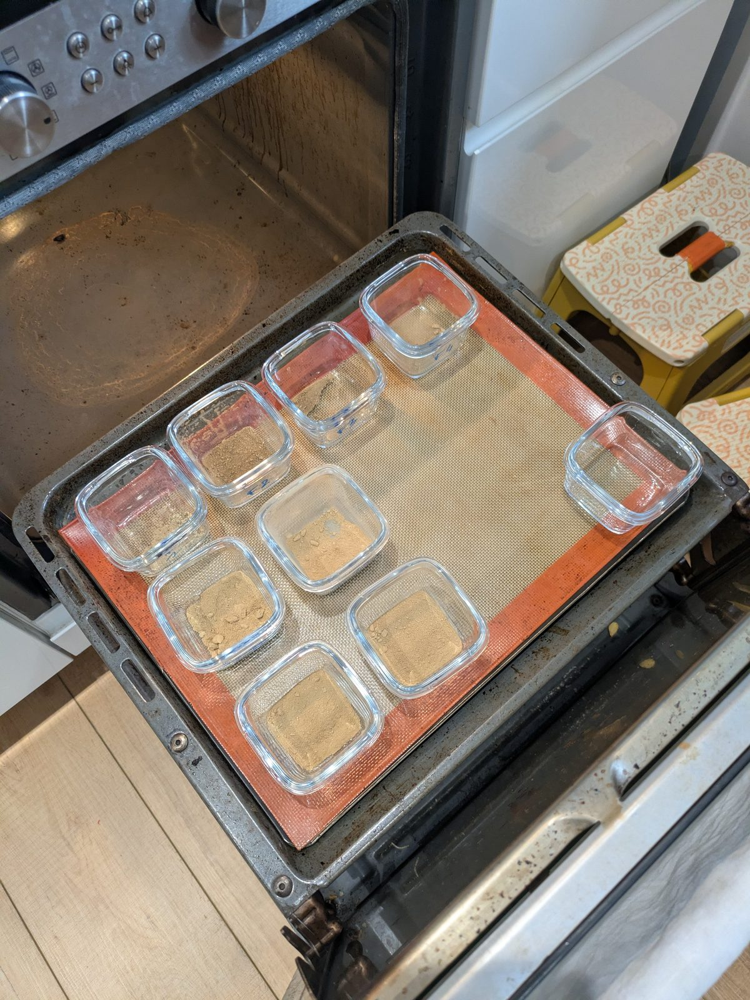
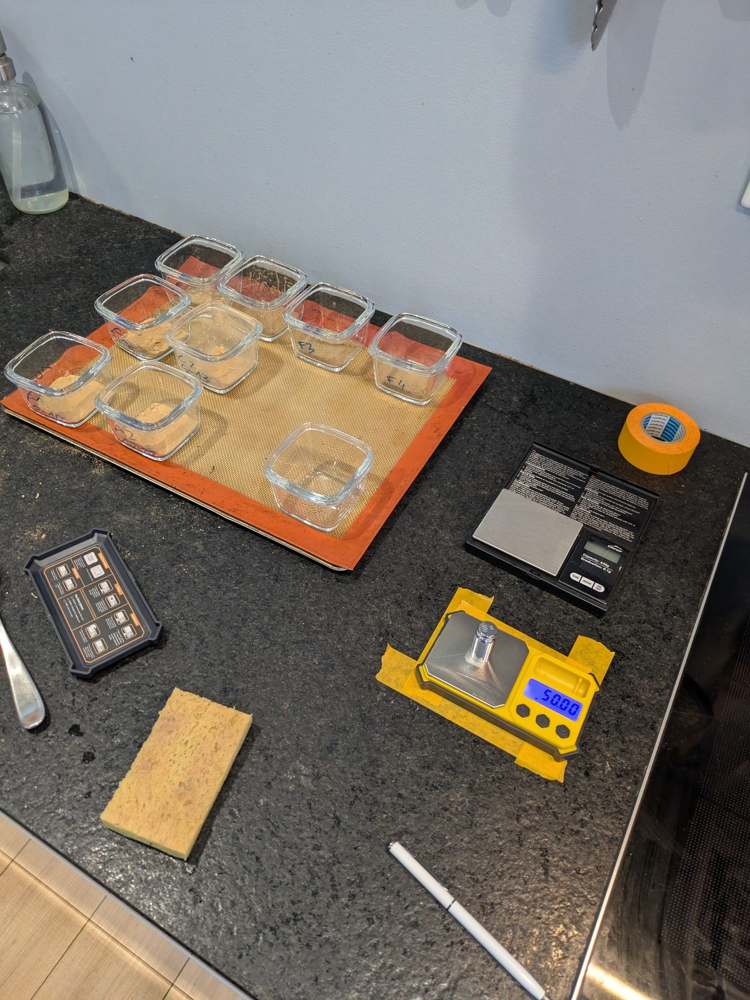
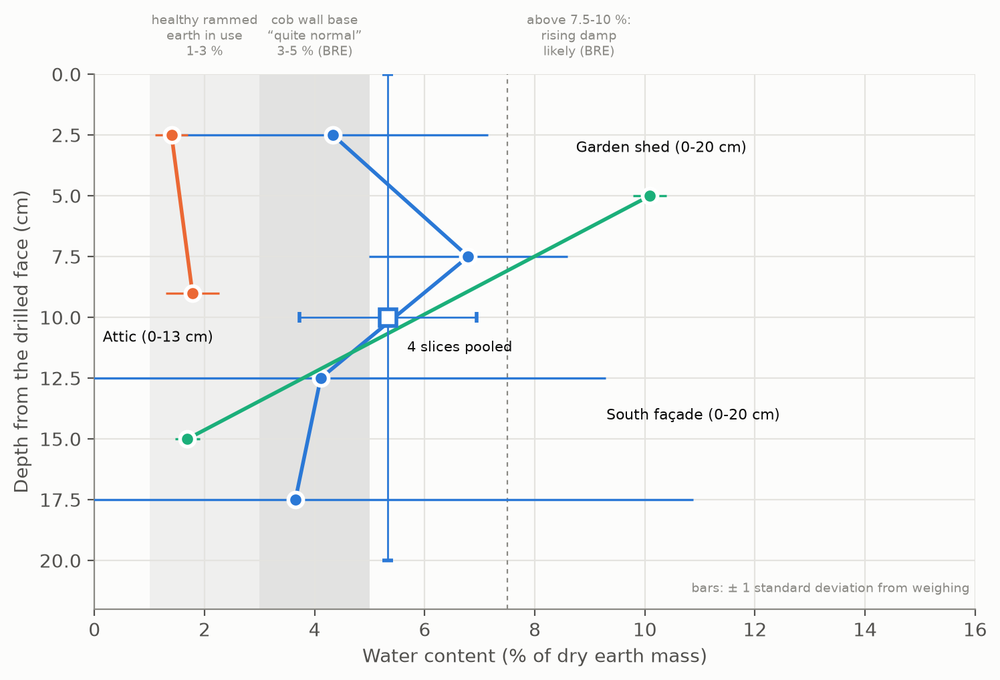

::: diptyque

:::

**What water does an old cob wall hold?** The earth feels dry; but how much water, and where? Before insulating, it is the
starting state of any moisture calculation, and almost nothing is published for old cob in service. We took earth from
three walls and weighed each sample as taken and after drying in a kitchen oven: the water is the difference.

## In short

- **A dry core, a wet skin.** In the wall of an unheated garden shed, the first 10 cm hold 10 % water, the next 10 cm
  1.7 %. The attic partition wall is dry (1.4 to 1.8 %).
- **The façade cannot be read slice by slice**: too little earth per core. Pooled: 5.3 ± 1.6 %.
- **Biases make the earth look drier than it is**: these values are more likely minimums.
- **A water content is not a relative humidity.** Going from one to the other needs the sorption isotherm of the wall's
  earth, which we did not measure: on two published earths, the same 3 % content is worth 75 % or 90 % relative humidity.
- **Before closing a wall**, a damp skin amounts to some 12 to 15 kg of water per m² that will have to leave: to be
  measured when closing.

## The paper in three parts

1. **The measurement**: what was sampled, how, what the balance showed. Nothing else.
2. **The interpretation**: how the weighings become a water content (choices, noise, bias), and what that says about the
   walls, with the literature.
3. **What this changes for insulating**: the isotherm, the damp skin, what to measure. The author's moisture calculations
   for specific insulation systems are not published: no conclusion about an insulant.

## Limits

One day, one sample per place, no repetition; a façade that gave only 0.5 to 2 g of earth per slice; no isotherm measured
on these earths, so relative humidities that are only readings on other earths. Reference points to discuss, not design
values.

## Going further

{{boutons}}

## Your feedback

You have measured the moisture of an old cob wall, you see a mistake, you have the isotherm of a comparable earth: tell us
([GitHub issues]({{depot}}/issues)){{contact}}.
Everything behind the paper is in the [`humidite-de-la-bauge/`]({{depot}}/tree/main/humidite-de-la-bauge) folder of the GitHub repository: raw
readings, the code that rebuilds the numbers and figures, and the photos. Text, data, figures and photos under
CC BY 4.0; code under the MIT licence.

This topic complements [Screws in cob](../vis-dans-la-bauge/index.html), whose tests were made on the shed wall measured
here.
