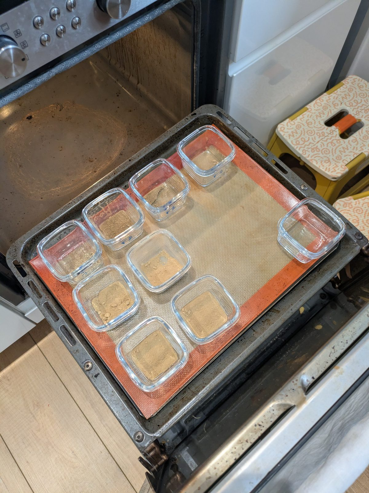
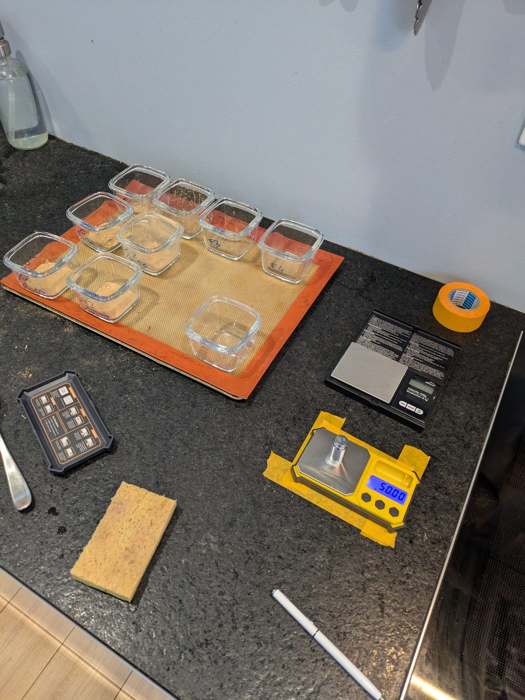
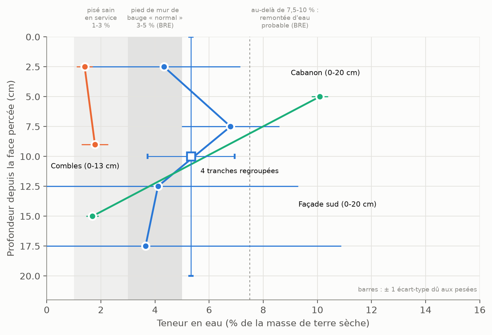

::: diptyque

:::

**Quelle eau contient un vieux mur de bauge ?** Au toucher, la terre est sèche ; mais combien d'eau, et où ? Avant d'isoler,
c'est l'état de départ de tout calcul d'humidité, et presque rien n'est publié dans une bauge ancienne en service. Nous
avons prélevé de la terre dans trois murs, pesé chaque prélèvement tel quel puis après séchage au four de cuisine : l'eau
est la différence.

## En bref

- **Un cœur sec, une peau mouillée.** Dans le mur d'un cabanon non chauffé, les 10 premiers centimètres contiennent 10 %
  d'eau, les 10 suivants 1,7 %. Le mur de refend des combles est sec (1,4 à 1,8 %).
- **La façade ne se lit pas tranche par tranche** : trop peu de terre par carotte. Regroupée : 5,3 ± 1,6 %.
- **Les biais font paraître la terre plus sèche qu'elle n'est** : ces valeurs sont plutôt des minimums.
- **Une teneur en eau n'est pas une humidité relative.** Pour passer de l'une à l'autre, il faut l'isotherme de sorption de
  la terre du mur, que nous n'avons pas mesurée : sur deux terres publiées, la même teneur de 3 % vaut 75 % ou 90 %
  d'humidité relative.
- **Avant de fermer un mur**, une peau humide représente de l'ordre de 12 à 15 kg d'eau par m² qui devront sortir : à
  mesurer au moment de fermer.

## Le papier en trois parties

1. **La mesure** : ce qui a été prélevé, comment, ce que la balance a affiché. Rien d'autre.
2. **L'interprétation** : comment les pesées deviennent une teneur en eau (choix, bruit, biais), et ce que cela dit des
   murs, avec la littérature.
3. **Ce que cela change pour isoler** : l'isotherme, la peau humide, ce qu'il faut mesurer. Les calculs d'humidité de
   l'auteur pour des systèmes d'isolation précis ne sont pas publiés : aucune conclusion sur un isolant.

## Les limites

Une journée, un prélèvement par endroit, aucune répétition ; une façade qui n'a donné que 0,5 à 2 g de terre par tranche ;
aucune isotherme mesurée sur ces terres, donc des humidités relatives qui ne sont que des lectures sur d'autres terres.
Des repères à discuter, pas des valeurs de calcul.

## Pour aller plus loin

{{boutons}}

## Vos retours

Vous avez mesuré l'humidité d'une bauge ancienne, vous voyez une erreur, vous avez l'isotherme d'une terre comparable :
dites-le-nous ([issues GitHub]({{depot}}/issues)){{contact}}.
Tout ce qui sert au papier est dans le dossier [`humidite-de-la-bauge/`]({{depot}}/tree/main/humidite-de-la-bauge) du dépôt GitHub : les relevés
bruts, le code qui refait les chiffres et les figures, les photos. Texte, données, figures et photos sous licence
CC BY 4.0 ; code sous licence MIT.

Ce sujet complète celui des [vis dans la bauge](../vis-dans-la-bauge/index.html), dont les essais ont été faits sur le mur
du cabanon mesuré ici.
