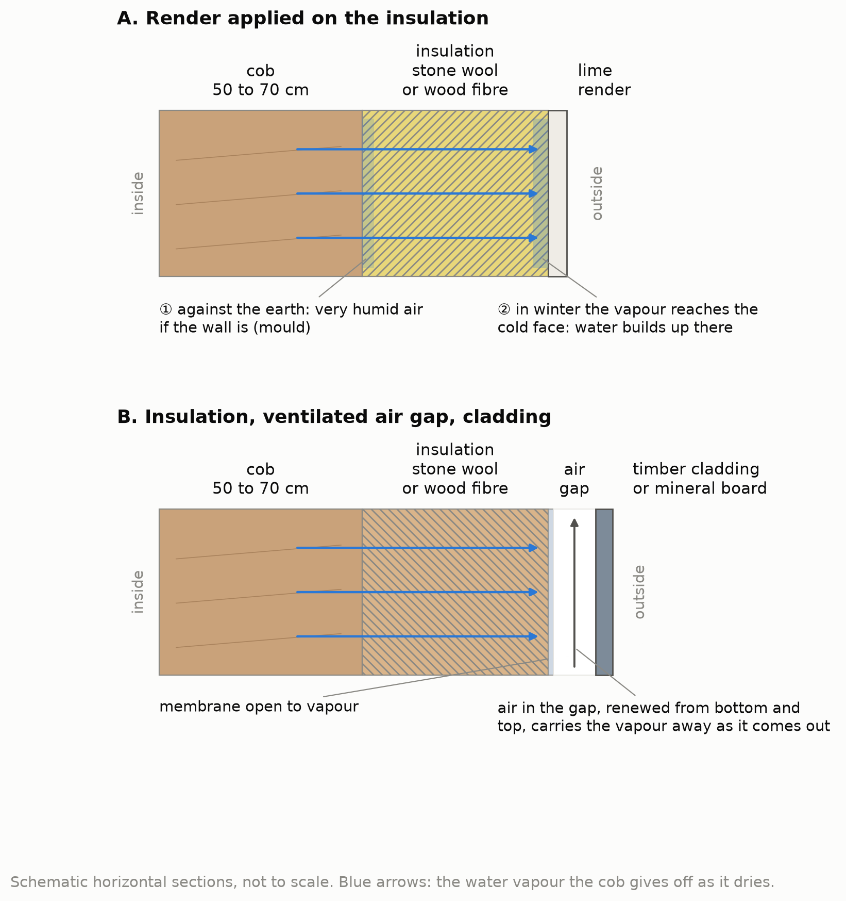
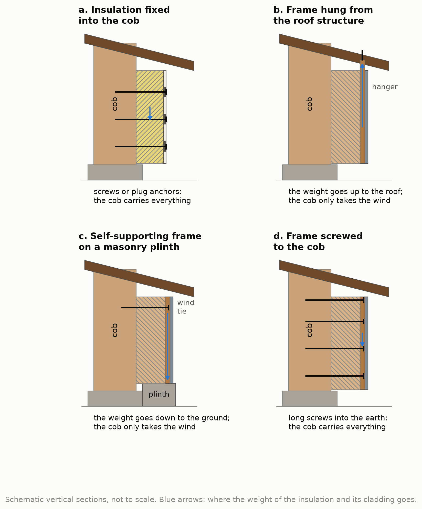
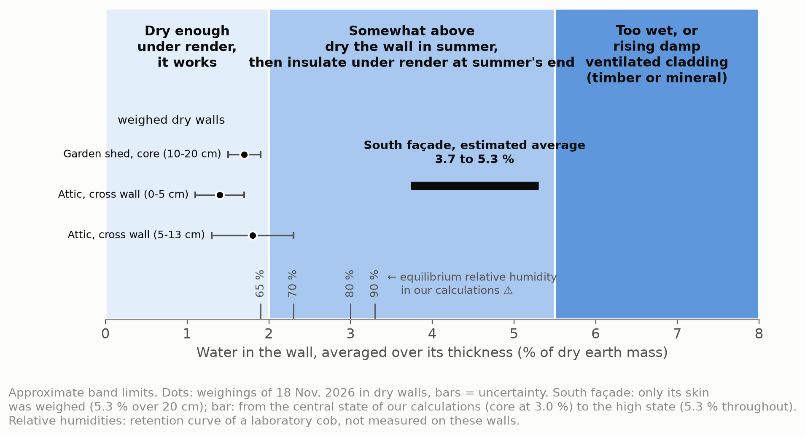

**Insulating an earth wall from the outside without harming it.** External wall insulation is probably the best way to
insulate an earth wall, and the trickiest. This page sets out how we frame the question for our cob house: what we see
as non-negotiable, the two problems that remain, the gap in the rules, and where our thinking is heading. It is not a
guide: it is work in progress, published to be discussed.

## In short

- **Why from the outside**: the earth moves to the warm side, its thermal mass works for the house, the insulation
  shields it from rain and frost, and comfort improves, summer and winter.
- **The non-negotiable**: a system that is very open to water vapour and tight against rain. On the insulation side,
  that leaves stone wool and wood fibre wool, plus some wood fibre boards, under conditions.
- **Two problems**: how to hold the insulation up, and how to let the cob's water out without damaging the insulation.
- **A regulatory gap**: no insulation product is assessed for cob.
- **Our leads**: on a dry enough wall, insulation under render works; a bit wetter, dry the wall in summer before
  insulating; too wet, switch to ventilated cladding.

## Why insulate earth from the outside

Insulated from the inside, a 50 to 70 cm cob wall stays on the cold side: its mass no longer serves the house, and it
stays exposed to rain and frost. Insulated from the outside, it moves to the warm side: its tonnes of earth smooth out
temperature swings and buffer indoor humidity, while the insulation and its cladding protect it from the weather. On
paper, this is the best comfort an earth wall can offer.

**The field is getting there.** Built examples are still rare and rarely monitored, but they exist:

- on existing rammed earth, at Brullioles (Rhône, 2016): wood fibre wool between studs, a rigid wood fibre board and a
  lime render; at Hauterive (Drôme, 2010), straw behind timber cladding. Both are described in Manon Girerd's 2023
  survey of professional practice, which serves as the introduction to a doctoral thesis on external insulation of
  rammed earth [1];
- the HYGROBA programme (2013) simulated a 50 cm rammed-earth wall insulated from the outside (120 mm rigid wood fibre,
  lime render): low risk of condensation at the interface, for a wall that is sound to begin with [2];
- in England, SPAB monitored with sensors, from 2012 to 2017, a cob wall insulated externally under a lime and perlite
  insulating render, at Riddlecombe (Devon) [3]. It is the only measured monitoring of an insulated cob wall we know of
  (see "Limits").

## The non-negotiable: open to vapour, closed to rain

Earth lives with water: it takes it up and gives it back all the time, and it loses its cohesion if it stays wet. The
insulation system must therefore let it dry outwards, that is be **very open to water vapour**, while stopping the
rain: be **watertight against liquid water**.

**The insulation.** That leaves:

- **stone wool** and **wood fibre wool**, both very open to vapour;
- **some wood fibre boards, under conditions**: a thick board, within the manufacturers' scope of use, on a dry wall;
- **out**: polystyrene and polyurethane, which strongly hold back vapour, and even cork board. In our calculations of
  four rendered build-ups, cork resists vapour like 3.9 m of still air (1.2 to 10 m depending on the cork), against
  0.5 m for stone wool and 0.7 m for wood fibre wool closed by a board: it meets its own moisture limits by leaving the
  water in the wall.

**The cladding.** Two families:

- **ventilated**: an air gap open at the bottom and top, then cladding, timber or mineral;
- **a render applied directly on the insulation**, open to vapour, so not cement-based: a lime render.

## First problem: how to hold the insulation up?

External insulation is heavy, around 50 kg per m² with a frame and mineral cladding in our estimates, and the wind
pulls on it. That weight and that force have to go somewhere:

- **Into the cob.** The insulation (plug anchors with washers) or its frame (long screws) is fixed straight into the
  earth. No technical approval covers a fixing in cob. But our tests show that some screws would do the job with a wide
  margin [4]: fully threaded Ø10 structural timber screws held 300 kg sideways, without failing, from 9.5 cm into the
  cob, and in pull-out 220 kg at 11.5 cm, 300 to 400 kg from 12.5 to 17.5 cm. For a screwed frame, our orders of
  magnitude are 16 to 28 kg per screw under the weight, and some fifteen kilos of wind pull: over ten times less. These
  tests were made on a single wall and give no safe load: the caveats of the [Screws in
  cob](../vis-dans-la-bauge/index.html) topic apply.
- **On a timber frame**, which can be:
  - **hung from the roof structure**, which takes the weight;
  - **self-supporting**, standing on a masonry plinth at the foot of the wall, the weight going down to the ground;
  - **itself screwed to the cob**, which brings us back to the screws.

  In the first two cases, the cob only holds against the wind.

## Second problem: how to deal with the cob's moisture?

Earth can store a lot of water and dries slowly. In our calculations, a 62.5 cm cob wall in equilibrium with air at
80 % relative humidity holds about 32 kg of water per m², against 1 kg for a 22 cm solid brick; and our weighings found
wall skins much wetter than their cores ([Moisture in cob](../humidite-de-la-bauge/index.html) [5]). Once the wall is
insulated, that water has to come out, and it goes through the insulation.

The risk: if the water comes out too fast and the insulation does not drain it away enough, it can saturate the
insulation, with a risk of mould and other damage. Under a render (sketch A of the cladding figure), two places are
exposed:

1. **against the earth**, the insulation sits in very humid air for as long as the wall surface is wet;
2. **under the render**, on the cold side, vapour condenses in winter: the insulation takes up water there, and the
   render can freeze while wet from behind.

A ventilated air gap (sketch B) deals with the second: the air flowing through it carries the vapour away as it comes
out of the insulation.

**On top of that, an earth wall shrinks as it dries.** For example, going from 5 to 2 % water loses about 1 mm of height
per metre of façade (an order of magnitude, not yet measured on our walls). Anything very rigid has to allow for it,
starting with the render.

## The regulatory gap

There is knowledge about cob: good-practice guides, theses, site experience. But for insulating it, there is a huge
regulatory gap: **no insulation product is approved for cob**, simply. In France, external insulation relies on a DTU
(the French standard for building work) or a technical approval, each listing the substrates it accepts; in those we
surveyed in 2026, earth is not among them. Even lime render on metal lath, covered by NF DTU 26.1, leaves unwritten how
to anchor its support into cob.

## Where our thinking is heading

Everything depends on how much water the wall holds when it is insulated.

- **If the cob is reasonably dry**, around 2 % water (by dry earth mass) on average through its thickness, which is
  equilibrium with air at 65 % relative humidity in our calculations and the state of our dry inner walls (1.4 to 1.8 %
  weighed), our simulations show that stone wool under render, wood fibre wool under render, or other similar rendered
  solutions, work very well: their indicators then match those of the same insulation on a dry brick wall.
- **If the wall is somewhat above that**, one can try to dry it before insulating: open it in summer, sheltered from
  rain and well ventilated, and insulate at the end of summer. In our calculations, four months open take out 5 to 10 kg
  of water per m²; the wall's skin dries, its core much less. This is the case of our south façade: only its skin was
  weighed (5.3 % over 20 cm), its average is estimated between 3.7 and 5.3 %, and our calculations find stone wool under
  render workable there after two to four months of drying with the wall open.
- **If the wall is too wet, or there is significant rising damp, things get worse.**
  - Wood fibre falls outside its admissible range. In practice it may still work; but it no longer meets what the
    manufacturers ask: at most 80 % of its mass in water in the centimetre of board under the render during the first
    two winters, then a stricter limit curve [6]; for wood fibre wool, a mould threshold of 23 % of its mass [7].
  - Stone wool is less sensitive, but there is a risk of mould between the earth and the insulation, and of harmful
    condensation between the insulation and the render.
  - **The fail-safe solution is then insulation behind cladding**, timber or mineral: the air gap drains moisture from
    the insulation extremely well, and even a very wet wall cannot saturate it.

## Limits

- **Our moisture calculations are not published** so far: neither their code nor their results. They rely on the
  retention curve of a laboratory cob; our weighed dry walls hold less water than that curve predicts, so the
  "reasonably dry" threshold could be lower, around 1.2 to 1.5 %.
- **No monitored project**: we know of no wool or wood fibre insulation on earth whose moisture was measured after the
  work. The only monitoring, Riddlecombe [3], saw its outermost sensor stay around 100 % relative humidity for six
  years; the source puts this down to the cob being heavily wetted before rendering.
- **The screws**: a single wall, a single day per test, no safe load [4].
- These are leads, not settled choices: the page will be revised once we have measured the water in our walls at the
  time we open them.

## References

1. Girerd, M. (2023). *L'isolation thermique des murs en pisé par l'extérieur avec des matériaux bio et/ou géo
   sourcés : état des lieux de la pratique professionnelle actuelle et analyse des solutions techniques* [External
   thermal insulation of rammed-earth walls with bio- and geo-based materials: current professional practice and
   analysis of technical solutions]. DSA dissertation, ENSA Grenoble. <https://dumas.ccsd.cnrs.fr/dumas-04472910>,
   accessed 27 Nov. 2026. Brullioles pp. 34-35, Hauterive pp. 36-37.
2. HYGROBA (CETE de l'Est, Maisons Paysannes de France, ENSA Toulouse), *Cahier n° 1 : murs en terre crue* [Booklet 1:
   earth walls], 2013, pp. 22-23. <https://www.ressourcescaue31.fr/public/uploads/ressources/5372/hygrobatcrue_0.pdf>,
   accessed 27 Nov. 2026.
3. SPAB (Society for the Protection of Ancient Buildings), *Building Performance Survey, Final Report*, 2019,
   Riddlecombe cob wall.
   <https://www.spab.org.uk/sites/default/files/documents/MainSociety/Advice/SPAB%20Building%20Performance%20Survey%20Final%20Report%202019-small.pdf>,
   accessed 27 Nov. 2026.
4. Cura, R. (2026). *Screws in cob*. <https://remi.cura.info/renovation-terre-crue/en/vis-dans-la-bauge/>,
   DOI 10.5281/zenodo.24504812.
5. Cura, R. (2026). *Moisture in cob*. <https://remi.cura.info/renovation-terre-crue/en/humidite-de-la-bauge/>.
6. Fraunhofer IBP for the vdnr (German association of bio-based insulation manufacturers), hygrothermal simulation
   guide for wood fibre ETICS, July 2024, slides 23 to 26 (criterion for the first two winters; afterwards, relative
   humidity below 95 − 0.30 × T as a ten-day average).
7. CSTB, CODIFAB, FCBA, *ETICS sur construction ou façade à ossature bois* [ETICS on timber-frame buildings or
   façades], guide, February 2025, annex B.4 (23 % by mass "as a first approach", a mould criterion).

## Further reading

{{boutons}}

## Feedback

You have insulated an earth wall from the outside, measured its moisture before or after, or you see a mistake: tell us
([GitHub issues]({{depot}}/issues)){{contact}}.
