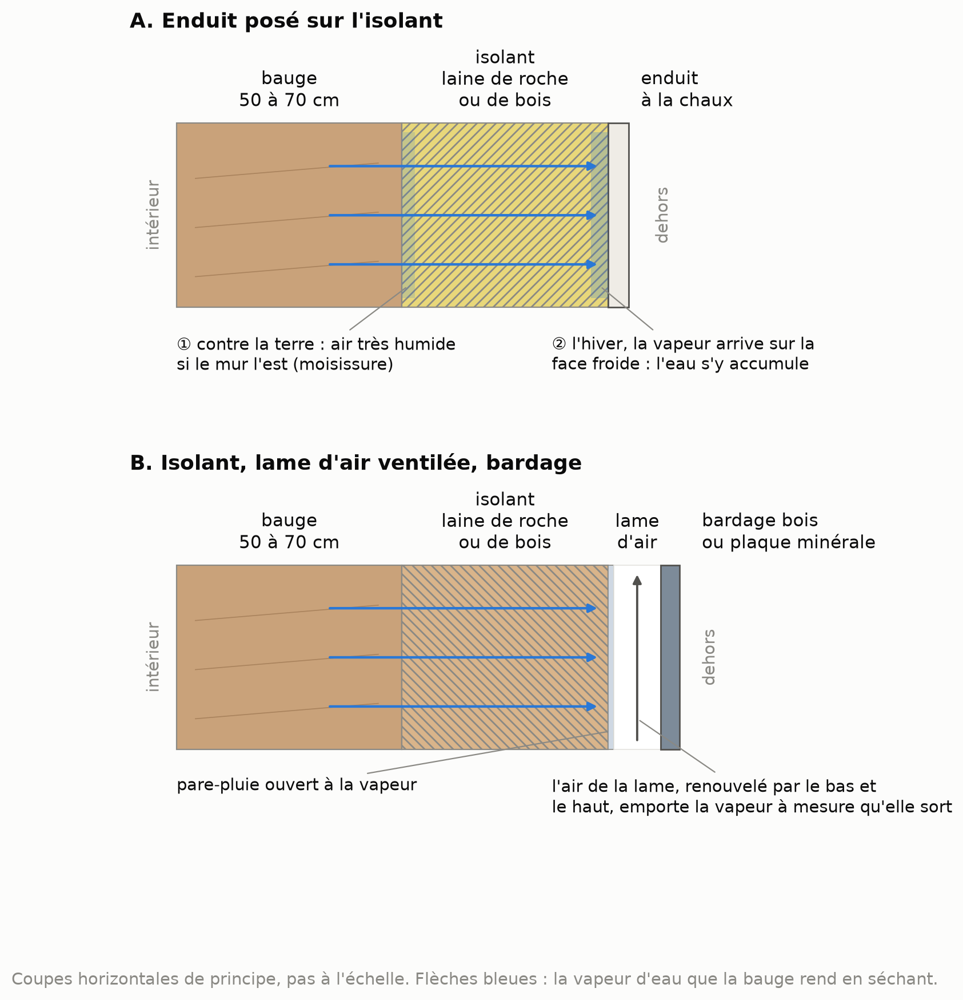
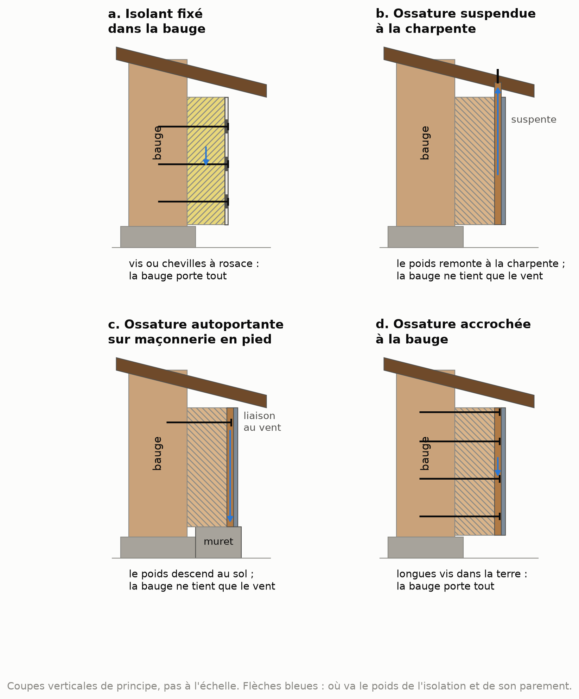
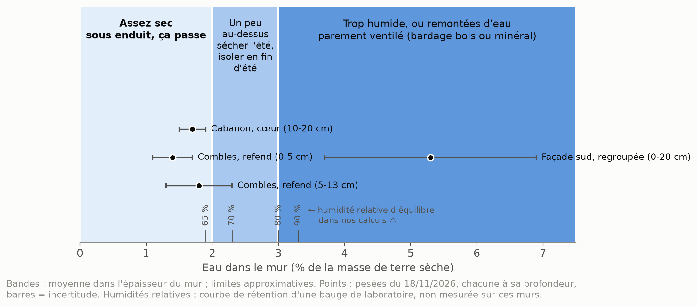

**Isoler un mur de terre par l'extérieur, sans lui nuire.** L'isolation par l'extérieur (ITE) est sans doute la
meilleure façon d'isoler un mur en terre crue, et la plus délicate. Cette page dit comment nous posons la question pour
notre maison en bauge : ce qui nous paraît non négociable, les deux problèmes qui restent, le vide des textes, et nos
pistes. Ce n'est pas un guide : c'est une réflexion en cours, publiée pour être discutée.

## En bref

- **Pourquoi par l'extérieur** : la terre passe du côté chaud, son inertie travaille pour la maison, l'isolant la protège
  de la pluie et du gel, et le confort y gagne, été comme hiver.
- **Le non-négociable** : un système très ouvert à la vapeur d'eau et étanche à l'eau de pluie. Côté isolant, il reste
  la laine de roche et la laine de bois, plus certains panneaux de fibre de bois, sous condition.
- **Deux problèmes** : comment accrocher l'isolation, et comment laisser sortir l'eau de la bauge sans abîmer l'isolant.
- **Un trou réglementaire** : aucun isolant n'est évalué pour la bauge.
- **Nos pistes** : sur un mur assez sec, un isolant sous enduit passe ; un peu au-dessus, on sèche le mur l'été avant
  d'isoler ; trop humide, on passe à un parement ventilé.

## Pourquoi isoler la terre par l'extérieur

Isolée par l'intérieur, une bauge de 50 à 70 cm reste du côté froid : sa masse ne sert plus la maison, et elle reste
exposée à la pluie et au gel. Isolée par l'extérieur, elle passe du côté chaud : ses tonnes de terre lissent les écarts
de température et tamponnent l'humidité de l'air intérieur, tandis que l'isolant et son parement la protègent des
intempéries. C'est, sur le papier, le meilleur confort qu'un mur de terre puisse offrir.

**Le milieu y vient.** Les réalisations restent rares et peu suivies, mais elles existent :

- sur du pisé existant, à Brullioles (Rhône, 2016) : laine de bois entre montants, panneau rigide de fibre de bois et
  enduit à la chaux ; à Hauterive (Drôme, 2010), de la paille sous bardage bois. Les deux chantiers sont décrits dans
  l'état des lieux de la pratique professionnelle de Manon Girerd (2023), qui sert d'introduction à une thèse de
  doctorat sur l'ITE du pisé [1] ;
- le programme HYGROBA (2013) a simulé un pisé de 50 cm isolé par l'extérieur (fibre de bois rigide de 120 mm, enduit à
  la chaux) : risque de condensation faible à l'interface, pour un mur sain au départ [2] ;
- en Angleterre, la SPAB a suivi par capteurs, de 2012 à 2017, un mur de bauge isolé par l'extérieur sous un enduit
  isolant de chaux et de perlite, à Riddlecombe (Devon) [3]. C'est le seul suivi mesuré d'une bauge isolée que nous
  connaissions (voir « Les limites »).

## Le non-négociable : ouvert à la vapeur, fermé à la pluie

La terre crue vit avec l'eau : elle en prend et en rend sans cesse, et elle perd sa cohésion si elle reste mouillée. Le
système d'ITE doit donc la laisser sécher vers l'extérieur, c'est-à-dire être **très perméable à la vapeur d'eau**, tout
en arrêtant la pluie : être **étanche à l'eau liquide**.

**L'isolant.** Cela laisse :

- la **laine de roche** et la **laine de bois**, très ouvertes à la vapeur ;
- **certains panneaux de fibre de bois, sous condition** : un panneau épais, dans le domaine d'emploi prévu par les
  fabricants, sur un mur sec ;
- **exit** le polystyrène et le polyuréthane, qui freinent fortement la vapeur, et même le liège en panneau. Dans nos
  calculs de quatre montages sous enduit, le liège oppose à la vapeur une résistance de 3,9 m d'air équivalent (1,2 à
  10 m selon le liège), contre 0,5 m pour la laine de roche et 0,7 m pour la laine de bois fermée par un panneau : il
  tient ses propres limites d'humidité en laissant l'eau dans le mur.

**Le parement.** Deux familles :

- **ventilé** : une lame d'air ouverte en bas et en haut, puis un bardage, en bois ou minéral ;
- **un enduit posé directement sur l'isolant**, perméable à la vapeur, donc pas à base de ciment : un enduit à la chaux.

## Premier problème : comment accrocher l'ITE ?

Une ITE pèse, de l'ordre de 50 kg par m² avec une ossature et un parement minéral selon nos estimations, et le vent la
tire. Ce poids et cet effort doivent aller quelque part :

- **Dans la bauge.** On fixe l'isolant (chevilles à rosace) ou son ossature (longues vis) directement dans la terre.
  Aucun avis technique ne couvre une fixation dans la bauge. Mais nos essais montrent que certaines vis feraient
  largement l'affaire [4] : des vis de charpente Ø10 à filetage total ont tenu 300 kg de côté, sans rompre, dès 9,5 cm
  dans la bauge, et en traction 220 kg à 11,5 cm, 300 à 400 kg de 12,5 à 17,5 cm. Pour une ossature vissée, nos ordres
  de grandeur sont de 16 à 28 kg par vis sous le poids, et d'une quinzaine de kilos de traction par le vent : plus de dix
  fois moins. Ces essais portent sur un seul mur et ne donnent pas de charge sûre : les réserves du sujet [Vis dans la
  bauge](../vis-dans-la-bauge/index.html) s'appliquent.
- **Sur une ossature bois**, qui peut être :
  - **suspendue à la charpente**, qui reprend le poids ;
  - **autoportante**, posée sur une maçonnerie en pied de mur, le poids descendant au sol ;
  - **accrochée elle-même à la bauge**, ce qui ramène aux vis.

  Dans les deux premiers cas, la bauge ne retient que le vent.

## Second problème : comment gérer l'humidité de la bauge ?

La terre peut stocker beaucoup d'eau et sécher lentement. Dans nos calculs, un mur de bauge de 62,5 cm en équilibre avec
un air à 80 % d'humidité relative contient environ 32 kg d'eau par m², contre 1 kg pour une brique pleine de 22 cm ; et
nos pesées ont trouvé des peaux de mur nettement plus humides que leur cœur ([Humidité de la
bauge](../humidite-de-la-bauge/index.html) [5]). Une fois le mur isolé, cette eau doit sortir, et elle passe par l'ITE.

Le risque : si l'eau sort trop vite et que l'isolant ne la draine pas assez, elle peut le saturer, avec un risque de
moisissure et d'autres dégâts. Sous un enduit (schéma A de la figure des parements), deux endroits sont exposés :

1. **contre la terre**, l'isolant baigne dans un air très humide tant que la surface du mur l'est ;
2. **sous l'enduit**, du côté froid, la vapeur se condense l'hiver : l'isolant s'y charge d'eau, et l'enduit peut geler
   mouillé par l'arrière.

Une lame d'air ventilée (schéma B) traite le second : l'air qui la traverse emporte la vapeur à mesure qu'elle sort de
l'isolant.

**En plus, un mur en terre qui sèche rétrécit.** Par exemple, passer de 5 à 2 % d'eau fait perdre environ 1 mm de
hauteur par mètre de façade (ordre de grandeur, pas encore mesuré sur nos murs). C'est à prendre en compte pour tout ce
qui est très rigide, à commencer par l'enduit.

## Le trou réglementaire

Il existe des connaissances sur la bauge : guides de bonnes pratiques, thèses, retours de chantier. Mais pour l'isoler,
c'est un énorme trou réglementaire : **aucun isolant n'est approuvé pour la bauge**, tout simplement. En France, une ITE
s'appuie sur un DTU ou sur un avis technique, qui listent les supports admis ; dans ceux que nous avons recensés en 2026,
la terre crue n'y figure pas. Même l'enduit sur lattis métallique, couvert par le NF DTU 26.1, laisse sans texte la façon
d'ancrer son support dans la bauge. Les fabricants d'isolants en fibre de bois que nous avons interrogés répondent que
la bauge est hors de leur domaine d'emploi, sans garantie et sans retour de chantier sur ce support. Chaque projet avance
donc sur ses propres mesures et ses propres calculs.

## Nos pistes de réflexion

Tout dépend de l'eau que contient le mur au moment où on l'isole.

- **Si la bauge est raisonnablement sèche**, de l'ordre de 2 % d'eau (en masse de terre sèche) en moyenne dans son
  épaisseur, soit l'équilibre avec un air à 65 % d'humidité relative dans nos calculs et l'état de nos murs intérieurs
  secs (1,4 à 1,8 % pesés), nos simulations montrent que la laine de roche sous enduit et la laine de bois sous enduit,
  ou d'autres solutions semblables sous enduit, passent très bien : leurs indicateurs rejoignent alors ceux des mêmes
  isolants posés sur une brique sèche.
- **Si le mur est un peu au-dessus**, on peut essayer de le sécher avant d'isoler : l'ouvrir l'été, à l'abri de la pluie
  et bien ventilé, et l'isoler en fin d'été. Dans nos calculs, quatre mois d'ouverture font sortir 5 à 10 kg d'eau par
  m² ; la peau du mur sèche, son cœur beaucoup moins.
- **Si le mur est trop humide, ou s'il y a des remontées d'eau significatives, les choses se gâtent.**
  - On sort du domaine admissible pour la fibre de bois. En pratique, ça passe peut-être ; mais on ne respecte plus ce
    que demandent les fabricants : au plus 80 % de sa masse en eau dans le centimètre de panneau sous l'enduit les deux
    premiers hivers, puis une courbe limite plus sévère [6] ; pour la laine de bois, un repère de moisissure à 23 % de
    sa masse [7].
  - La laine de roche est moins sensible, mais on risque des moisissures entre la terre et l'isolant, et une
    condensation néfaste entre l'isolant et l'enduit.
  - **La solution infaillible est alors une ITE sous bardage**, bois ou minéral : la lame d'air draine extrêmement bien
    l'humidité de l'isolant, et même un mur très humide ne pourra pas le saturer.

## Les limites

- **Nos calculs d'humidité ne sont pas publiés** à ce jour : ni leur code, ni leurs résultats. Ils reposent sur la
  courbe de rétention d'une bauge de laboratoire ; nos murs secs pesés retiennent moins d'eau que cette courbe ne le
  prévoit, si bien que le seuil « raisonnablement sèche » pourrait être plus bas, vers 1,2 à 1,5 %.
- **Aucune réalisation suivie** : nous ne connaissons aucune isolation en laine ou en fibre de bois sur de la terre dont
  l'humidité ait été mesurée après travaux. Le seul suivi, Riddlecombe [3], a vu son capteur le plus extérieur rester
  vers 100 % d'humidité relative pendant six ans ; la source l'attribue à un arrosage abondant de la bauge avant
  l'enduit.
- **Les vis** : un seul mur, une seule journée par essai, pas de charge sûre [4].
- Ce sont des pistes, pas des choix arrêtés : la page sera reprise quand nous aurons mesuré l'eau de nos murs au moment
  de les ouvrir.

## Références

1. Girerd, M. (2023). *L'isolation thermique des murs en pisé par l'extérieur avec des matériaux bio et/ou géo
   sourcés : état des lieux de la pratique professionnelle actuelle et analyse des solutions techniques*. Mémoire de
   DSA « Architecture de terre », ENSA Grenoble. <https://dumas.ccsd.cnrs.fr/dumas-04472910>, consulté le 27/11/2026.
   Brullioles p. 34-35, Hauterive p. 36-37.
2. HYGROBA (CETE de l'Est, Maisons Paysannes de France, ENSA Toulouse), *Cahier n° 1 : murs en terre crue*, 2013,
   p. 22-23. <https://www.ressourcescaue31.fr/public/uploads/ressources/5372/hygrobatcrue_0.pdf>, consulté le
   27/11/2026.
3. SPAB (Society for the Protection of Ancient Buildings), *Building Performance Survey, Final Report*, 2019, mur de
   bauge de Riddlecombe.
   <https://www.spab.org.uk/sites/default/files/documents/MainSociety/Advice/SPAB%20Building%20Performance%20Survey%20Final%20Report%202019-small.pdf>,
   consulté le 27/11/2026.
4. Cura, R. (2026). *Des vis dans la bauge*. <https://remi.cura.info/renovation-terre-crue/vis-dans-la-bauge/>,
   DOI 10.5281/zenodo.24504812.
5. Cura, R. (2026). *Humidité de la bauge*. <https://remi.cura.info/renovation-terre-crue/humidite-de-la-bauge/>.
6. Fraunhofer IBP pour le vdnr (association allemande des fabricants d'isolants biosourcés), guide de simulation
   hygrothermique des ETICS en fibre de bois, juillet 2024, diapositives 23 à 26 (critère des deux premiers hivers ;
   ensuite, humidité relative sous 95 − 0,30 × T en moyenne de dix jours).
7. CSTB, CODIFAB, FCBA, *ETICS sur construction ou façade à ossature bois*, guide, février 2025, annexe B.4 (23 % de la
   masse « en première approche », critère de moisissure).

## Pour aller plus loin

{{boutons}}

## Vos retours

Vous avez isolé un mur de terre par l'extérieur, vous avez mesuré son humidité avant ou après, vous voyez une erreur :
dites-le-nous ([issues GitHub]({{depot}}/issues)){{contact}}.
