Identifier: Zenodo DOI assigned to each version, see the repository page. Readings, photos, figures and calculations:
<https://github.com/Remi-C/renovation-terre-crue>, website <https://remi.cura.info/renovation-terre-crue/>. Text, data and
figures under the CC BY 4.0 licence. Feedback: the GitHub repository's “issues”.

# In short

- **Can you screw into cob?** Earth building guides say yes, but give no detail: no diameter, no length, no load. We
  tested a wall to give builders those figures.
- **The screws**: good-quality fully threaded structural timber screws, 8 and 10 mm in diameter. For the Ø10, a 5 to
  6 mm pilot hole clearly reduces the driving torque and keeps within the screw manufacturer's recommendations.
- **Sideways (in shear), 300 kg is easily reached.** What matters most is the length of screw in the cob: 200 kg from
  5.5 cm with Ø10 and from 7.5 cm with Ø8; at least 300 kg from 9.5 cm with Ø10; a small Ø6 screw 3.5 cm in already
  holds 40 kg.
- **These sideways figures hold for a screw fixing a timber batten against the wall**: the batten makes the whole
  stiffer than a screw alone.
- **In pull-out (screw pulled out of the wall), a screw holds less.** A Ø10 gave way at 70 kg 7 cm into the cob, at
  130 kg at 9 cm, at 220 kg at 11.5 cm; from 12.5 to 17.5 cm, it held 300 to 400 kg. Up to 11.5 cm at least, pull-out
  is what limits.
- **How much can you hang on it? We give no safe load**: it depends on too many things (the cob of the wall, how the
  screw is loaded, knocks, what happens if it gives way). Published texts advise screws of 10 to 20 cm; for other
  earth walls, they allow 3 to 50 kg per fixing; none gives a load for cob. For more, use more screws, or embed a
  timber in the cob.
- **Plan for redundancy**: even if a screw holds 300 kg, spread the load over several screws, so that a local flaw in
  the cob does not compromise the structure.
- **Limits**: a single wall, of dry cob, one test per configuration. There is no official margin for cob: for
  comparison, the paper gives those used elsewhere.

# Why this paper

Renovating a cob house means that one day you fix something to the wall: an insulation frame, shelves, a joist hanger.
Screws are not the answer to everything; for heavy loads, the guides suggest rods through the wall or timber pieces
embedded in the earth. But a screw whose holding power is known adds another string to the renovator's bow.

These tests are not professional tests. They were carried out by a private individual renovating his house, on a wall
at his disposal: getting access to an old building to run tests on is not easy. We publish them with their limits, and
we ask for feedback from those who fix things into earth every day.

A screw is loaded **sideways** (also called “in shear”) when it is pulled parallel to the wall, the way the weight of a
shelf pulls on its screws; it is loaded in **pull-out** (in tension) when it is pulled along its axis, out of the
wall, like the top screws of a bracket. We
distinguish what is **measured** (read on the crane scale or the dial gauge), **estimated** by the author (by eye or
from memory), **calculated** from the measurements, and **assumed** (a likely explanation, not checked).

# Where we start from

The French good-practice guides for earth building accept screwing directly into the wall. Those for cob and for
earth brick mention the « vis à bois entrée directement dans le matériau sans pré-trou ni chevilles dans la mesure où
les charges sont faibles et sans trop serrer » [wood screw driven directly into the material, without pilot hole or
wall plugs, as long as the loads are light, and without over-tightening], in a box declared non-normative [1, 2]; the
one for rammed earth accepts « vissage direct » [direct screwing] for light loads [3]. An eco-building association,
APTE, advises screws at least 10 to 15 cm deep in rammed earth [4]; an English-speaking cob practitioner, screws of
12.7 cm or more [5]; a cob building guide from a European research project, screws of at least 20 cm to fix doors and
windows [25].

None of these sources gives a load or a diameter. For other walls (earth brick, rammed earth, earth tiles, hemp
blocks), manufacturers and technical approvals give loads per fixing, from 3 to 50 kg [11, 26–28]; none for cob. Yet « sans pré-trou » [without a pilot hole] means nothing without a
diameter: a 6 mm by 80 mm screw and a 10 mm by 260 mm screw do not drive in the same way at all. We started from this
principle, screwing directly into the earth, in order to characterise it: how much it holds, at what depth, with what
diameter, and from when a pilot hole becomes necessary.

**We found no measurement of a screw or a nail installed afterwards in earth and loaded sideways, nor of a wood screw
pulled out of a cob wall**, after searching in five languages; related measurements deal with other fixings
(appendix D); the closest, sideways, deals with steel bars glued into small rammed earth cubes [29].

# The tests

## The wall and the screws

A cob wall of a garden shed, in place, at least 50 years old, at least 45 cm thick. It has long been
sheltered by timber cladding over an air gap, with no sign of damp. The cob is very dry; under a tool, it scratches and
turns to dust; it contains flint stones. Its moisture content was not measured.

Two days of tests on this wall: sideways on 30 October 2026 (tests C1 to C8), in pull-out on 7 November 2026 (tests
A1 to A8).

The screws are off-the-shelf wood screws: fischer PowerFull II, 8 and 10 mm in diameter, threaded over almost their
whole length, with a European approval for use in timber (no approval covers earth) [20]; sideways, a 6 mm stainless
steel screw; in pull-out, a 6 mm wood screw threaded over 5 cm. In the sideways tests, each screw clamps a 45 mm board
(Douglas fir; oak, thickness not noted) against the wall and goes into the cob by its length minus the board. The three
260 mm screws isolate the effect of the piece: oak board (C1), Douglas fir board (C7), no board (C8, which reuses the
screw and the hole of C1, head flush with the wall). Details in appendix A.

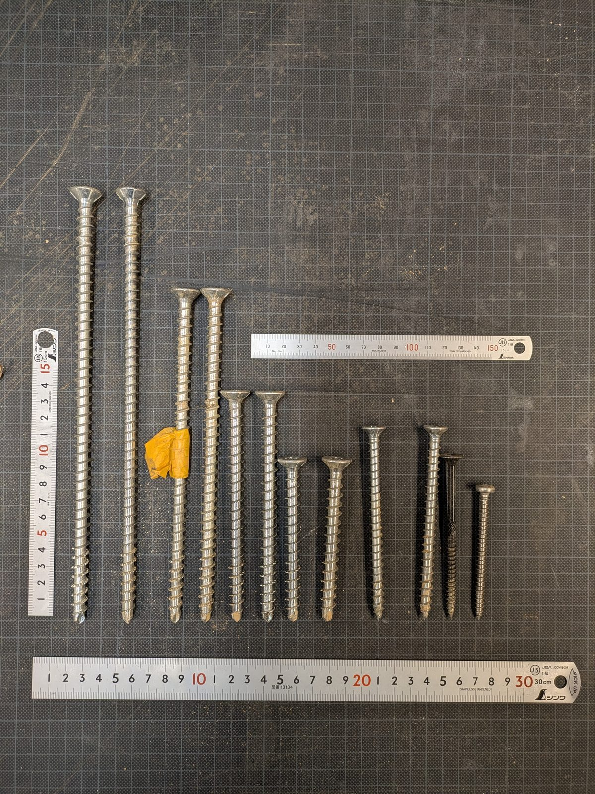{#photo_vis_reglets}

## The sideways rig

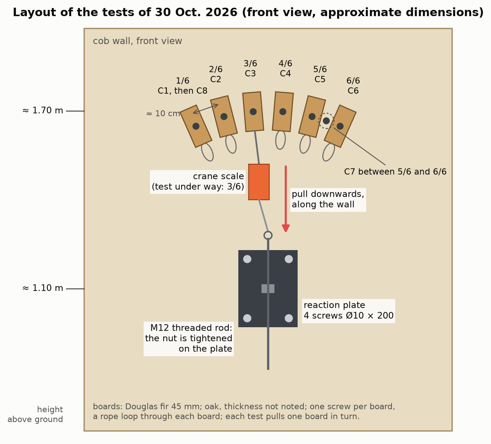{#fig_implantation}

Each board is pulled downwards, along the wall, like a weight, towards a reaction plate screwed lower down into the
same cob with four Ø10 screws. The load is applied by tightening a nut on a threaded rod, at the end of a chain that
includes a 1-tonne electronic crane scale. A dial gauge, a dial that reads movements to a hundredth of a millimetre,
touches the edge of the board. The equipment costs a few hundred euros.

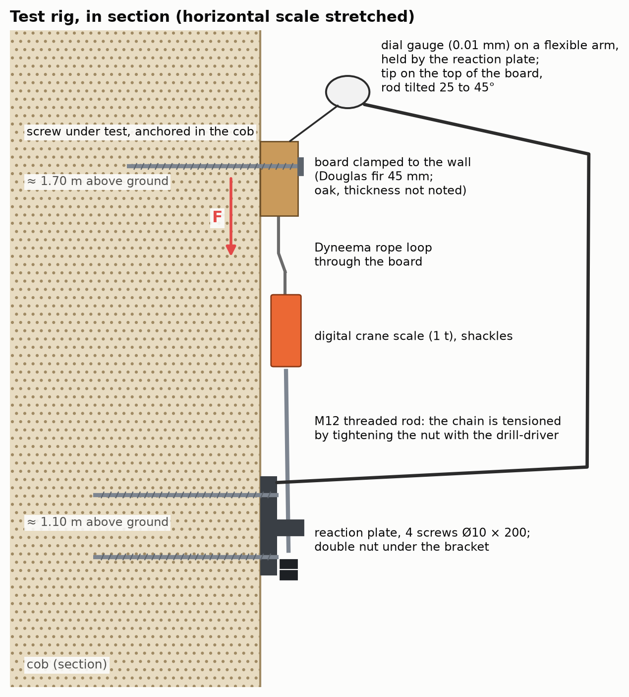{#fig_montage}

The load is raised in steps, noting at each step the highest load and the movement; the first loading is read
separately from the reloadings. Loads are in kilos, as on the crane scale (100 kg is about 1 kN).

**The loads are reliable**: the crane scale is in the pulling chain. **The movements are fragile** (dial gauge held by
the reaction plate, which moves back a little; gauge rod tilted 25 to 45° without the angle being noted; small
readings taken to the tenth of a millimetre): the real movement may differ from the reading by a factor of 0.7 to 1.4,
and below 50 kg we mostly read the rig. We therefore give the stiffness only as a wide range (next section). The shape of the curves remains
reliable; so do the comparisons between tests, the tilt of the rod being comparable from one test to another, without
reading too much into small differences. Discarded:
the first loading of C1 (a shackle was rubbing) and the movements of C8 (the dial gauge probably slipped on the small
screw head); the load of C8, on the other hand, is reliable.

## The pull-out rig

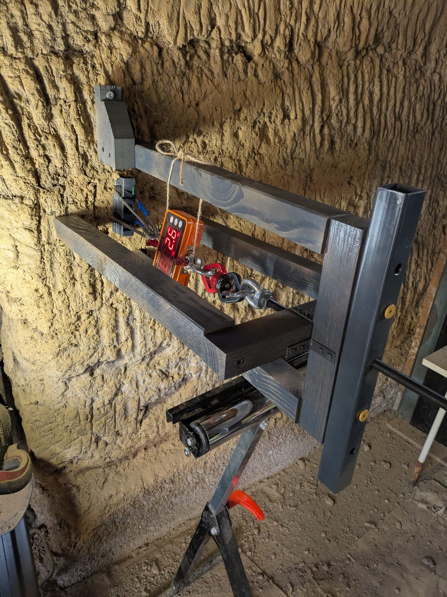{#photo_traction_montage}

The cob is planed flat where the screw goes (5 mm removed at most). The screw passes through a steel plate, which takes
15 mm of it, and goes into the cob. It is pulled along its axis, perpendicular to the wall, by a threaded rod turning
in a nut; the nut is carried by a frame on four feet bearing on the wall, about ten centimetres from the screw. The same
1-tonne crane scale is in the chain. No dial gauge: before giving way, the screw moves only a few hundredths of a
millimetre, below what this equipment reads.

Each screw is driven fully home, then loaded. If it holds, it is backed out by 1 cm and loaded again, until it gives
way: one screw thus gives several lengths. A load held was held for a few seconds at least; it is a minimum. Only the
last load of a test is a failure. Pilot holes: 6 mm over the whole length for the Ø10 × 200 screws, 5 mm for the
Ø10 × 100 screws and for one of the three Ø8; none for the other two Ø8 and for the Ø6.

## One wall, two days, one test per configuration

A single wall, dry, two days (30 October and 7 November 2026), one test per configuration, short-term loads. Repeated
measurements would obviously be better. But we found no other measurement of this kind, and the sideways tests are
remarkably consistent with one another: the four Ø10 screws with a board, 9.5 to 21.5 cm into the cob, all carried
300 kg or more; at 100 kg, three Ø10 screws at different depths read the same movement within two hundredths; on
reloading, three screws read 1.6 to 1.65 mm at 300 kg. With so little variability, these measurements already have
value in themselves. In pull-out, the four Ø10 failures fall in order of length; the three Ø8 of the same length gave
way between 120 and 200 kg.

# Results

## Sideways: how much it held

| Test | Screw | In the cob | Board | Highest load carried | What happened |
|---|---|---|---|---|---|
| C2 | PowerFull II Ø10 × 200 | 15.5 cm | oak | **350 kg** | no failure |
| C1 | PowerFull II Ø10 × 260 | 21.5 cm | oak | **300 kg** | no failure |
| C7 | PowerFull II Ø10 × 260 | 21.5 cm | Douglas fir | **300 kg** | no failure; a cracking sound at 300 kg |
| C3 | PowerFull II Ø10 × 140 | 9.5 cm | Douglas fir | **300 kg** | no failure; “on the edge of cracking” at 300 kg |
| C8 | screw from C1, no board | 26 cm | none | **300 kg and more** | no failure; deformation visible by eye |
| C4 | PowerFull II Ø10 × 100 | 5.5 cm | Douglas fir | 200 kg | “pull-out” |
| C5 | PowerFull II Ø8 × 120 | 7.5 cm | Douglas fir | 200 kg | “it's sliding” |
| C6 | stainless A2 Ø6 × 80 | 3.5 cm | Douglas fir | 50 kg | “it's slipping” |

Table: The eight tests of 30 October 2026. Ø10: screw 10 mm in diameter at the thread. Pilot hole: 6 mm over most of
the length (C1, C2, C7); 5 mm over 3.5 cm of cob at most (C3, C4, C5); none (C6). In quotation marks: the words noted
at the time (translated from French).

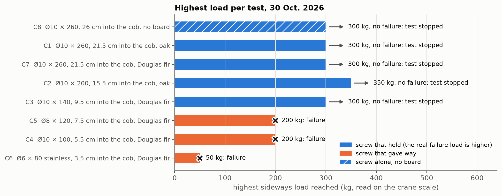{#fig_efforts}

The Ø10 screws at least 9.5 cm into the cob carried 300 to 350 kg: these are minimums, we stopped before failure, and
they cannot be ranked against each other. For the short screws, the words noted probably indicate that the screw came
out of the wall (they were not examined when taken down).

## Below 100 kg, depth changes little; diameter does

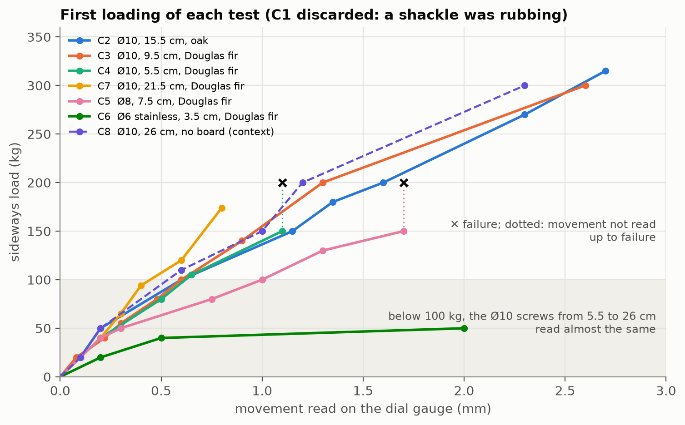{#fig_premiere_charge}

Below 100 kg, the Ø10 screws behave the same whatever their depth: at 100 kg, those 5.5, 9.5 and 15.5 cm into the cob
all read 0.60 to 0.62 mm. Our reading, assumed (appendix B): only the first few centimetres of the screw work
sideways; beyond that, depth serves to keep the screw from coming out. It is not useless for all that: the short
screws are the ones that gave way.

The Ø8 moves clearly more: 50 to 70% more than the Ø10 screws, read at 80 and 100 kg (1.0 mm against 0.6 mm at
100 kg). At 40 kg, all read 0.2 mm, the reading precision; the gap most likely starts earlier. Only one Ø8 was tested:
without reading too much into this figure, what is certain is that it gave way at 200 kg, and it is quite conceivable
that it is less stiff than the Ø10.

**A stiffness range, very limited.** Dividing the load by the displacement read, a Ø10 clamping a board gives 130 to
250 kg per millimetre of board slip (first loadings up to 100 kg and reloadings of C1 to C4 and C7); the Ø8, about 70
to 100 kg per millimetre. With the reading uncertainty (factor 0.7 to 1.4), the Ø10 range widens to about 90 to 360 kg
per millimetre: at 100 kg, a board fixed this way moves 0.3 to 0.9 mm. This is the stiffness of the whole assembly,
screw, board and cob together, not that of the cob alone; it rests on fragile displacements and on a single wall.

## A braked spring

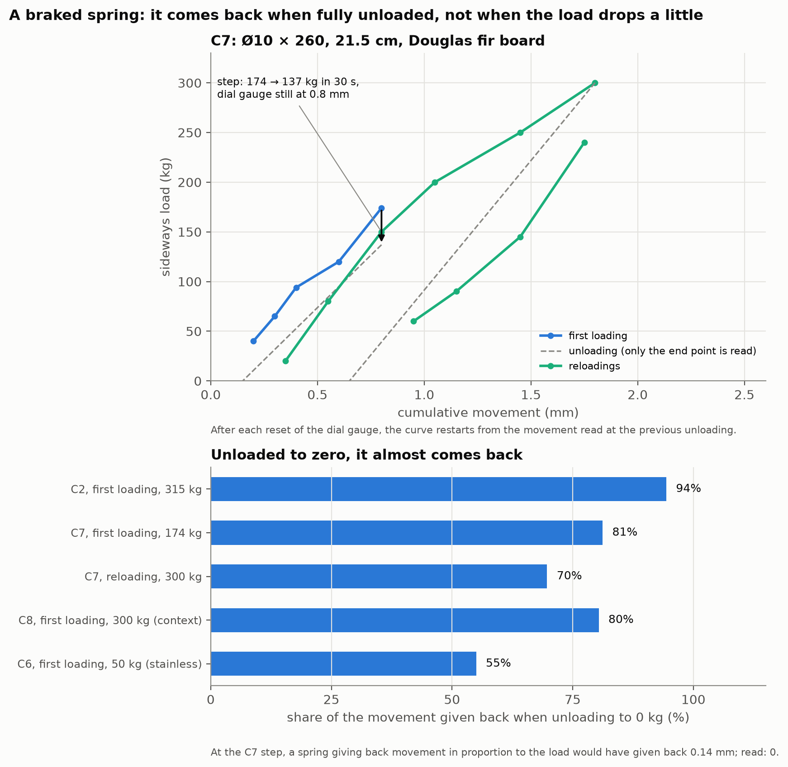{#fig_ressort_freine}

- **Unloaded down to zero, the assembly comes back almost entirely**: 94% of the movement (C2, after 315 kg), 81%
  (C7, after 174 kg).
- **After a small drop, it does not come back**: at each step, the load dropped straight away, often by 20 to 30 kg
  around 100 kg (estimate), without the dial gauge moving.

Assumed: the board rubs on the wall and stays stuck there; fully unloaded, the screw, which acts as a spring, brings it
back (appendix B).

## The screw alone, without a board

C8, head flush with the wall and without a board, carried 300 kg and more, beyond doubt in the author's view, but
while moving by several millimetres: at least 3 mm at 300 kg, estimated by eye, the largest movement of the day. On
the photos taken at about 250 kg, a gap opens at the mouth of the hole, on the side opposite the pull (visual
observation, no scale; photo in appendix B). The hole had already been used for C1. This is the textbook case: in
practice, a screw always holds something, a steel plate, a stud, a board.

## In pull-out: how much it held

| Test | Screw | Pilot hole | Held (length in the cob: load) | Gave way | What we saw |
|---|---|---|---|---|---|
| A7 | PowerFull II Ø10 × 100 | 5 mm | 8 cm: 100 kg | **7 cm: 70 kg** | cone of 4 cm radius |
| A6 | PowerFull II Ø10 × 100 | 5 mm | — | **8 cm: 100 kg** | cone; many stones |
| A5 | PowerFull II Ø10 × 200 | 6 mm | 10.5 cm: 150 kg; 9.5 cm: 160 kg | **9 cm: 130 kg** | “invisible cone of 4 cm radius” |
| A4 | PowerFull II Ø10 × 200 | 6 mm | 17.5 cm: 380 kg; 16.5 cm: 400 kg; 15.5 cm: 350 kg; 14.5 cm: 320 kg; 13.5 and 12.5 cm: 300 kg | **11.5 cm: 220 kg** | no visible cone; the cob sounds hollow over 8 cm radius |
| A1 | PowerFull II Ø8 × 120 | 5 mm | — | **10.5 cm: 150 to 200 kg** | “pull-out, surface sheet” (straw) |
| A2 | PowerFull II Ø8 × 120 | none | 10.5 cm: 120 then 150 kg | **10.5 cm: 160 to 170 kg** | no cone |
| A3 | PowerFull II Ø8 × 120 | none | — | **10.5 cm: 120 to 130 kg** | small cone; sounds hollow further out |
| A8 | Ø6 wood screw, threaded over 5 cm | none | — | **5 cm: 56 kg** | — |

Table: The eight pull-out tests of 7 November 2026. Each screw is loaded, then backed out by 1 cm as long as it holds.
“Held”: the highest load held at that length, a minimum. Range: load noted between two values. In quotation marks: the
words noted at the time (translated from French). Length in the cob: to within 5 mm.

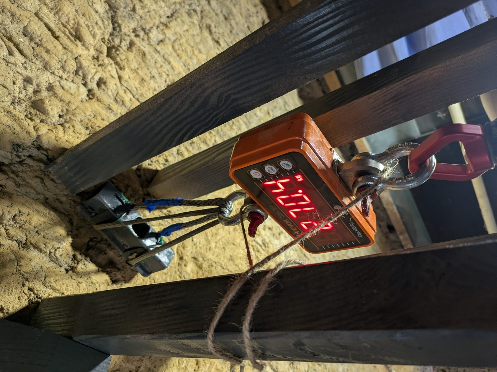{#photo_traction_402}

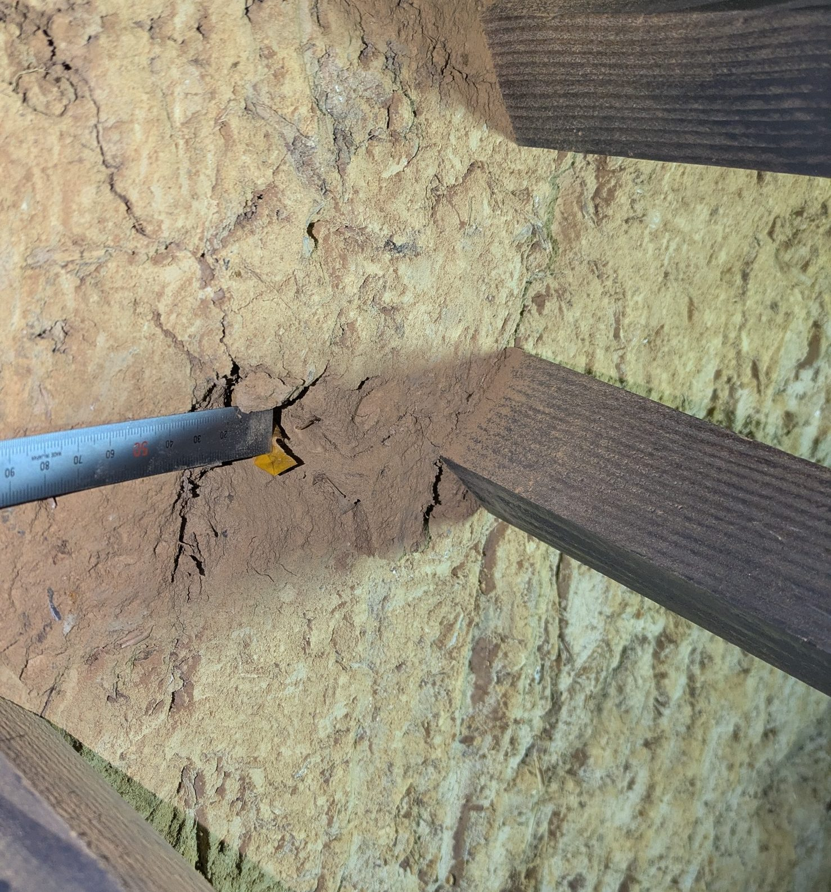{#photo_traction_cone}

- **Every failure is the screw sliding along its thread.** Up to 9 cm, the screw tears out a shallow cone of surface
  cob, about 4 cm in radius (a few centimetres deep, by eye). Deeper, the cone can no longer be seen, but the cob
  sounds hollow around the hole, over 8 cm radius for A4. The author thinks the cone is always there, sometimes
  invisible.
- **Holding rises fast with length**: a Ø10 gives way at 70 kg at 7 cm, at 100 kg at 8 cm, at 130 kg at 9 cm, at
  220 kg at 11.5 cm, three times more for 4.5 cm more.
- **From 12.5 to 17.5 cm, A4 held 300 to 400 kg** without giving way: these are minimums. It then gave way at 11.5 cm.
- **The three Ø8 screws 10.5 cm in gave way between 120 and 200 kg.** The only one driven with a pilot hole (A1) held
  no less than the other two.
- **The Ø6**, in by its 5 cm of thread, gave way at 56 kg (60 mm noted at the time; the screw has only 5 cm of thread,
  and only the thread was in the cob).

The length in the cob counts the whole screw, tip included. The tip carries little: on the Ø10, the thread is only
complete 8 or 9 mm from the end, then it is serrated over about 3 cm (read from photos, appendix A).

## By length: sideways and in pull-out

{#fig_tenue_longueur}

The two loadings were tested separately, with two rigs: sideways, the screw clamped a board against the wall; in
pull-out, it was pulled on its own. The figure puts them side by side; it does not combine them. At the top, the
lengths advised by published texts (“Recommendations”).

- **Up to 11.5 cm at least, pull-out is the weaker.** 7 to 9 cm in, a Ø10 gives way at 70 to 130 kg in pull-out;
  sideways, a Ø8 7.5 cm in carried 200 kg, a Ø10 9.5 cm in at least 300 kg.
- **At 15.5 cm, both exceed 350 kg**: we do not know which is the weaker.

These two figures do not combine into a strength under mixed loading. A screw loaded sideways presses the cob against
its thread, which probably changes its pull-out strength. And, sideways, the board may pass part of the load into the
screw as tension: C4 gave way sideways at 200 kg by coming out of the wall (“pull-out”), but what share of those 200 kg
pulled the screw along its axis, no measurement tells. Going from one test to the other would multiply their
uncertainties.

## Driving the screw: torque and pilot hole

Driving a screw takes a twisting effort, the **torque**, in newton-metres (N·m). The **driving limit** used here is
the torque that breaks the screw, divided by 1.5, the ratio the approval itself requires for driving into timber:
26 N·m for the Ø10, 18.7 N·m for the Ø8 [20]. The torque is inferred from the setting at which the drill-driver's
clutch slipped, speed not noted, 1st gear assumed; in a wall of the attic (10 October 2026), this ceiling was checked
with a wrench (appendix C).

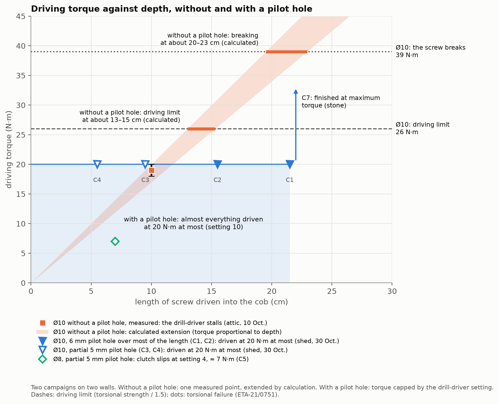{#fig_pre_trou}

- **Ø10 without a pilot hole** (attic, first campaign): the drill-driver stalled at 18–20 N·m at about 10 cm of cob,
  with a screw that was nevertheless shorter than the longest ones at the shed; driving was very hard. If the torque
  kept rising at the same rate (calculation), the driving limit would be reached at about 13 to 15 cm, and breaking at
  about 20 to 23 cm.
- **Ø10 with a pilot hole** (shed, second campaign): 6 mm over most of the length for C1, C2 and C7; 5 mm over
  3.5 cm of cob at most for C3 and C4, hence a partial pilot hole. Almost everything was driven at 20 N·m at most
  (setting 10 of the drill-driver), down to 21.5 cm of cob. Only C7 (21.5 cm) had to be finished at the drill-driver's maximum
  torque, because of a stone; it did not break.
- **Ø8, 7.5 cm, partial pilot hole**: the drill-driver's clutch slipped at setting 4 (about 7 N·m) 5 mm from the end,
  far from its driving limit.
- **Ø6 stainless, 3.5 cm, no pilot hole**: “very touchy” driving, the screw started to spin freely.

From one campaign to the other (two different walls), the pilot hole clearly reduced the driving torque: it makes it possible to stay within
the screw manufacturer's recommendations.

# Recommendations

These are the author's advice, drawn from these measurements. They apply to these screws, in this dry cob, loaded for
a short time. They replace neither a calculation nor a test on your wall.

## No safe load, but reference points

We give no safe load per screw. What a screw can carry without risk depends on too many things our tests do not
cover: the cob of your wall (straw, stones, moisture, depth), how the screw is loaded, for how long, knocks, and what
happens if it gives way. One test per point, on a single wall, gives no safe figure for another wall.

In real life, a screw works both in pull-out and sideways, and we do not know how the two interact in cob. To place a
fixing against our measurements, the author takes, at the length driven, the weaker of the two strengths: pull-out,
up to 11.5 cm at least.

## What published texts advise, next to the measurements

Figure 10 sets our measurements under the screw lengths advised by published texts.

- **Length**: those that give one advise screws 10 to 15 cm into rammed earth [4]; in cob, screws of 12.7 cm or more
  [5], or of 20 cm or more to fix doors and windows, in cob without too many stones [25]. For cob, this is the length
  of the screw: under a fixed part, the length in the cob is shorter. Our measurements point the same way: in pull-out,
  the strength rises quickly with length, up to about 12 cm.
- **Load**: no text gives a load for a screw in cob. For other walls, the loads advised per fixing point stay low: 3
  to 15 kg for wall plugs of 3 to 9 cm in brick masonry and rammed earth [11]; above 10 kg, a frame that spreads the
  load, in compressed earth brick partitions [27]; at most 25 kg in pull-out and 50 kg sideways, in cement-stabilised
  earth tiles [28]; 5 kg on a Ø6 wood screw anchored 7 cm, 10 kg on a Ø8 anchored 9.5 cm, in hemp blocks [26].
- **Our measurements** are well above: in pull-out, 56 kg for a Ø6 5 cm in, 70 to 220 kg for a Ø10 7 to 11.5 cm in,
  and no failure beyond 12 cm, up to 400 kg. Neither can be derived from the other: other materials, other fixings,
  and margins whose basis is not always published.

## For more load

The safest is to use more screws (“Plan for redundancy”, below), or to turn to the traditional structural methods: an
oak timber of large section embedded in the cob. The cob guide quoted above likewise suggests timber pieces embedded
during construction, cut with a dovetail shape so they do not pull out of the wall [25].

## Diameter

- **Ø8** for a few tens of kilos and for hanging non-structural items. Sideways, 7.5 cm into the cob, it carried
  200 kg; in pull-out, 10.5 cm in, it gave way between 120 and 200 kg.
- **Ø10** above about 40 to 50 kg per screw: at 80 and 100 kg sideways, the Ø8 moved 50 to 70% more (read on the dial
  gauge, only one Ø8 tested), and it gave way at 200 kg.

## The pilot hole

What our two campaigns show (results above): the pilot hole clearly reduces the driving torque and makes it possible
to stay within the screw manufacturer's recommendations. What the author takes from this:

- **Ø6 by 80 to 100 mm**, the usual screw the guides probably have in mind: no need for a pilot hole, for their light
  loads (under a 45 mm board, only 3.5 to 5.5 cm of cob remains; a Ø6 screw 5 cm in gave way at 56 kg in
  pull-out).
- **Ø8 by 120 mm**: you can possibly do without one (author's recollection; not measured). **At 160 mm**, the author
  advises a pilot hole: without one, you would quickly run into a problem (author's advice; not measured).
- **Ø10**: a pilot hole, almost always. Without a pilot hole, driving was very hard from 10 cm; with a 5 or 6 mm pilot
  hole, it almost always stayed at 20 N·m at most down to 21.5 cm, below the screw's driving limit.
- **Pilot hole diameter**: 5 or 6 mm, we do not know which works better. A pilot hole at least equal to the screw's
  core (6.2 mm for the Ø10) might ease driving: still to be checked. In pull-out, the only Ø8 driven with a 5 mm pilot
  hole held no less than the two driven without (“In pull-out: how much it held”). The drill bit suffers in
  flint: the 6 mm one had its carbide tip chipped.
- **If the drill-driver stalls**, back the screw out a little and drive it again, or re-drill, rather than forcing it
  with a wrench: forcing brings the screw closer to breaking in torsion, and a very hard drive loads the screw more than
  use does (in the workshop, a screw finished with a wrench came out bent, most likely during driving).

**What remains to be measured.** The real question is not “pilot hole or not”: for each screw diameter and each depth
in the cob, which pilot hole, from 0 (none) to 5 or 6 mm, keeps driving below the screw's limit? Our two campaigns give
only two cases of it, for the Ø10: without a pilot hole, and with 5 or 6 mm. The Ø8 160 mm long without a pilot hole is
among the first measurements to make.

## Clamping a piece against the wall stiffens it

A screw always holds something. Clamped to the wall by the screw, the board carried 300 kg and more while moving
little; the screw alone carried as much, but while moving by several millimetres. The piece stops the head from
rotating and rubs on the wall (assumed, appendix B). A piece standing off the wall, for example a frame laid over soft
insulation, probably loses this reinforcement. The guides say « sans trop serrer » [without over-tightening]: we did
not measure from what point tightening damages the thread in the earth; the 6 mm screw (C6) spun freely at the end of
driving, probably what the guides want to avoid.

## Plan for redundancy

Even though a well-embedded Ø10 screw held 300 kg and more, do not let a structure hang on a single screw. Cob is not
uniform: a less dense pocket, a crack, a stone or a damper spot, and the screw that lands there holds much less. You
cannot see it while driving the screw. Spread the load over several screws, so that the structure still holds if one
of them is poorly embedded. A screw that goes in too easily, or spins freely at the end of driving, signals a local
flaw: add another one next to it.

## And with a steel plate?

A hanger or a fixing plate is the classic case; we did not measure it. A thin plate (at most 5 mm for a Ø10) lets the
head rotate: we expect a behaviour between the board and the screw alone. A thick plate (at least 10 mm) holds it like
the board (timber joint rule, appendix B). A hanger carrying a cantilevered joist pulls its screws along their axis:
that is pull-out, the weaker of the two (“By length: sideways and in pull-out”).

## What margin to take?

The safety factor is the ratio between the load that causes failure (or the test load held) and the load one allows
oneself. It depends on what is fixed (what happens if it falls) and on the risk of impact. It matters all the more in
cob, a non-uniform material, tested here screw by screw on a single wall.

There is no official margin for a fixing in cob: no standard and no guide we have read gives one. For comparison, here
is what is done for other materials and other fixings; from one source to another, the factor can only be compared by
saying what it applies to (details in appendix D).

**In earth**

- cob, wood screws, according to an English-speaking practitioner: **2** on the failure of a screw tested by hand; the
  number of screws is doubled [5];
- rammed earth: **1.5** on a test load held by the fixing, on a low wall [3];
- compressed earth blocks, bracket on concrete screws: **3.3** on a single test pushed to failure [7];
- earth bricks, plastic wall plugs: **5** on the average of pull-out tests [11].

**In other materials**

- concrete and masonry, on-site acceptance test: **1.25 to 1.5** on a proof load held [16];
- timber joints: **2.2 to 2.9** on a low value, exceeded by 95% of tests [18, 19];
- concrete and masonry, anchors for external wall insulation: **3.0** on a low value of the same kind [21];
- concrete and masonry, preliminary on-site tests: **3 to 7** on the load held or the failure [16];
- concrete and masonry, anchors tested on site: **4.7 to 7** on the average of the 5 lowest of 15 tests; **9 to 14**
  for wall plugs without approval or set in the joints [17].

Our tests are one-off. Sideways, the Ø10 screws at least 9.5 cm into the cob did not fail; in pull-out, neither did
those more than 12 cm in: these are minimums. Going from on-site tests to an allowable value requires at least fifteen
or so tests [14].

# Limits and next steps

To the limits already stated (one dry wall, two days, one test per configuration), add:

- **for all tests**: neither moisture content nor density measured; nothing on permanent loading over years (earth may
  compact slowly), on damp cob or on other screws; nothing on a screw loaded both sideways and in pull-out;
- **in pull-out**: only four Ø10 failures; each length tested on a screw already loaded and backed out (A4 carried
  fourteen loads before giving way); loads held for a few seconds; no movement measured, hence neither stiffness nor
  creep; tests in November, when the surface cob is probably damper than in summer (assumed).

**Cob varies.** Of some ten holes drilled for these tests, two were badly disturbed by the material (stones, straw),
according to the author: hence redundancy. The attic cob (appendix C) looks better than the shed's (less visible straw, less
friable, fewer stones); our figures are therefore probably on the safe side there, without this being checked.

An on-site test does not rank products [15]: this paper does not compare brands. To repeat the tests, appendix C says
what we would do differently.

Still to be measured: in pull-out, failures beyond 15 cm, on new screws loaded only once; the strength of a screw
loaded both sideways and in pull-out; another wall, including the attic one; the pilot hole needed depending on the
screw diameter and the depth, including the Ø8 160 mm long without a pilot hole (recommendations, “The pilot hole”).

This paper is a first milestone. We are looking for feedback from cob craftspeople, from the authors of the
good-practice guides, and from anyone who has measured or simply observed how a fixing holds in earth: through the
GitHub repository's “issues” <https://github.com/Remi-C/renovation-terre-crue>.

# Appendix A — The screws

## Screw properties

The values below are those published by the manufacturers; we measured none of them on the screws. No manufacturer
gives any value for earth: the pre-drilling and the driving limit are those for timber.

| | fischer PowerFull II Ø10 | fischer PowerFull II Ø8 | SECCARO stainless A2 Ø6 |
|---|---|---|---|
| Designation and item number | FPF II CTF 10.0 × length; items 562943 (100), 562945 (140), 562948 (200), 562951 (260) | FPF II CTF 8.0 × 120; item 562931 | A2 stainless wood screw 6 × 80, round head, box of 75 |
| Lengths tested | 100, 140, 200, 260 mm | 120 mm | 80 mm |
| Threaded length | 80, 120, 180, 240 mm | 101 mm | full thread; exact length not published |
| Unthreaded part below the top of the head (head included) | 20 mm; plain shank Ø 7.0 mm | 19 mm; plain shank Ø 5.85 mm | not published |
| Thread diameter | 10.0 mm | 8.0 mm | 6 mm |
| Core diameter (solid shank under the thread) | 6.2 mm | 5.2 mm | not published |
| Head | countersunk, diameter 18.0 mm, height 8.0 mm | countersunk, diameter 14.4 mm, height 4.6 mm | round; dimensions not published |
| Drive | Torx TX50 | Torx TX40 | Pozidriv cross recess, according to the seller's listing; size not published |
| Point | 8 mm drill point, which pre-drills the timber | fine point, no drill point | not published |
| Steel | blue zinc-plated carbon steel (zinc at least 5 µm) | blue zinc-plated carbon steel (zinc at least 5 µm) | A2 stainless (chromium-nickel stainless family); exact grade not published |
| Torque that breaks the screw in torsion | 39 N·m | 28 N·m | not published |
| Driving torque recommended by the manufacturer | not published | not published | not published |
| Driving limit used (breaking ÷ 1.5, calculation) | 26 N·m | 18.7 N·m | — |
| Recommended pre-drilling in timber | 6 mm | 5 mm | not published |
| Moment that bends the screw (yielding) | 48 N·m | 30.2 N·m | not published |
| Tensile strength of the steel | 37.8 kN | 26.4 kN | not published |
| Approval | ETA-21/0751, for timber | ETA-21/0751, for timber | none |
| Sources | [20, 22, 23] | [20, 22, 23] | [24] |

Table: Screw properties, as published by the manufacturers (sources consulted on 01/11/2026). For the PowerFull II,
the steel values are those of the European approval: lower values, which 95% of the screws reach or exceed. “Not
published”: neither the manufacturer nor the seller gives this value.

- **Driving torque.** No manufacturer gives a driving torque. The approval only requires that, in timber, the mean
  driving torque stays at least 1.5 times below the torque that breaks the screw (timber of 480 kg/m³) [20]: this is
  the driving limit used in this paper.
- **Pre-drilling.** In timber, the approval recommends 5 mm for the Ø8 and 6 mm for the Ø10, never more than the core
  [20]. The pilot holes made in the cob (5 and 6 mm) stay below the core. In hardwoods such as oak, it recommends
  pre-drilling the Ø10 and limits the Ø8 without pre-drilling to 60 mm of thread.
- **Stainless screw.** SECCARO is a brand sold on online marketplaces (seller ecomserv): we found neither a data sheet
  nor any mechanical value [24]. The screw is known only from its purchase description.
- **Ø6 screw of the pull-out test (A8).** Good-quality self-drilling wood screw, not structural, brand not noted:
  threaded over 5 cm from the tip, then 1 cm of twisted flutes and a smooth shank. No published value found.
- **The tip, read from photos.** The test screws, photographed against a rule on 8 November 2026, to within 1 mm: the
  PowerFull II Ø10 has a complete thread only 8 or 9 mm from the tip, then a serrated thread up to 35 to 41 mm; the Ø8,
  a complete thread at about 9 mm, without serrations; the Ø6 of A8, at about 8 mm.

## Driving and embedment, test by test (sideways)

| Test | Screw | In the cob | Board | Pilot hole in the cob | Driving: where the drill-driver's clutch slipped |
|---|---|---|---|---|---|
| C1 | Ø10 × 260 | 21.5 cm | oak, drilled at 8 mm | 6 mm, 240 mm drill bit | setting 8, at about halfway |
| C2 | Ø10 × 200 | 15.5 cm | oak | 6 mm, 200 mm drill bit | setting 4, 10 cm still to drive |
| C3 | Ø10 × 140 | 9.5 cm | Douglas fir | 5 mm, 80 mm drill bit | setting 4, 6 cm left; setting 8, 2 cm left |
| C4 | Ø10 × 100 | 5.5 cm | Douglas fir | 5 mm, 80 mm drill bit | setting 4, 2 cm left |
| C5 | Ø8 × 120 | 7.5 cm | Douglas fir | 5 mm, 80 mm drill bit | setting 4, 5 mm left |
| C6 | stainless Ø6 × 80 | 3.5 cm | Douglas fir | none | very touchy, spins freely |
| C7 | Ø10 × 260 | 21.5 cm | Douglas fir | 6 mm, 240 mm drill bit | finished without the clutch slipping (“max” setting); a stone rubs |
| C8 | Ø10 × 260 (screw from C1) | 26 cm, head flush with the wall | none | hole from C1 | driven back in 4.5 cm further |

Table: Driving the screws. Drill-driver Metabo SB 18 LTX-3 BL Q I; according to its manual, in 1st gear, setting 4
corresponds to 7 N·m, setting 8 to 16 N·m, the maximum to about 60 N·m. On the “max” setting, the clutch does not
slip: the torque transmitted is the one the screw demands.

Notes:

- The depth in the cob is the length of the screw minus 45 mm of board. The thickness of the oak boards (C1, C2) was
  not noted.
- The actual depth of the pilot holes was not noted; the length of the drill bit gives a maximum. The 5 mm pilot holes
  with an 80 mm drill bit cover only part of the screw length in the cob.
- The speed of the drill-driver was not noted; 1st gear is assumed. In 2nd gear, the torques would be half as much.
- A new screw for each test, except C8, which reuses the screw and the hole of C1.
- The screws tested are about 1.70 m above the ground; the reaction plate, held by four Ø10 × 200 mm screws in the same
  cob, at about 1.10 m (estimated heights).

# Appendix B — Modelling: what we think is happening

This appendix is the most fragile part of the paper. It carries none of the results: those come from the measurements.
It offers explanations, each with a diagram and a rule that can be reused elsewhere. We do not fit curves, and we do
not give the strength of the cob as a value.

{#fig_theorie}

## 1. Only the first few centimetres of the screw work sideways

A screw loaded sideways in a material that supports it along its whole length behaves like a beam lying on springs. It
bends only over a short length near the mouth of the hole. This length depends on the stiffness of the screw and on
that of the earth. For a Ø10 (6.2 mm core, steel) and an earth stiffness within a wide range, it is 3 to 5 cm
(calculation). Beyond about 10 cm, depth therefore no longer changes the sideways stiffness: this is what the overlaid
first loadings suggest. What it changes for the sideways strength is not measured: no long screw was pushed to
failure. It serves to keep the screw from coming out. The Ø8, more flexible, departs from this as expected; the Ø10
5.5 cm in is at the limit.

## 2. The piece clamped under the head changes everything

A screw on its own, with its head free to rotate, is not enough to explain the loads measured: it would take an earth
resisting at least 9 MPa. When the board is clamped to the wall, the head cannot rotate: the screw has to bend at two
places, as in a timber-frame joint. This mode, standard in timber joint design [18], reproduces all the tests with a
board, for an earth that resists at least 3.7 to 5.8 MPa under the screw (37 to 58 kg per cm², calculation).

## 3. The bending screw pulls on the piece and clamps it to the wall

As it bends, the screw stretches a little and goes into tension. This tension clamps the board against the wall, and
the friction of the board on the wall carries part of the load. Timber joint design takes this tension into account
for screws, under the name of rope effect [18, 19]. With a grip of the screw in the earth derived from the driving
torque measured without a pilot hole in the attic (appendix C), an independent estimate, the most demanding tests require an earth that resists 3.5 to 4.6 MPa (calculation).
This explanation, the most defensible in our view, also accounts for the short screws: the tension grows with the load
and ends up pulling out a poorly anchored screw.

These calculations put the strength of this cob under a screw at about 3.5 to 6 MPa. This figure depends on the model:
it is not a measurement.

## 4. The braked spring: four explanations

The observations to explain (readings in appendix C): an almost complete return on full unloading; no return after a
small drop in load; a drop in load at each step, down to 174 → 137 kg in 30 seconds for C7, much less marked on
reloading; reloadings that do not follow the first loading (C2 reloads 1.7 times stiffer, C3 a little more flexible).

- **The chain relaxes.** The load is applied by tightening a nut: an elongation is imposed. If the rope, the knots or
  the shackles settle, the load drops without the board moving. Likely for the drop in load, especially on the first
  loading; not measured.
- **The board rubs on the wall** (the best supported). It stays stuck as long as the drop in load is smaller than the
  friction, then slides, and the screw, which acts as a spring, brings it back almost to the start. This is what best
  explains the contrast between the two returns: 80 to 94% when fully unloaded, nothing when the load drops by 10 to
  30%. For a drop of 20 to 30 kg, a friction of at least 10 to 15 kg is needed (calculation). The friction is under the
  board, not along the load path: the rope touched neither the wall nor the plate. Without a board (C8), the screw moved
  the most of the day, by eye (at least 3 mm at 300 kg), which is what we expect if the board provides the friction.
- **The earth compacts against the screw.** It would keep the compacted part and give back the rest. But this predicts
  a return visible on the dial gauge from a small drop, and a residual larger than the 6% of C2. It explains a part at
  most.
- **The screw bent for good.** Unlikely for the long Ø10 screws: the screw of C1, taken out after 300 kg, was straight
  or nearly so (bent by less than a millimetre if at all). Still possible for the short screws that gave way, which were
  not examined.

## 5. What remains unexplained

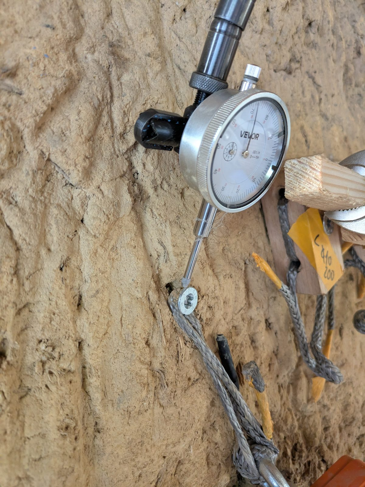{#photo_c8}

- **C8 carried 300 kg without a board.** The calculation for the screw alone with a free head would require an earth
  resisting at least 9 MPa, against 3.5 to 6 MPa for the other tests. Leads, none checked: the free screw also goes
  into tension at large movements; the actual steel is stronger than the approval's lower value; the hole, already
  loaded by C1, was deformed and the earth compacted; the cob is locally better. The load of C8 is reliable; it is its
  explanation that is missing.
- **C3 reloads more flexibly than its first loading**, the opposite of C2. The cracking sounds heard at 300 kg suggest
  damage.

## 6. The steel plate

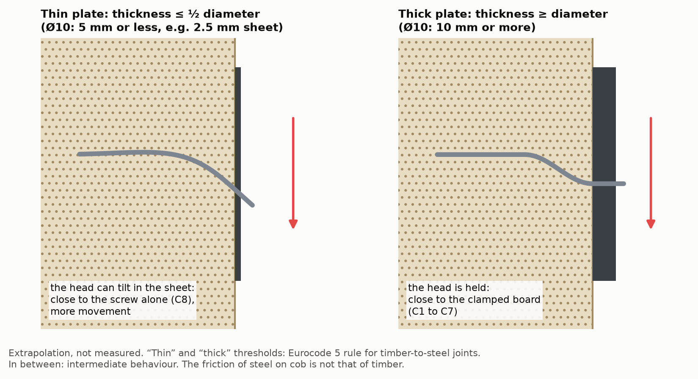{#fig_platine}

Timber joint design (Eurocode 5) classes a steel plate as thin up to half the screw diameter (the head is not held)
and as thick from the diameter upwards (the head is held), with a gradual transition between the two [18, 19]. The
45 mm board in the tests is a thick piece; a 2 to 3 mm plate is thin for a Ø10, it would take 10 mm for it to be thick.
The friction of metal on cob was not measured. No measurement or rule on a steel plate screwed into earth was found.

## 7. In pull-out: a cone, then the thread?

What the failures show: the screw slides along its thread, and the surface cob comes away as a shallow cone, about
4 cm in radius, sloping much less than 45° (by eye, not measured). The load that makes a Ø10 give way grows faster
than its length: about 10 kg per centimetre of screw at 7 cm, 19 at 11.5 cm. A grip that is the same all along the
screw does not explain this.

The author's hypothesis: as long as the screw is short, the cone grows with it, and holding rises fast; from a
certain length on, the cone stops growing, and each extra centimetre of thread adds a roughly fixed share. That length
is not observed: the cone can no longer be seen beyond 9 cm, but it may still be there, invisible (A4 sounded hollow
over 8 cm radius). A cone growing without end describes our four failures just as well: failures beyond 15 cm would be
needed to tell the two apart. This is why figure 10 draws no curve through the points.

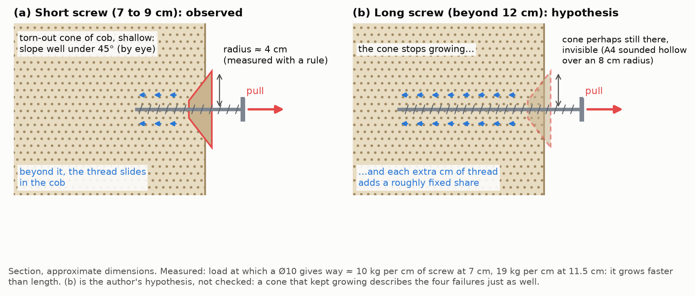{#fig_cone}

# Appendix C — Raw readings and calibration

## The sideways rig in detail

- Load parallel to the wall: the board is pulled downwards, along the wall, towards the reaction plate.
- Pulling chain: Dyneema rope loop passed through the board, 1-tonne electronic crane scale, shackles, 12 mm threaded
  rod, double nut tightened with the drill-driver. The load is therefore applied by imposing an elongation on a
  flexible chain, not a force: the load drops a little at each step. The rope touched neither the wall nor the plate.
- Dial gauge reading to a hundredth of a millimetre, on a flexible arm, fixed to a small plate screwed onto the
  reaction plate, for lack of a way to fix it firmly to the cob. Tip on the edge of the board, on the side opposite the
  pull, at the top of the board, in the middle of its width; wood cut smooth. Rod tilted 25 to 45° to the pull, angle
  not noted test by test.
- C8: rope passed over the screw head, dial gauge on the head; the dial gauge arm was fixed on the board of an earlier
  test.
- Crane scale zeroed with the chain slack, then dial gauge zeroed.

## Readings of 30 October 2026

Notation: “20: 0.1” means 20 kg read on the crane scale, 0.1 mm read on the dial gauge. “↓ 0”: full unloading.
“reset”: dial gauge reset to zero. “—”: not read. The words in quotation marks are those noted at the time (translated
from French). The readings are also in the repository's `vis-dans-la-bauge/donnees/` folder.

| Test | First loading | Then |
|---|---|---|
| C1 (discarded) | 20: 0.02 · 40: 0.05 · 70: 0.14 ↓ 0: 0.05 | 40: 0.07 · 100: 0.20; one more turn on the shackle, reset; 40: 0.05 · 180: 0.5 · 240: 1.0 · 300: 1.6 |
| C2 | 20: 0.1 · 50: 0.2 · 100: 0.6 · 150: 1.15 · 180: 1.35 · 200: 1.6 · 270: 2.3 · 315: 2.7 ↓ 0: 0.15 | reset; 40: 0.2 · 100: 0.8 · 200: 1.4 · 300: 1.6; reset; 300: 1.6 · 350: 1.8 |
| C3 | 20: 0.08 · 40: 0.22 · 55: 0.3 · 80: 0.48 · 100: 0.6 · 140: 0.9 · 200: 1.3 · 300: 2.6; “a lot of hysteresis” up to 200 | reset; 30: 0.2 · 50: 0.4 · 60: 0.5 · 70: 0.6 · 80: 0.7 · 200: 1.5 · 300: — “on the edge of cracking” |
| C4 | 20: 0.1 · 40: 0.2 · 80: 0.5 · 105: 0.65 · 150: 1.1 · 200: — “pull-out” | — |
| C5 (Ø8) | 20: 0.1 · 40: 0.2 · 50: 0.3 · 80: 0.75 · 100: 1.0 · 130: 1.3 · 150: 1.7 · 200: — “it's sliding, careful” | 0; 20; 40 “linear”; 80: 0.8 |
| C6 (stainless) | 20: 0.2 · 40: 0.5 · 50: 2.0 ↓ 0: 0.9 | 20: 0.15 · 40: 0.25 · 50: — “it's slipping” |
| C7 | (30: 0.2 · 40: 0.5 discarded: the dial gauge was touching the crane scale); 40: 0.2 · 65: 0.3 · 94: 0.4 · 120: 0.6 · 174: 0.8, dropped to 137 kg in 30 s at 0.8 ↓ 0: 0.15 | reset; 20: 0.2 · 80: 0.4 (“almost linear from 20 to 80”) · 150: 0.65 · 200: 0.9 · 250: 1.3 · 300: 1.65 “a crack is heard” ↓ 0: 0.5; reset; 60: 0.3 · 90: 0.5 · 145: 0.8 · 240: 1.1 |
| C8 (movements: context) | 20: 0.1 · 50: 0.2 · 110: 0.6 · 150: 1.0 · 200: 1.2 · 300: 2.3 “deformation visible to the naked eye” ↓ 0: 0.45 | — |

Table: Readings as noted on 30 October 2026.

Status of the readings, decided by the author:

- **C1**: the first loading and the second cycle are discarded, because a shackle was rubbing on the plate until the
  extra turn. The following reloading, from 40 to 300 kg, is read.
- **C8**: the load is reliable; the movements serve as context, not as a measurement. The screw head is small, the
  dial gauge probably shifted on it, and the hole had already been used for C1. For C8, the dial gauge was held by the
  board of an earlier test, and not by the reaction plate. By eye, C8 was moving by at least 3 mm at 300 kg, against
  2.3 mm read.
- **C7**: the first loading starts at 40 kg with no zero noted.

## What the readings give without a model

- Movement recovered on full unloading: 94% (C2, after 315 kg), 80 to 81% (C7 after 174 kg; C8 after 300 kg,
  context), 70% (C7 after 300 kg on reloading), 55% (C6, stainless).
- Reloading after resetting to zero, at 300 kg: 1.6 mm (C1, C2, oak) and 1.65 mm (C7, Douglas fir).
- At 100 kg on first loading: 0.60 to 0.62 mm for C2, C3, C4; about 0.53 mm for C8 (context); 1.0 mm for the Ø8 (C5).
- Below 50 kg, the readings are 0.1 to 0.2 mm: they mostly reflect the reading precision.

## The pull-out rig in detail

- Load perpendicular to the wall, along the screw's axis. Tests about 1.10 m above the ground; cob planed flat where
  each screw goes (5 mm removed at most).
- Plate: a length of 2 mm square steel tube, with a much thicker bar welded under it on the wall side; the screw head
  sits in a partly countersunk seat. The plate takes 15 mm of the screw.
- Chain: Dyneema rope loop, shackles, 1-tonne electronic crane scale, swivel (so that the scale does not turn), ring,
  threaded rod.
- The rod turns in a nut fixed to a frame on four 4 × 4 cm feet, whose centres are 13 cm from the screw (nearest edge
  about 10 cm). The drill-driver turns the rod; its torque setting limits the load, but its clutch is not repeatable:
  the crane scale is what counts.
- The weakened areas found with a hammer extended no more than 8 cm in radius (from memory), inside the frame's feet:
  we think the frame did not hold back the cone, without having shown it.
- Length in the cob: screw length, minus 15 mm of plate, minus the length backed out, minus the thread left outside the
  cob where the wall is not flat (5 mm for A6); read to within 5 mm. When a length was noted at the time, it is the one
  used (A5 at failure: 90 mm noted, 85 calculated). A8: 50 mm, the length of its thread.

## Readings of 7 November 2026

| Test | Loads, in order (length in the cob: load) |
|---|---|
| A1, Ø8 | 10.5 cm: gives way between 150 and 200 kg; “surprised: 300 kg expected, load rises fast” |
| A2, Ø8 | 10.5 cm: 120 and 150 kg held, then gives way between 160 and 170 kg |
| A3, Ø8 | 10.5 cm: gives way between 120 and 130 kg |
| A4, Ø10 | 17.5 cm: 150 · 180 · 230 · 300 · 380 kg held; 16.5 cm: 150 · 180 · 200 · 300 · 400 kg held; 15.5 cm: 350; 14.5 cm: 320; 13.5 cm: 300; 12.5 cm: 300; 11.5 cm: gives way at 220 kg |
| A5, Ø10 | 10.5 cm: 150 kg held; 9.5 cm: 160 kg held; 9 cm: gives way at 130 kg |
| A6, Ø10 | 8 cm: gives way at 100 kg |
| A7, Ø10 | 8 cm: 100 kg held; 7 cm: gives way at 70 kg |
| A8, Ø6 | 5 cm: gives way at 56 kg |

Table: Readings as noted on 7 November 2026, also in the repository's `vis-dans-la-bauge/donnees/` folder. No screw was
loaded at its full length: each was driven fully home, then backed out by 1 cm before the first loading (A5: down to
10.5 cm).

## Workshop calibration, 8 October 2026

Before the tests, the same rig was tried in the workshop: same Ø10 × 260 screw, same Douglas fir board, same chain;
the cob was replaced by 20 cm of Douglas fir, which the screw entered as end grain.

- Dial gauge placed on the workbench: about 1, 2 and 3 mm at 100, 200 and 300 kg, after three or four cycles. This
  reading includes the movement of the workbench clamp.
- Dial gauge placed on the support block: 1.25 mm at 300 kg, over two cycles.
- When taken apart, the screw was bent by 2 to 3 mm at 10–11 cm from its head; it had been very hard to drive,
  finished with a wrench. It most likely bent while being driven.

This calibration measures an assembly (board, screw, Douglas fir block), not the board alone: it does not allow the
share of the wood to be removed from the readings taken on the cob.

## Driving torque, inferred from the drill-driver setting

| Test | Pilot hole (drill bit) | Where the drill-driver's clutch slipped | Thread in the cob at that moment |
|---|---|---|---|
| C1, Ø10 × 260 | 6 mm, 240 mm | setting 8, at about halfway (uncertain reading) | 8.5 cm |
| C2, Ø10 × 200 | 6 mm, 200 mm | setting 4, 10 cm left | 5.5 cm |
| C3, Ø10 × 140 | 5 mm, 80 mm | setting 4, 6 cm left; setting 8, 2 cm left | 3.5; 7.5 cm |
| C4, Ø10 × 100 | 5 mm, 80 mm | setting 4, 2 cm left | 3.5 cm |
| C5, Ø8 × 120 | 5 mm, 80 mm | setting 4, 5 mm left | 7.0 cm |
| another wall, 10/10/2026, Ø10 | none | stalled at 18–20 N·m, ceiling checked with a wrench | 10 cm |

Table: Driving torque. “Left”: screw length still to drive when the clutch slips. At the shed, torques from the
drill-driver's manual in 1st gear (assumed); in 2nd gear, they would be half as much. In the other wall, the
drill-driver's ceiling was checked with a torque wrench. The torque taken by the board is not subtracted.

## To repeat the test

What we would do differently:

- hold the dial gauge on a support independent of the plate that pulls, otherwise it also reads the plate moving back;
- put the dial gauge rod in line with the pull: tilted, the reading is ambiguous by a factor of 2; failing that, note
  its angle at each test;
- do not rest the dial gauge on a small screw head: it slips;
- check that nothing rubs on the chain (a shackle on the plate, the dial gauge on the crane scale): a rubbing contact
  distorts a whole loading;
- loading with the nut means imposing an elongation: note the highest load and the load it settles at;
- note the speed and the setting of the drill-driver when driving, or better, the torque on a torque wrench;
- read small movements to the hundredth, not to the tenth;
- photograph the mouth of the hole, unloaded then loaded, with a ruler in the frame;
- in pull-out, one new screw per length, loaded only once, rather than one screw backed out centimetre by centimetre;
- record at each failure the radius and depth of the cone, and the area that sounds hollow under a hammer;
- note each screw's driving torque with a torque wrench, to link driving and holding in the same hole;
- use a pulling chain whose every part holds more than 400 kg: the rig's M12 eye nut, with a proof load of 347 kg, was
  taken to 400 kg (no visible deformation).

# Appendix D — State of the art: what is said, and what has been measured elsewhere

## Guides and practitioners

The rammed earth guide suggests trying the fixing on a low test wall with items 1.5 times heavier than planned [3].
The APTE association adds that « une visseuse puissante » [a powerful drill-driver] is needed [4]. The English-speaking
cob practitioner advises trying a screw by hand until it gives way, working out the number of screws from that, then
doubling that number [5]. In earth bricks and blocks, the other practice dominates, the drilled hole [7, 12, 13]; no
source read forbids either one.

The CobBauge guide, from a European research project on cob, asks for screws of at least 20 cm to fix doors and
windows, in cob without too many stones, or timber pieces embedded with a dovetail shape; light earth alone does not
hold a fixing [25]. It gives no load.

## Loads advised elsewhere

For other walls, technical approvals and manufacturers give loads per fixing point (1 daN, the unit of the technical
approvals, is about 1 kg):

- **compressed earth brick partitions**: up to 10 kg, set in mortar after core drilling; above, a secondary frame that
  spreads the load [27];
- **cement-stabilised earth tiles** (5 cm): at most 25 daN in pull-out and 50 daN sideways per point; the two approved
  wall plugs are allowed 4.55 and 22.8 daN, the same value in both directions [28];
- **hemp concrete blocks**, wood screws without plugs: 5 kg for a Ø6 anchored 7 cm, 10 kg for a Ø8 anchored 9.5 cm,
  50 kg for a chemical anchor [26];
- **brick masonry and rammed earth**, plastic wall plugs: 3 to 15 kg for plugs of 3 to 9 cm, 20 kg for a chemical plug,
  values from the plug maker TOX with Claytec, basis not published [11, p. 3].

## Related measurements

No published measurement we found deals with a wood screw in cob. The closest deal with other fixings or other base
materials: they are reference points, not values to carry over to cob. One kilonewton (kN) is about 100 kg.

| Loading | Fixing | Base material | Result | Source |
|---|---|---|---|---|
| pull-out | M10 stainless rods set in lime grout over 39 cm | cob, in the laboratory | 22.9 ± 4.1 kN (about 2.3 tonnes), 5 tests; 0.62 ± 0.11 MPa over the grouted surface | [6] |
| pull-out | Hilti HUS3 Ø8 concrete screws, anchored 65 mm | compressed earth block masonry | 3.1 to 3.5 kN (about 310 to 350 kg), 5 tests | [7] |
| sideways | Ø6 × 100 wood screw anchored 80 mm, Ø8 × 160 anchored 130 mm; Ø10 × 160 aerated-concrete screw anchored 130 mm | hemp concrete blocks | 582, 846 and 1,125 N (about 60, 85 and 115 kg), characteristic values (low values, not averages) | [26] |
| sideways | Ø6 to Ø10 reinforcing bars glued with resin, anchored 25 to 75 mm | 10 cm rammed earth cubes (1.4 MPa) | about 0.3 to 0.6 kN (30 to 60 kg), read from the curves | [29] |
| sideways and pull-out | two brackets on 4 HUS3 Ø8 × 85 screws, load 30 cm from the wall | compressed earth block masonry | failure of the base material at 330 kg | [7] |

Table: Published measurements on related fixings. The ATEx 2911 tests are those it reports; it has expired since 2023.

In the rammed earth cubes [29], the fixing is at most 5 cm from the edges: it is the cube that breaks, not a wall. The
bracket [7] loads its screws both sideways and in pull-out: it is not a pure sideways measurement. Other measurements
deal with plastic wall plugs in earth bricks [11], grouted bolts in a draft New Zealand standard [9], and screws
embedded in freshly rammed earth [8]. A research programme on adobe notes that anchors loaded sideways give way
gradually, and those pulled along their axis suddenly [10].

We searched in five languages, in guides, earth building codes, research programmes and manufacturers' documents;
several foreign manuals could not be opened.

## Margins used elsewhere

The factor is the ratio between the load that causes failure (or the test load) and the load one allows oneself.

| What is done | Material | Factor | What it applies to |
|---|---|---|---|
| Test on a low wall, rammed earth guide [3] | rammed earth | 1.5 | a test load held, without going to failure |
| Acceptance test of fixings on site, British standard BS 8539 [16] | concrete, masonry | 1.25 to 1.5 | a proof load, without failure |
| English-speaking cob practitioner [5] | cob (earth) | 2 | the failure of a screw tested by hand; the number of screws is doubled |
| Timber joint design, Eurocode 5 [18, 19] | timber | 2.2 to 2.9 | a low value, exceeded by 95% of tests (ratio recalculated) |
| Anchors for external wall insulation, European approval [21] | concrete, masonry | 3.0 | a low value, exceeded by 95% of tests |
| Bracket on compressed earth blocks, ATEx (« appréciation technique d'expérimentation » [technical assessment of an experimental product]) from the CSTB, the French building research centre (Centre scientifique et technique du bâtiment) [7] | compressed earth blocks | 3.3 | a single test pushed to failure (330 kg), for 100 kg allowed |
| Plastic wall plugs in earth bricks [11] | earth bricks | 5 | the average of pull-out tests |
| Fixings in weak base materials, on-site tests, BS 8539 [16] | concrete, masonry | 3 to 7 | the load held, or the failure, in preliminary tests |
| Approved anchors, on-site tests, French fixings trade body [17] | concrete, masonry | 4.7 to 7 | the average of the 5 lowest of 15 tests |
| Wall plugs without approval, or set in the joints [17] | concrete, masonry (joints) | 9 to 14 | same |

Table: Margins used in similar situations, side by side, without choosing.

These factors cannot be compared without saying what they apply to: a single test, an average or the average of the
lowest; a test load held or a failure.

# Acknowledgements

Thanks to M. A., who lent us their wall for these tests. Thanks also to everyone who shared with us what they know
about cob.

# References

The full references, with their address and date of consultation, are in the
[list of references in the GitHub repository](../references.md) (folder `vis-dans-la-bauge/papier/`).

1. Guide de bonnes pratiques de la construction en terre crue — Bauge [Good-practice guide for earth building — Cob],
   2018 (web ed. 2021), §4.2.1.5.
2. Guide de bonnes pratiques de la construction en terre crue — Brique de terre crue [Good-practice guide for earth
   building — Earth brick], 2020 (web ed. 2021), §5.2.2.2.
3. Guide de bonnes pratiques de la construction en terre crue — Pisé [Good-practice guide for earth building — Rammed
   earth], 2018 (web ed. 2021), §3.4.
4. APTE (eco-building association), fact sheet « Le pisé » [Rammed earth], section « Fixation dans du pisé » [Fixing
   into rammed earth].
5. Smith M. G., “Structural Considerations for Cob Buildings”, questions and answers, Green Home Building.
6. Miccoli L., Fontana P., *Bond strength performances of anchor pins for earthen buildings*, SAHC 2014.
7. CSTB (Centre scientifique et technique du bâtiment [French building research centre]), ATEx (appréciation
   technique d'expérimentation [technical assessment of an experimental product]) A no. 2911, cloison en maçonnerie
   de BTC Cycle Terre [Cycle Terre CEB masonry partition] (CEB: compressed earth blocks), 2021, expired on
   10/05/2023; tests p. 48–49.
8. Haußer T., La Magna R., *Horizontal Earth*, IOP Conf. Ser. Earth Environ. Sci. 1554, 2025.
9. Standards New Zealand, DZ 4297 *Engineering design of earth buildings*, draft of 12/04/2024.
10. Tolles E. L. *et al.*, *Seismic Stabilization of Historic Adobe Structures*, Getty Conservation Institute, 2000.
11. Röhlen U. (Claytec), *Befestigen, fliesen, maschinelles Verarbeiten* (“Fixing, tiling, machine application”),
    LEHM 2020.
12. Würth, Claytec, *Befestigungen im Lehmbau* (“Fixings in earth building”), 2018.
13. Minke G., *Building with Earth*, Birkhäuser, 2006.
14. EOTA (European Organisation for Technical Assessment), TR 051, *Job-site tests of plastic anchors and screws*,
    2018.
15. Hilti, *Possibilities and limitations of on-site anchor testing*.
16. Construction Fixings Association, *Procedure for site testing construction fixings*, 2012 (guide to the British
    standard BS 8539:2012).
17. Cisma (French trade body for the fixings industry), *Recommandations pour la réalisation d'essais de chevilles sur
    site* [Recommendations for carrying out on-site tests of anchors], 2013.
18. EN 1995-1-1 (Eurocode 5), *Design of timber structures*, part 1-1.
19. Swedish Wood, *Design of timber structures, Volume 2*, 2022.
20. ETA-Danmark, ETA-21/0751 (European Technical Assessment), fischer PowerFull II, 26/08/2022.
21. DIBt (German Institute for Building Technology), ETA-14/0130, EJOT H3 insulation anchors.
22. fischerwerke, *PowerFull II* brochure, 03/2023.
23. fischer France, product pages « Vis à filetage total PowerFull II CTF, tête fraisée » [PowerFull II CTF full-thread
    screw, countersunk head] (Ø8) and « … CTF ø10, tête fraisée » [same, countersunk head] (fischer.fr).
24. SECCARO (brand of the merchant ecomserv), listing « Spanplattenschraube Halbrundkopf 6 x 80 mm, Edelstahl V2A VA A2 …
    75 Stück » (“round-head chipboard screw 6 × 80 mm, A2 stainless, 75 pieces”), Kaufland.
25. CobBauge (Interreg France (Channel)-England programme), *CobBauge — A guide for builders*, 2023, §8.9 and 8.13.
26. UBAtc (Belgian Union for technical approval in construction), ATG 3169, IsoHemp hemp concrete blocks, 2026, §7.5
    and table 5.
27. CSTB, ATEx no. 3548 V1, TERREAL compressed earth brick partitions, 2026, §5.10.4.
28. CSTB, ATEx no. 3509 V2, TERLIAN earth tile partitions, 2025, §5.8.
29. Wolf L. A., Augarde C. E., Jaquin P. A., “Investigating the lateral capacity of wall top fixings in rammed earth
    materials”, in *Rammed Earth Construction*, CRC Press / Balkema, 2015, p. 181–184.
