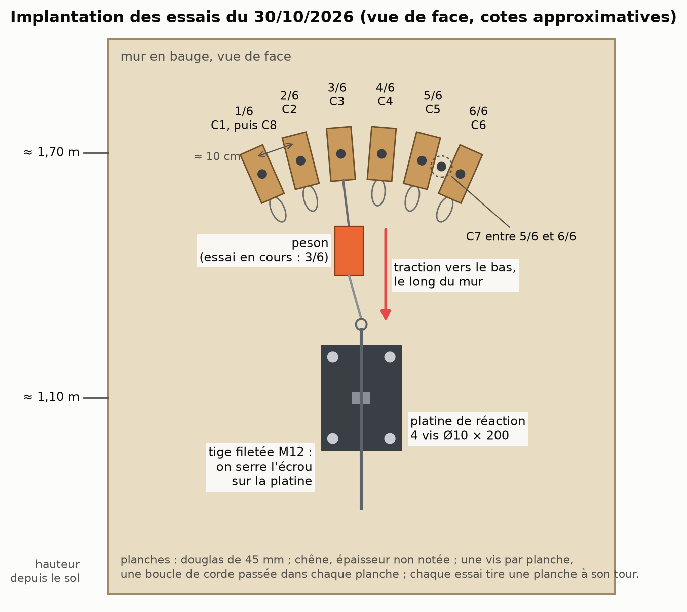
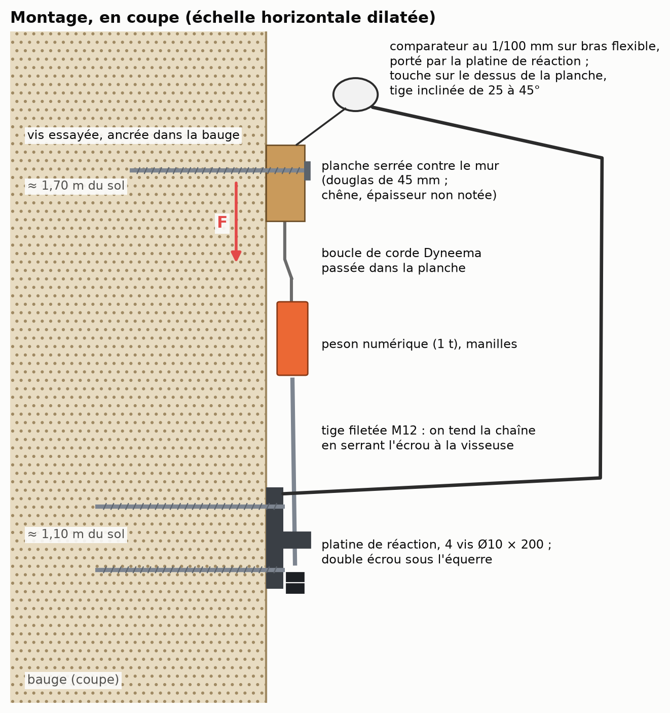
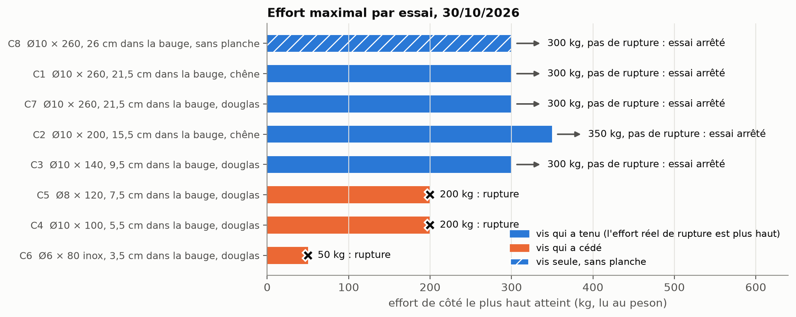
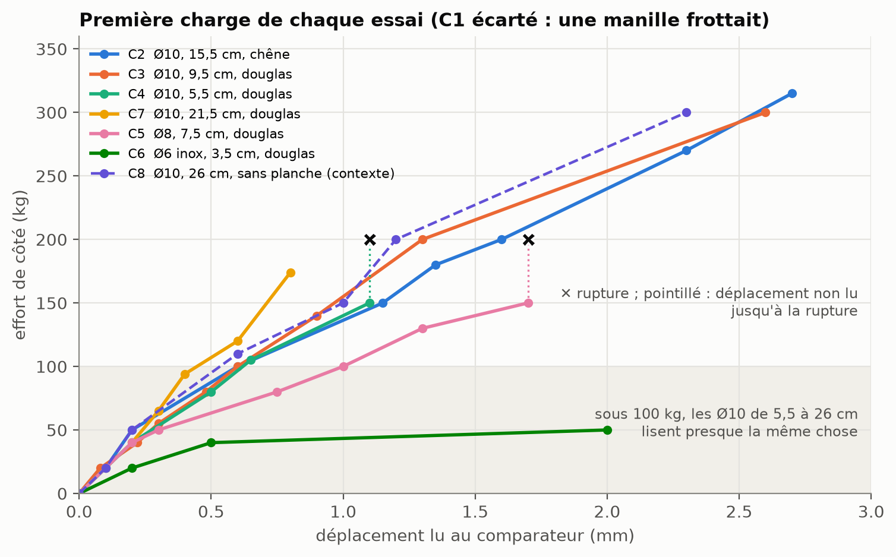
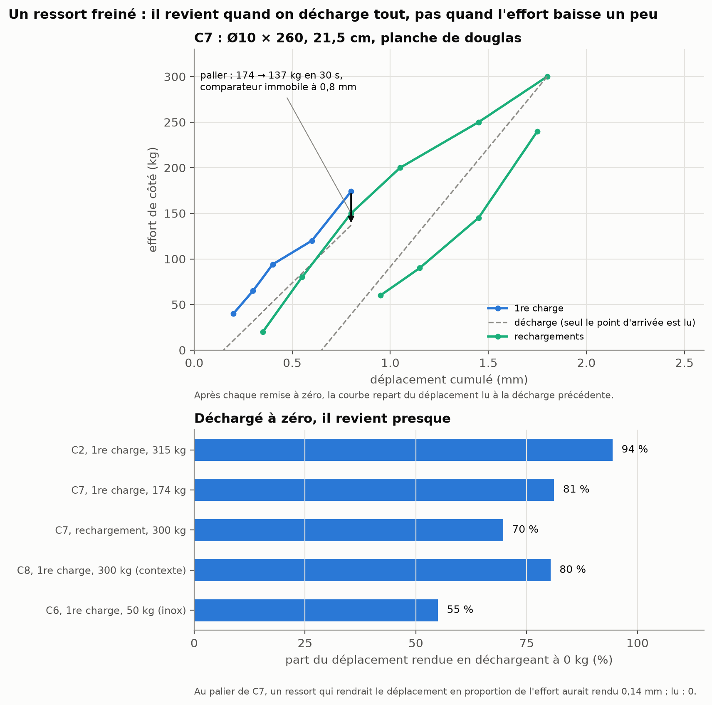
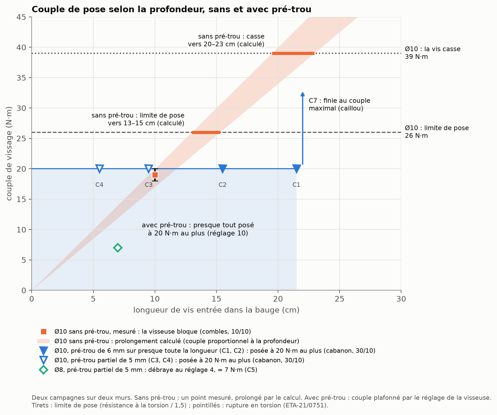
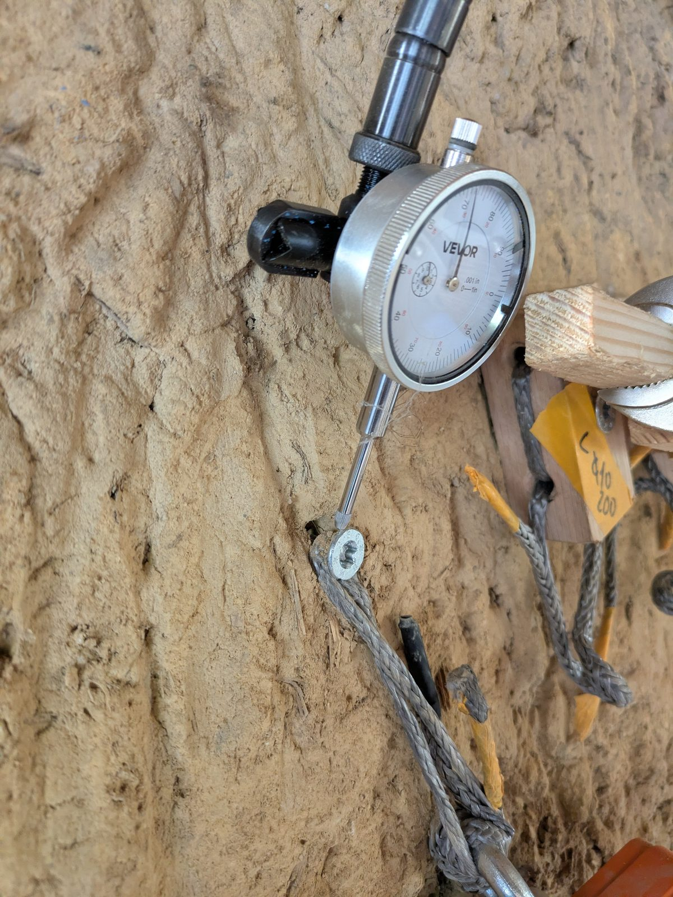
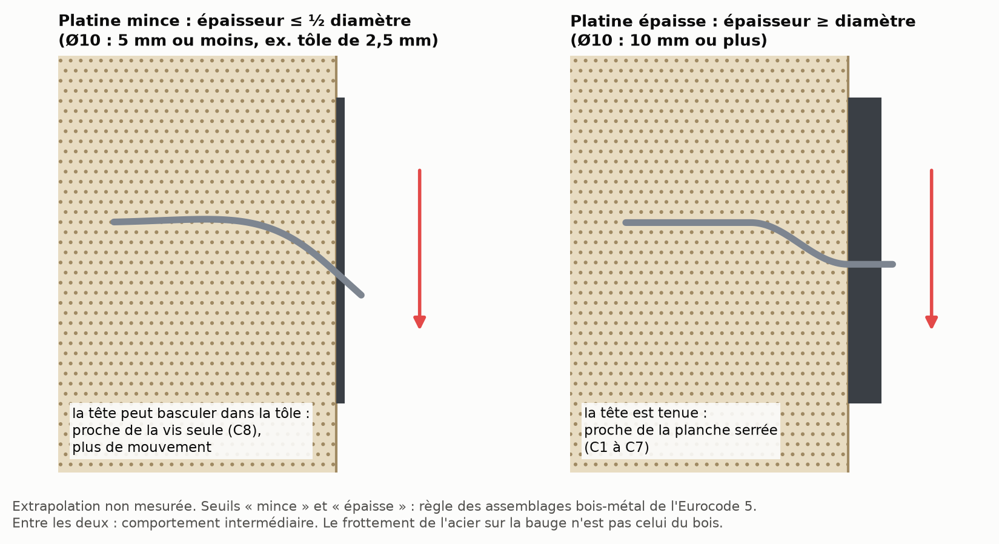

Identifiant : DOI Zenodo attribué à chaque version, voir la page du dépôt. Relevés, photos, figures et calculs :
<https://github.com/Remi-C/renovation-terre-crue>, site <https://remi-c.github.io/renovation-terre-crue/>. Texte, données et
figures sous licence CC BY 4.0. Retours : les « issues » du dépôt GitHub.

# En bref

- Dans un vieux mur de bauge sec, nous avons fait huit essais de vis du commerce chargées de côté, le long du mur :
  un essai par configuration, en une journée, avec du matériel courant.
- Une vis à bois de 10 mm de diamètre, posée avec un pré-trou, entrée de 9,5 à 21,5 cm dans la bauge et plaquant une
  planche contre le mur, a porté **300 à 350 kg** sans rompre. Les essais ont été arrêtés avant la rupture : la vraie
  limite est plus haute.
- Trop courtes, les vis ont lâché : vers 200 kg pour une vis de 10 mm entrée de 5,5 cm et une vis de 8 mm entrée de
  7,5 cm ; dès 50 kg pour une petite vis inox de 6 mm entrée de 3,5 cm.
- Ce que nous en retenons : 8 mm de diamètre pour quelques dizaines de kilos, 10 mm au-delà ; 8 cm dans la bauge au
  minimum, 10 cm de préférence ; toujours plaquer une pièce contre le mur.
- La pose : sans pré-trou, une vis de 10 mm, pourtant plus courte, a bloqué la visseuse à 18–20 N·m vers 10 cm de
  bauge, et sa pose a été très difficile ; avec un pré-trou de 5 ou 6 mm, presque toutes ont été posées à 20 N·m au
  plus, jusqu'à 21,5 cm. Le pré-trou réduit clairement le couple de pose et permet de rester dans les préconisations du
  fabricant de la vis. Quel pré-trou pour quel diamètre et quelle profondeur reste à mesurer.
- Ce papier ne donne ni charge admissible ni marge de sécurité : il place nos mesures à côté des marges pratiquées
  ailleurs. L'arrachement (vis tirée dans son axe) fait l'objet d'une seconde campagne, en novembre 2026.

# Pourquoi ce papier

Rénover une maison en bauge, c'est un jour fixer quelque chose au mur : une ossature d'isolation, des étagères, un sabot
de solive. Les vis ne sont pas la solution à tout ; pour le lourd, les guides proposent des tiges qui traversent le mur
ou des pièces de bois noyées dans la terre. Mais une vis dont on connaît la tenue ajoute une corde à l'arc du
rénovateur.

Ces essais ne sont pas des essais professionnels. Ils ont été faits par un particulier qui rénove sa maison, sur un mur
à sa disposition : avoir accès à un bâti ancien pour y faire des essais n'est pas facile. Nous les publions avec leurs
limites et nous demandons un retour à ceux qui fixent dans la terre tous les jours.

Une vis est chargée **de côté** (on dit aussi « en cisaillement ») quand on la tire parallèlement au mur, comme le poids
d'une étagère tire sur ses vis ; elle est chargée **en arrachement** quand on la tire dans son axe, hors du mur. Nous
distinguons ce qui est **mesuré** (lu au peson ou au comparateur), **estimé** par l'auteur (à l'œil ou de mémoire),
**calculé** à partir des mesures, et **supposé** (une explication probable, non vérifiée).

# D'où on part

Les guides français de bonnes pratiques de la construction en terre crue admettent la vis directe. Ceux de la bauge et
de la brique de terre crue citent la « vis à bois entrée directement dans le matériau sans pré-trou ni chevilles
dans la mesure où les charges sont faibles et sans trop serrer », dans un encadré déclaré non normatif [1, 2] ; celui
du pisé admet le « vissage direct » pour des charges faibles [3]. Une association d'éco-construction, l'APTE, conseille
dans le pisé des vis entrées d'au moins 10 à 15 cm [4] ; un praticien de la bauge anglaise, des vis de 12,7 cm ou
plus [5].

Aucune de ces sources ne donne de charge ni de diamètre. Or « sans pré-trou » n'a pas de sens sans diamètre : une vis
de 6 mm sur 80 mm et une vis de 10 mm sur 260 mm ne se posent pas du tout de la même façon. Nous sommes partis de ce
principe, visser directement dans la terre, pour le caractériser : combien ça tient, à quelle profondeur, avec quel
diamètre, et à partir de quand le pré-trou devient nécessaire.

**Nous n'avons trouvé aucune mesure d'une vis ou d'un clou posé après coup dans une terre crue et chargé de côté**,
après avoir cherché en cinq langues ; les mesures voisines portent sur d'autres fixations (annexe D).

# Les essais

## Le mur et les vis

Un mur en bauge d'un cabanon de jardin, en place, vieux d'au moins 50 ans, épais d'au moins 45 cm. Il est
abrité depuis longtemps par un bardage en bois sur lame d'air, sans signe d'humidité. La bauge est très sèche ; sous
l'outil, elle se raye et part en poussière ; elle contient des cailloux de silex. Sa teneur en eau n'a pas été mesurée.

Les vis sont des vis à bois du commerce : des fischer PowerFull II de 8 et 10 mm de diamètre, filetées sur presque
toute leur longueur, sous agrément européen pour l'usage dans le bois (aucun agrément ne couvre la terre) [20], et une
vis inox de 6 mm. Chacune plaque contre le mur une planche de 45 mm (douglas ; chêne d'épaisseur non notée) et entre
dans la bauge de sa longueur moins la planche. Les trois vis de 260 mm isolent l'effet de la pièce : planche de chêne
(C1), de douglas (C7), aucune planche (C8, qui reprend la vis et le trou de C1, tête au ras du mur). Détail en annexe A.

## Le montage

{#fig_implantation}

On tire chaque planche vers le bas, le long du mur, comme un poids, vers une platine de réaction vissée plus bas dans
la même bauge par quatre vis Ø10. On met en charge en serrant un écrou sur une tige filetée, au bout d'une chaîne qui
comprend un peson électronique de 1 tonne. Un comparateur, un cadran qui lit les déplacements au centième de
millimètre, touche le chant de la planche. Le matériel coûte quelques centaines d'euros.

{#fig_montage}

On monte l'effort par paliers, en notant à chaque palier l'effort le plus haut et le déplacement ; la première charge
se lit à part des rechargements. Les efforts sont en kilos, comme sur le peson (100 kg font environ 1 kN).

**Les efforts sont sûrs** : le peson est dans la chaîne de traction. **Les déplacements sont fragiles** (comparateur
tenu par la platine qui recule un peu, tige inclinée de 25 à 45° sans que l'angle soit noté, petites lectures au
dixième) : le déplacement réel peut différer de la lecture d'un facteur 0,7 à 1,4, et sous 50 kg on lit surtout le
montage. Nous ne donnons donc pas de raideur de la bauge. La forme des courbes reste sûre ; les comparaisons entre
essais aussi, l'inclinaison de la tige étant comparable d'un essai à l'autre, sans trop lire dans les petits écarts.
Sont écartés la première charge de C1 (une
manille frottait) et les déplacements de C8 (le comparateur a probablement glissé sur la petite tête de vis) ; l'effort
de C8, lui, est sûr.

## Un mur, une journée, un essai par configuration

Un seul mur, sec, une seule journée (le 30 octobre 2026), un essai par configuration, des charges de courte durée. Des
mesures répétées vaudraient évidemment mieux. Mais nous n'avons trouvé aucune autre mesure de ce genre, et ces essais
sont remarquablement cohérents entre eux : les quatre Ø10 avec planche entrées de 9,5 à 21,5 cm ont toutes porté 300 kg
ou plus ; à 100 kg, trois Ø10 de profondeurs différentes lisent le même déplacement à deux centièmes près ; au
rechargement, trois vis lisent 1,6 à 1,65 mm à 300 kg. Avec aussi peu de variabilité, ces mesures ont déjà une valeur en
elles-mêmes.

# Résultats

## Combien ça a tenu

| Essai | Vis | Dans la bauge | Planche | Effort maximal porté | Ce qui s'est passé |
|---|---|---|---|---|---|
| C2 | PowerFull II Ø10 × 200 | 15,5 cm | chêne | **350 kg** | pas de rupture |
| C1 | PowerFull II Ø10 × 260 | 21,5 cm | chêne | **300 kg** | pas de rupture |
| C7 | PowerFull II Ø10 × 260 | 21,5 cm | douglas | **300 kg** | pas de rupture ; un craquement à 300 kg |
| C3 | PowerFull II Ø10 × 140 | 9,5 cm | douglas | **300 kg** | pas de rupture ; « limite craquement » à 300 kg |
| C8 | vis de C1, sans planche | 26 cm | aucune | **300 kg et plus** | pas de rupture ; déformation visible à l'œil |
| C4 | PowerFull II Ø10 × 100 | 5,5 cm | douglas | 200 kg | « arrachement » |
| C5 | PowerFull II Ø8 × 120 | 7,5 cm | douglas | 200 kg | « ça coulisse » |
| C6 | inox A2 Ø6 × 80 | 3,5 cm | douglas | 50 kg | « ça glisse » |

Table: Les huit essais du 30 octobre 2026. Ø10 : vis de 10 mm de diamètre au filet. Pré-trou : 6 mm sur l'essentiel de
la longueur (C1, C2, C7) ; 5 mm sur 3,5 cm de bauge au plus (C3, C4, C5) ; aucun (C6). Entre guillemets : les mots notés
sur le moment.

{#fig_efforts}

Les Ø10 entrées d'au moins 9,5 cm ont porté 300 à 350 kg : ce sont des minimums, on s'est arrêté avant la rupture, et
on ne peut pas les classer entre elles. Pour les vis courtes, les mots notés indiquent probablement que la vis est
sortie du mur (elles n'ont pas été examinées au démontage).

## Sous 100 kg, la profondeur change peu ; le diamètre, si

{#fig_premiere_charge}

Sous 100 kg, les Ø10 se comportent pareil quelle que soit leur profondeur : à 100 kg, celles entrées de 5,5, 9,5 et
15,5 cm lisent toutes 0,60 à 0,62 mm. Notre lecture, supposée (annexe B) : seuls les premiers centimètres de vis
travaillent de côté ; au-delà, la profondeur sert à empêcher la vis de sortir. Elle n'est pas inutile pour autant : les
vis courtes sont celles qui ont lâché.

La Ø8 bouge nettement plus : 50 à 70 % de plus que les Ø10, lus à 80 et 100 kg (1,0 mm contre 0,6 mm à 100 kg).
À 40 kg, toutes lisent 0,2 mm, la précision de lecture ; l'écart commence vraisemblablement plus tôt. Une seule Ø8 a
été essayée : sans trop lire dans ce chiffre, ce qui est sûr, c'est qu'elle a lâché à 200 kg, et qu'elle soit moins
raide que la Ø10 est tout à fait concevable.

## Un ressort freiné

{#fig_ressort_freine}

- **Déchargé jusqu'à zéro, l'ensemble revient presque entièrement** : 94 % du déplacement (C2, après 315 kg), 81 %
  (C7, après 174 kg).
- **À une petite baisse, il ne revient pas** : à chaque palier, l'effort retombait aussitôt, souvent de 20 à 30 kg vers
  100 kg (estimation), sans que le comparateur bouge.

Supposé : la planche frotte sur le mur et y reste accrochée ; déchargée tout à fait, la vis, qui fait ressort, la
ramène (annexe B).

## La vis seule, sans planche

C8, tête au ras du mur et sans planche, a porté 300 kg et plus, sans doute possible pour l'auteur, mais en bougeant de
plusieurs millimètres : au moins 3 mm à 300 kg, estimés à l'œil, le plus gros déplacement de la journée. Sur les photos
prises vers 250 kg, un vide s'ouvre à l'entrée du trou, du côté opposé à la traction (constat visuel, sans échelle ;
photo en annexe B). Le trou avait déjà servi à C1. C'est le cas d'école : en pratique, une vis tient toujours quelque
chose, une platine, un montant, une planche.

## La pose : le couple et le pré-trou

Poser une vis demande un effort de torsion, le **couple**, en newtons-mètres (N·m). La **limite de pose** retenue est
le couple qui casse la vis, divisé par 1,5, le rapport que l'agrément demande lui-même pour la pose dans le bois :
26 N·m pour la Ø10, 18,7 N·m pour la Ø8 [20]. Le couple est déduit du réglage où la visseuse débrayait, vitesse non
notée, 1re supposée ; dans un mur des combles (10 octobre 2026), ce plafond a été vérifié à la clé (annexe C).

{#fig_pre_trou}

- **Ø10 sans pré-trou** (combles, première campagne) : la visseuse a bloqué à 18–20 N·m vers 10 cm de bauge, avec une
  vis pourtant plus courte que les plus longues du cabanon ; la pose a été très difficile. Si le couple continuait de
  croître au même rythme (calcul), la limite de pose serait atteinte vers 13 à 15 cm, et la casse vers 20 à
  23 cm.
- **Ø10 avec pré-trou** (cabanon, seconde campagne) : 6 mm sur presque toute la longueur pour C1, C2 et C7 ; 5 mm sur
  3,5 cm de bauge au plus pour C3 et C4, donc un pré-trou partiel. Presque tout a été posé à 20 N·m au plus (réglage 10
  de la visseuse), jusqu'à 21,5 cm de bauge. Seule C7 (21,5 cm) a dû être finie au couple maximal de la visseuse, à
  cause d'un caillou ; elle n'a pas cassé.
- **Ø8, 7,5 cm, pré-trou partiel** : la visseuse a débrayé au réglage 4 (environ 7 N·m) à 5 mm de la fin, loin de sa
  limite de pose.
- **Ø6 inox, 3,5 cm, sans pré-trou** : pose « très sensible », la vis s'est mise à tourner dans le vide.

D'une campagne à l'autre (deux murs différents), le pré-trou a clairement réduit le couple de pose : il permet de rester dans les préconisations
du fabricant de la vis.

## L'arrachement : à faire (campagne de novembre 2026)

**À faire** : section à compléter après la campagne d'arrachement de novembre 2026 ; aucun résultat d'arrachement n'est
encore disponible.

Les vis courtes ont probablement lâché en sortant du mur, et un sabot ou une étagère en porte-à-faux tire ses vis dans
leur axe. Pour une vis à bois vissée dans la bauge, nous n'avons trouvé aucune valeur d'arrachement (mesures voisines :
annexe D). Une campagne est prévue en novembre 2026 ; cette section sera complétée avec ses résultats.

# Recommandations

Ce sont les conseils de l'auteur, tirés de ces mesures. Ils valent pour ces vis, dans cette bauge sèche, chargées de côté
pendant peu de temps, avec une pièce plaquée au mur. Ils ne remplacent ni un calcul ni un essai sur votre mur.

## Le diamètre

- **Ø8** pour quelques dizaines de kilos et pour accrocher du non structurel. Entrée de 7,5 cm, elle a porté 200 kg.
- **Ø10** au-delà d'environ 40 à 50 kg par vis : à 80 et 100 kg, la Ø8 a bougé 50 à 70 % de plus (lu au comparateur,
  une seule Ø8 essayée), et elle a lâché à 200 kg.

## La profondeur dans la bauge

- **4 cm : non**, sauf peut-être pour un cadre léger. La vis inox entrée de 3,5 cm a glissé à 50 kg ; dans un autre mur,
  une vis de charpente de 6,2 mm entrée de 5 cm a pris du jeu sous 100 kg, quand une Ø10 entrée de 15 cm portait la
  même charge sans jeu. Ces deux vis courtes étaient fines : aucune Ø8 ni Ø10 n'a été essayée sous 5,5 cm.
- **8 cm au minimum ; 10 cm de préférence** : c'est à partir de 9,5 cm que nos Ø10 ont porté 300 kg et plus.
- **Plus long** : utile pour tenir l'arrachement et pour passer un défaut local de la bauge (une poche moins
  cohérente). Sous 100 kg, plus long ne rend pas la vis plus raide ; plus résistante de côté, nous ne savons pas :
  aucune vis longue n'a été poussée à la rupture.

## Le pré-trou

Ce que montrent nos deux campagnes (résultats ci-dessus) : le pré-trou réduit clairement le couple de pose et permet
de rester dans les préconisations du fabricant de la vis. Ce que l'auteur en retient :

- **Ø6 sur 80 à 100 mm**, la vis usuelle que les guides ont probablement en tête : pas besoin de pré-trou, pour leurs
  charges faibles (sous une planche de 45 mm, il ne reste que 3,5 à 5,5 cm de bauge, sous notre minimum).
- **Ø8 sur 120 mm** : on peut éventuellement s'en passer (souvenir de l'auteur ; non mesuré). **Sur 160 mm**, l'auteur
  conseille un pré-trou : sans, on arriverait vite à un problème (conseil de l'auteur ; non mesuré).
- **Ø10** : un pré-trou, presque toujours. Sans pré-trou, la pose a été très difficile dès 10 cm ; avec un pré-trou de
  5 ou 6 mm, elle est presque toujours restée à 20 N·m au plus jusqu'à 21,5 cm, sous la limite de pose de la vis.
- **Diamètre du pré-trou** : 5 ou 6 mm, nous ne savons pas lequel convient le mieux. Un pré-trou au moins égal au noyau
  de la vis (6,2 mm pour la Ø10) soulagerait peut-être la pose : à vérifier pendant la campagne d'arrachement. Le foret
  souffre dans le silex : celui de 6 mm avait son carbure ébréché.
- **Si la visseuse bloque**, dévisser un peu et revisser, ou repercer, plutôt que forcer à la clé : forcer rapproche la
  vis de sa casse en torsion, et une pose très dure charge la vis plus que l'usage (à l'atelier, une vis finie à la clé
  est ressortie pliée, vraisemblablement à la pose).

**La suite à mesurer.** La vraie question n'est pas « pré-trou ou non » : pour chaque diamètre de vis et chaque
profondeur dans la bauge, quel pré-trou, de 0 (aucun) à 5 ou 6 mm, garde la pose sous la limite de la vis ? Nos deux
campagnes n'en donnent que deux cas, pour la Ø10 : sans pré-trou, et avec 5 ou 6 mm. La Ø8 de 160 mm sans pré-trou est
parmi les premières mesures à faire.

## Toujours plaquer une pièce contre le mur

Une vis tient toujours quelque chose. Plaquée au mur par la vis, la planche a porté 300 kg et plus en bougeant peu ; la
vis seule a porté autant, mais en bougeant de plusieurs millimètres. La pièce empêche la tête de tourner et frotte sur
le mur (supposé, annexe B). Une pièce décollée du mur, par exemple une ossature posée sur un isolant souple, perd
probablement ce renfort. Les guides disent « sans trop serrer » : nous n'avons pas mesuré à partir de quand un serrage
abîme le filet dans la terre ; la vis de 6 mm (C6) a tourné dans le vide en fin de pose, probablement ce que les guides
veulent éviter.

## Beaucoup de vis modestes plutôt que quelques vis très chargées

L'espacement tient à la bauge, qui peut être moins bonne par endroits, et beaucoup à l'assurance : ce qu'un assureur
acceptera de couvrir. La stratégie de l'auteur : que la tenue de l'ouvrage ne dépende jamais de quelques fixations, ce
qui demanderait un calcul de structure ; donc beaucoup d'ancrages modestes plutôt que quelques ancrages très forts. Pour
une ossature d'isolation, une vis tous les 50 cm se justifie sans peine.

## Et avec une platine métallique ?

Un sabot ou une platine de fixation est le cas classique ; nous ne l'avons pas mesuré. Une platine mince (au plus 5 mm
pour une Ø10) laisse tourner la tête : on s'attend à un comportement entre la planche et la vis seule. Une platine
épaisse (au moins 10 mm) la retient comme la planche (règle des assemblages bois, annexe B). Un sabot qui porte une
solive en porte-à-faux tire ses vis dans leur axe : c'est l'arrachement.

## Quelle marge prendre ? Ce qu'on pratique ailleurs

Ce n'est pas à ce papier de choisir une marge. Le facteur est le rapport entre l'effort qui fait céder (ou l'effort
d'essai) et la charge qu'on s'autorise. Dans des situations voisines (détail en annexe D) :

- **1,25 à 1,5** sur une charge d'essai tenue sans rupture [3, 16] ;
- **2** sur la rupture d'une vis essayée à la main, en doublant le nombre de vis [5] ;
- **2,2 à 3** sur une valeur basse de calcul, que 95 % des essais dépassent [18, 19, 21] ;
- **3 à 7** sur la rupture, ou la charge tenue, d'essais de fixations en support faible, dont 3,3 et 5 dans des blocs et
  des briques de terre [7, 11, 16, 17] ;
- **9 à 14** pour des chevilles sans homologation ou posées dans les joints [17].

Nos essais sont uniques et, pour les Ø10 entrées d'au moins 9,5 cm, sans rupture : des minimums. Passer d'essais de
chantier à une valeur admissible demande au moins une quinzaine d'essais [14].

# Limites et suite

Aux limites déjà dites (un mur sec, une journée, un essai par configuration), s'ajoutent : ni teneur en eau ni densité
mesurées, l'état des vis au démontage non noté (sauf C1, droite ou presque), et rien sur la charge permanente pendant
des années (la terre peut se tasser lentement), sur une bauge humide ou sur d'autres vis. Un essai sur site ne classe
pas des produits [15] : ce papier ne compare pas de marques. Pour refaire l'essai, l'annexe C dit ce que nous ferions
autrement.

Restent à mesurer : l'arrachement (campagne de novembre 2026) ; le pré-trou qu'il faut selon le diamètre de la vis et
la profondeur, dont la Ø8 de 160 mm sans pré-trou (recommandations, « Le pré-trou »).

Ce papier est un premier jalon. Nous cherchons des retours d'artisans de la bauge, des auteurs des guides de bonnes
pratiques, et de toute personne qui a mesuré ou simplement observé la tenue d'une fixation dans la terre : par les
« issues » du dépôt GitHub <https://github.com/Remi-C/renovation-terre-crue>.

# Annexe A — Les vis

## Caractéristiques des vis

Les valeurs ci-dessous sont celles que publient les fabricants ; nous n'en avons mesuré aucune sur les vis. Aucun
fabricant ne donne de valeur pour la terre : le pré-perçage et la limite de pose sont ceux du bois.

| | fischer PowerFull II Ø10 | fischer PowerFull II Ø8 | SECCARO inox A2 Ø6 |
|---|---|---|---|
| Désignation et article | FPF II CTF 10,0 × longueur ; articles 562943 (100), 562945 (140), 562948 (200), 562951 (260) | FPF II CTF 8,0 × 120 ; article 562931 | vis à bois inox A2 6 × 80, tête demi-ronde, boîte de 75 |
| Longueurs essayées | 100, 140, 200, 260 mm | 120 mm | 80 mm |
| Longueur filetée | 80, 120, 180, 240 mm | 101 mm | filetage total ; longueur exacte non publiée |
| Partie non filetée sous le dessus de la tête (tête comprise) | 20 mm ; tige lisse de Ø 7,0 mm | 19 mm ; tige lisse de Ø 5,85 mm | non publiée |
| Diamètre au filet | 10,0 mm | 8,0 mm | 6 mm |
| Diamètre du noyau (tige pleine sous le filet) | 6,2 mm | 5,2 mm | non publié |
| Tête | fraisée, diamètre 18,0 mm, hauteur 8,0 mm | fraisée, diamètre 14,4 mm, hauteur 4,6 mm | demi-ronde ; dimensions non publiées |
| Empreinte | Torx TX50 | Torx TX40 | cruciforme Pozidriv, d'après l'annonce du vendeur ; taille non publiée |
| Pointe | pointe perceuse de 8 mm, qui pré-perce le bois | pointe fine, sans pointe perceuse | non publiée |
| Acier | acier au carbone zingué bleu (zinc d'au moins 5 µm) | acier au carbone zingué bleu (zinc d'au moins 5 µm) | inox A2 (famille des inox au chrome-nickel) ; nuance exacte non publiée |
| Couple qui casse la vis en torsion | 39 N·m | 28 N·m | non publié |
| Couple de pose recommandé par le fabricant | non publié | non publié | non publié |
| Limite de pose retenue (casse ÷ 1,5, calcul) | 26 N·m | 18,7 N·m | — |
| Pré-perçage recommandé dans le bois | 6 mm | 5 mm | non publié |
| Moment qui fait plier la vis (plastification) | 48 N·m | 30,2 N·m | non publié |
| Résistance de l'acier en traction | 37,8 kN | 26,4 kN | non publiée |
| Agrément | ETA-21/0751, pour le bois | ETA-21/0751, pour le bois | aucun |
| Sources | [20, 22, 23] | [20, 22, 23] | [24] |

Table: Caractéristiques des vis, telles que les publient les fabricants (sources consultées le 01/11/2026). Pour les
PowerFull II, les valeurs d'acier sont celles de l'agrément européen : des valeurs basses, que 95 % des vis atteignent
ou dépassent. « Non publié » : ni le fabricant ni le vendeur ne donnent cette valeur.

- **Couple de pose.** Aucun fabricant ne donne de couple de pose. L'agrément demande seulement que, dans le bois, le
  couple moyen de pose reste au moins 1,5 fois sous le couple qui casse la vis (bois de 480 kg/m³) [20] : c'est la
  limite de pose retenue dans ce papier.
- **Pré-perçage.** Dans le bois, l'agrément recommande 5 mm pour la Ø8 et 6 mm pour la Ø10, jamais plus que le noyau
  [20]. Les pré-trous faits dans la bauge (5 et 6 mm) restent sous le noyau. Dans les bois durs comme le chêne, il
  recommande de pré-percer la Ø10 et limite la Ø8 non pré-percée à 60 mm de filet.
- **Vis inox.** SECCARO est une marque vendue sur les places de marché (vendeur ecomserv) : nous n'avons trouvé ni fiche
  technique ni valeur mécanique [24]. La vis n'est connue que par son libellé d'achat.

## Pose et ancrage, essai par essai

| Essai | Vis | Dans la bauge | Planche | Pré-trou dans la bauge | Pose : où la visseuse a débrayé |
|---|---|---|---|---|---|
| C1 | Ø10 × 260 | 21,5 cm | chêne, percée à 8 mm | 6 mm, foret de 240 mm | réglage 8, vers la moitié |
| C2 | Ø10 × 200 | 15,5 cm | chêne | 6 mm, foret de 200 mm | réglage 4, reste 10 cm à visser |
| C3 | Ø10 × 140 | 9,5 cm | douglas | 5 mm, foret de 80 mm | réglage 4, reste 6 cm ; réglage 8, reste 2 cm |
| C4 | Ø10 × 100 | 5,5 cm | douglas | 5 mm, foret de 80 mm | réglage 4, reste 2 cm |
| C5 | Ø8 × 120 | 7,5 cm | douglas | 5 mm, foret de 80 mm | réglage 4, reste 5 mm |
| C6 | inox Ø6 × 80 | 3,5 cm | douglas | aucun | très sensible, tourne dans le vide |
| C7 | Ø10 × 260 | 21,5 cm | douglas | 6 mm, foret de 240 mm | finie sans débrayage (réglage « max ») ; un caillou frotte |
| C8 | Ø10 × 260 (vis de C1) | 26 cm, tête au ras du mur | aucune | trou de C1 | revissée 4,5 cm plus loin |

Table: Pose des vis. Visseuse Metabo SB 18 LTX-3 BL Q I ; d'après sa notice, en 1re vitesse, le réglage 4 correspond à
7 N·m, le réglage 8 à 16 N·m, le maximum à environ 60 N·m. En réglage « max », la visseuse ne débraye pas : le couple
transmis est celui que demande la vis.

Notes :

- La profondeur dans la bauge est la longueur de la vis moins 45 mm de planche. L'épaisseur des planches de chêne (C1,
  C2) n'a pas été notée.
- La profondeur réelle des pré-trous n'a pas été notée ; la longueur du foret en donne un maximum. Les pré-trous de
  5 mm sur foret de 80 mm ne couvrent qu'une partie de la longueur de vis dans la bauge.
- La vitesse de la visseuse n'a pas été notée ; la 1re vitesse est supposée. En 2e vitesse, les couples seraient deux
  fois plus bas.
- Une vis neuve par essai, sauf C8, qui reprend la vis et le trou de C1.
- Les vis essayées sont à environ 1,70 m du sol ; la platine de réaction, tenue par quatre vis Ø10 × 200 mm dans la
  même bauge, vers 1,10 m (hauteurs estimées).

# Annexe B — Modélisation : ce que nous pensons qu'il se passe

Cette annexe est la partie la plus fragile du papier. Elle ne porte aucun des résultats : ceux-ci viennent des mesures.
Elle propose des explications, chacune avec un schéma et une règle qu'on peut réutiliser ailleurs. Nous n'ajustons pas
de courbes, et nous ne donnons pas la résistance de la bauge comme une valeur.

{#fig_theorie}

## 1. Seuls les premiers centimètres de vis travaillent de côté

Une vis chargée de côté dans un matériau qui la soutient sur toute sa longueur se comporte comme une poutre posée sur
des ressorts. Elle ne plie que sur une courte longueur près de l'entrée du trou. Cette longueur dépend de la raideur de
la vis et de celle de la terre. Pour une Ø10 (noyau de 6,2 mm, acier) et une raideur de la terre dans une plage large,
elle vaut 3 à 5 cm (calcul). Au-delà de 10 cm environ, la profondeur ne change donc plus la raideur de côté : c'est ce
que suggèrent les premières charges superposées. Ce qu'elle change pour la résistance de côté n'est pas mesuré : aucune
vis longue n'a été poussée à la rupture. Elle sert à ne pas sortir. La Ø8, plus souple, s'en écarte comme attendu ; la
Ø10 entrée de 5,5 cm est à la limite.

## 2. La pièce serrée sous la tête change tout

Une vis seule dont la tête tourne librement ne suffit pas à expliquer les efforts mesurés : il faudrait une terre
résistant à 9 MPa au moins. Quand la planche est plaquée au mur, la tête ne peut pas tourner : la vis doit plier en
deux endroits, comme dans un assemblage de charpente. Ce mode, classique dans le calcul des assemblages bois [18],
reproduit tous les essais avec planche, pour une terre qui résiste à au moins 3,7 à 5,8 MPa sous la vis (37 à 58 kg
par cm², calcul).

## 3. La vis qui plie tire sur la pièce et la plaque au mur

En pliant, la vis s'allonge un peu et se met en traction. Cette traction plaque la planche contre le mur, et le
frottement de la planche sur le mur porte une part de l'effort. Le calcul des assemblages bois tient compte de cette
traction pour les vis, sous le nom d'effet de corde [18, 19]. Avec une adhérence de la vis dans la terre tirée du couple
de pose mesuré sans pré-trou dans les combles (annexe C), une estimation indépendante, les essais les plus exigeants demandent une terre qui résiste à 3,5 à 4,6 MPa
(calcul). Cette explication, la plus défendable selon nous, rend compte aussi des vis courtes : la traction croît avec
l'effort et finit par arracher une vis peu ancrée.

Ces calculs situent la résistance de cette bauge sous une vis vers 3,5 à 6 MPa. Ce chiffre dépend du modèle : ce n'est
pas une mesure.

## 4. Le ressort freiné : quatre explications

Les constats à expliquer (relevés en annexe C) : un retour presque complet à la décharge totale ; aucun retour à une
petite baisse d'effort ; une chute d'effort à chaque palier, jusqu'à 174 → 137 kg en 30 secondes pour C7, bien moins
marquée aux rechargements ; des rechargements qui ne suivent pas la première charge (C2 se recharge 1,7 fois plus
raide, C3 un peu plus souple).

- **La chaîne se détend.** On met en charge en serrant un écrou : on impose un allongement. Si la corde, les nœuds ou
  les manilles se mettent en place, l'effort baisse sans que la planche bouge. Probable pour la chute d'effort, surtout
  à la première charge ; non mesuré.
- **La planche frotte sur le mur** (la plus soutenue). Elle reste accrochée tant que la baisse d'effort est inférieure
  au frottement, puis glisse, et la vis, qui fait ressort, la ramène presque au départ. C'est ce qui explique le mieux le
  contraste entre les deux retours : 80 à 94 % quand on décharge tout, rien quand l'effort baisse de 10 à 30 %. Pour une
  chute de 20 à 30 kg, il faut un frottement de 10 à 15 kg au moins (calcul). Le frottement est sous la planche, pas sur
  le trajet de la charge : la corde ne touchait ni le mur ni la platine. Sans planche (C8), la vis a le plus bougé de la
  journée, à l'œil (au moins 3 mm à 300 kg), ce qu'on attend si la planche apporte le frottement.
- **La terre se tasse au contact de la vis.** Elle garderait la part tassée et rendrait le reste. Mais cela prévoit un
  retour visible au comparateur dès une petite baisse, et un résiduel plus grand que les 6 % de C2. Elle n'explique au
  plus qu'une part.
- **La vis a plié pour de bon.** Peu probable pour les Ø10 longues : la vis de C1, sortie après 300 kg, était droite ou
  presque (pliée de moins d'un millimètre si elle l'était). Reste possible pour les vis courtes qui ont lâché, qui n'ont
  pas été examinées.

## 5. Ce qui reste inexpliqué

{#photo_c8}

- **C8 a porté 300 kg sans planche.** Le calcul de la vis seule à tête libre demanderait une terre résistant à 9 MPa
  au moins, contre 3,5 à 6 MPa pour les autres essais. Pistes, aucune vérifiée : la vis libre se met elle aussi en
  traction aux grands déplacements ; l'acier réel est plus résistant que la valeur basse de l'agrément ; le trou, déjà
  chargé par C1, était déformé et la terre tassée ; la bauge est localement meilleure. L'effort de C8 est sûr ; c'est
  son explication qui manque.
- **C3 se recharge plus souple que sa première charge**, à l'inverse de C2. Les craquements entendus à 300 kg suggèrent
  un endommagement.

## 6. La platine métallique

{#fig_platine}

Le calcul des assemblages bois (Eurocode 5) classe la tôle comme mince jusqu'à la moitié du diamètre de la vis (la tête
n'est pas retenue) et comme épaisse à partir du diamètre (la tête est retenue), avec un passage progressif entre les
deux [18, 19]. La planche de 45 mm des essais est une pièce épaisse ; une platine de 2 à 3 mm est mince pour une Ø10, il
faudrait 10 mm pour qu'elle soit épaisse. Le frottement du métal sur la bauge n'a pas été mesuré. Aucune mesure ni règle
sur une platine vissée dans la terre n'a été trouvée.

## 7. Les mesures qui départageraient

Sortir les vis et regarder si elles sont pliées et où, et si le trou est ovalisé ; tapoter la planche après une
décharge complète et relire le comparateur ; glisser une cale glissante (film de téflon, film graissé) entre la planche
et le mur pour supprimer le frottement ; faire des cycles à charge croissante, avec retour à zéro à chaque fois ; pousser
une Ø10 de 9,5 cm et une de 21,5 cm jusqu'à la rupture ; prélever un peu de bauge pour sa teneur en eau et sa densité.

# Annexe C — Relevés bruts et étalonnage

## Le montage en détail

- Effort parallèle au mur : on tire la planche vers le bas, le long du mur, vers la platine de réaction.
- Chaîne de traction : boucle de corde en Dyneema passée dans la planche, peson électronique de 1 tonne, manilles, tige
  filetée de 12 mm, double écrou serré à la visseuse. On met donc en charge en imposant un allongement à une chaîne
  souple, pas un effort : l'effort retombe un peu à chaque palier. La corde ne touchait ni le mur ni la platine.
- Comparateur au centième de millimètre, sur bras souple, fixé à une petite platine vissée sur la platine de réaction,
  faute de pouvoir l'accrocher solidement à la bauge. Touche sur le chant de la planche, du côté opposé à la traction,
  en haut de la planche, au milieu de sa largeur ; bois coupé lisse. Tige inclinée de 25 à 45° sur la traction, angle non
  noté essai par essai.
- C8 : corde passée sur la tête de vis, comparateur sur la tête ; le bras du comparateur était fixé sur la planche d'un
  essai précédent.
- Zéro du peson chaîne détendue, puis zéro du comparateur.

## Relevés du 30 octobre 2026

Notation : « 20 : 0,1 » veut dire 20 kg lus au peson, 0,1 mm lu au comparateur. « ↓ 0 » : décharge complète. « RAZ » :
remise à zéro du comparateur. « — » : non lu. Les mots entre guillemets sont ceux notés sur le moment. Les relevés sont
aussi dans le dossier `vis-dans-la-bauge/donnees/` du dépôt.

| Essai | Première charge | Suite |
|---|---|---|
| C1 (écartée) | 20 : 0,02 · 40 : 0,05 · 70 : 0,14 ↓ 0 : 0,05 | 40 : 0,07 · 100 : 0,20 ; un tour de plus sur la manille, RAZ ; 40 : 0,05 · 180 : 0,5 · 240 : 1,0 · 300 : 1,6 |
| C2 | 20 : 0,1 · 50 : 0,2 · 100 : 0,6 · 150 : 1,15 · 180 : 1,35 · 200 : 1,6 · 270 : 2,3 · 315 : 2,7 ↓ 0 : 0,15 | RAZ ; 40 : 0,2 · 100 : 0,8 · 200 : 1,4 · 300 : 1,6 ; RAZ ; 300 : 1,6 · 350 : 1,8 |
| C3 | 20 : 0,08 · 40 : 0,22 · 55 : 0,3 · 80 : 0,48 · 100 : 0,6 · 140 : 0,9 · 200 : 1,3 · 300 : 2,6 ; « beaucoup d'hystérésis » jusqu'à 200 | RAZ ; 30 : 0,2 · 50 : 0,4 · 60 : 0,5 · 70 : 0,6 · 80 : 0,7 · 200 : 1,5 · 300 : — « limite craquement » |
| C4 | 20 : 0,1 · 40 : 0,2 · 80 : 0,5 · 105 : 0,65 · 150 : 1,1 · 200 : — « arrachement » | — |
| C5 (Ø8) | 20 : 0,1 · 40 : 0,2 · 50 : 0,3 · 80 : 0,75 · 100 : 1,0 · 130 : 1,3 · 150 : 1,7 · 200 : — « ça coulisse, attention » | 0 ; 20 ; 40 « linéaire » ; 80 : 0,8 |
| C6 (inox) | 20 : 0,2 · 40 : 0,5 · 50 : 2,0 ↓ 0 : 0,9 | 20 : 0,15 · 40 : 0,25 · 50 : — « ça glisse » |
| C7 | (30 : 0,2 · 40 : 0,5 écartés : le comparateur touchait le peson) ; 40 : 0,2 · 65 : 0,3 · 94 : 0,4 · 120 : 0,6 · 174 : 0,8, retombé à 137 kg en 30 s à 0,8 ↓ 0 : 0,15 | RAZ ; 20 : 0,2 · 80 : 0,4 (« quasi linéaire de 20 à 80 ») · 150 : 0,65 · 200 : 0,9 · 250 : 1,3 · 300 : 1,65 « on entend un craquement » ↓ 0 : 0,5 ; RAZ ; 60 : 0,3 · 90 : 0,5 · 145 : 0,8 · 240 : 1,1 |
| C8 (déplacements : contexte) | 20 : 0,1 · 50 : 0,2 · 110 : 0,6 · 150 : 1,0 · 200 : 1,2 · 300 : 2,3 « déformation visible à l'œil nu » ↓ 0 : 0,45 | — |

Table: Relevés tels que notés le 30 octobre 2026.

Statut des relevés, décidé par l'auteur :

- **C1** : la première charge et le deuxième cycle sont écartés, parce qu'une manille frottait sur la platine jusqu'au
  tour de plus. Le rechargement suivant, de 40 à 300 kg, est lu.
- **C8** : l'effort est sûr ; les déplacements servent de contexte, pas de mesure. La tête de vis est petite, le
  comparateur s'y est probablement décalé, et le trou avait déjà servi à C1. Pour C8, le comparateur était tenu par la
  planche d'un essai précédent, et non par la platine de réaction. À l'œil, C8 bougeait d'au moins 3 mm à 300 kg, contre
  2,3 mm lus.
- **C7** : la première charge part de 40 kg sans zéro noté.

## Ce que les relevés donnent sans modèle

- Déplacement rendu à la décharge complète : 94 % (C2, après 315 kg), 80 à 81 % (C7 après 174 kg ; C8 après 300 kg,
  contexte), 70 % (C7 après 300 kg en rechargement), 55 % (C6, inox).
- Rechargement après remise à zéro, à 300 kg : 1,6 mm (C1, C2, chêne) et 1,65 mm (C7, douglas).
- À 100 kg en première charge : 0,60 à 0,62 mm pour C2, C3, C4 ; environ 0,53 mm pour C8 (contexte) ; 1,0 mm pour la
  Ø8 (C5).
- Sous 50 kg, les lectures sont de 0,1 à 0,2 mm : elles disent surtout la précision de lecture.

## Étalonnage d'atelier, 8 octobre 2026

Avant les essais, le même montage a été essayé à l'atelier : même vis Ø10 × 260, même planche de douglas, même chaîne ;
la bauge était remplacée par 20 cm de douglas, où la vis entrait en bois de bout.

- Comparateur posé sur l'établi : environ 1, 2 et 3 mm à 100, 200 et 300 kg, après trois ou quatre cycles. Cette
  lecture contient le mouvement de la presse de l'établi.
- Comparateur posé sur le bloc support : 1,25 mm à 300 kg, sur deux cycles.
- Au démontage, la vis était pliée de 2 à 3 mm à 10–11 cm de sa tête ; sa pose avait été très dure, finie à la clé.
  Elle a vraisemblablement plié à la pose.

Cet étalonnage mesure un assemblage (planche, vis, bloc de douglas), pas la planche seule : il ne permet pas de retirer
la part du bois des lectures faites sur la bauge.

## Couple de pose, déduit du réglage de la visseuse

| Essai | Pré-trou (foret) | Où la visseuse a débrayé | Filet dans la bauge à ce moment |
|---|---|---|---|
| C1, Ø10 × 260 | 6 mm, 240 mm | réglage 8, vers la moitié (lecture incertaine) | 8,5 cm |
| C2, Ø10 × 200 | 6 mm, 200 mm | réglage 4, reste 10 cm | 5,5 cm |
| C3, Ø10 × 140 | 5 mm, 80 mm | réglage 4, reste 6 cm ; réglage 8, reste 2 cm | 3,5 ; 7,5 cm |
| C4, Ø10 × 100 | 5 mm, 80 mm | réglage 4, reste 2 cm | 3,5 cm |
| C5, Ø8 × 120 | 5 mm, 80 mm | réglage 4, reste 5 mm | 7,0 cm |
| autre mur, 10/10/2026, Ø10 | aucun | bloquée à 18–20 N·m, plafond vérifié à la clé | 10 cm |

Table: Couple de pose. « Reste » : longueur de vis encore à visser quand la visseuse débraye. Au cabanon, couples de la
notice de la visseuse en 1re vitesse (supposée) ; en 2e vitesse, ils seraient deux fois plus bas. Dans l'autre mur, le
plafond de la visseuse a été vérifié à la clé dynamométrique. Le couple pris par la planche n'est pas retiré.

## Pour refaire l'essai

Ce que nous ferions autrement :

- tenir le comparateur sur un support indépendant de la platine qui tire, sinon il lit aussi son recul ;
- mettre la tige du comparateur dans l'axe de la traction : inclinée, la lecture est ambiguë d'un facteur 2 ; à défaut,
  noter son angle à chaque essai ;
- ne pas poser le comparateur sur une petite tête de vis : il glisse ;
- vérifier que rien ne frotte sur la chaîne (une manille sur la platine, le comparateur sur le peson) : un frottement
  fausse une montée entière ;
- charger à l'écrou, c'est imposer un allongement : noter l'effort le plus haut et l'effort qui se stabilise ;
- noter la vitesse et le réglage de la visseuse à la pose, ou mieux, le couple à la clé ;
- noter l'état des vis après la pose et au démontage : la pose les charge plus que l'essai ;
- lire les petits déplacements au centième, pas au dixième ;
- photographier l'entrée du trou, déchargée puis chargée, avec une règle dans le champ.

# Annexe D — État de l'art : ce qu'on dit et ce qu'on a mesuré ailleurs

## Les guides et les praticiens

Le guide du pisé propose d'essayer la fixation sur un muret avec des éléments 1,5 fois plus lourds que prévu [3].
L'association APTE ajoute qu'il faut « une visseuse puissante » [4]. Le praticien de la bauge anglaise conseille
d'essayer une vis à la main jusqu'à ce qu'elle lâche, d'en déduire le nombre de vis, puis de doubler ce nombre [5].
Dans les briques et les blocs de terre, l'autre pratique domine, le trou percé [7, 12, 13] ; aucune source lue
n'interdit l'une ou l'autre.

## Les mesures voisines

Les mesures publiées que nous avons trouvées dans la terre portent sur : des tiges scellées au mortier de chaux et
tirées dans leur axe, dans du pisé, de la bauge et des blocs [6] ; une console sur quatre vis à béton dans des blocs de
terre comprimée, rompue à 330 kg [7] ; des chevilles plastiques dans des briques de terre [11] ; des boulons scellés,
dans une norme néo-zélandaise en projet [9] ; des vis noyées dans de la terre damée fraîche [8]. La seule mesure
d'arrachement trouvée dans une bauge porte sur des tiges de 10 mm scellées au mortier de chaux sur 39 cm, en
laboratoire : 22,9 kN en moyenne, soit environ 2,3 tonnes [6]. Un programme de recherche sur l'adobe note que les
ancrages chargés de côté cèdent progressivement, et ceux tirés dans leur axe brutalement [10].

Nous avons cherché en cinq langues, dans les guides, les règles du bâti en terre, les programmes de recherche et chez
les fabricants ; plusieurs manuels étrangers n'ont pas pu être ouverts.

## Les marges pratiquées ailleurs

Le facteur est le rapport entre l'effort qui fait céder (ou l'effort d'essai) et la charge qu'on s'autorise.

| Ce qu'on pratique | Facteur | Sur quoi il porte |
|---|---|---|
| Essai sur muret, guide du pisé [3] | 1,5 | une charge d'essai tenue, sans aller à la rupture |
| Essai de réception de fixations sur chantier, norme britannique BS 8539 [16] | 1,25 à 1,5 | une charge d'épreuve, sans rupture |
| Praticien de la bauge anglaise [5] | 2 | la rupture d'une vis essayée à la main ; on double le nombre de vis |
| Calcul des assemblages bois, Eurocode 5 [18, 19] | 2,2 à 2,9 | une valeur basse, que 95 % des essais dépassent (rapport recalculé) |
| Chevilles d'isolation par l'extérieur, agrément européen [21] | 3,0 | une valeur basse, que 95 % des essais dépassent |
| Console sur blocs de terre comprimée, appréciation technique d'expérimentation (ATEx) du CSTB, le Centre scientifique et technique du bâtiment [7] | 3,3 | un seul essai poussé à la rupture (330 kg), pour 100 kg admis |
| Chevilles plastiques dans des briques de terre [11] | 5 | la moyenne d'essais d'arrachement |
| Fixations en support faible, essais de chantier, BS 8539 [16] | 3 à 7 | la charge tenue, ou la rupture, d'essais préliminaires |
| Chevilles homologuées, essais sur site, profession française de la fixation [17] | 4,7 à 7 | la moyenne des 5 plus faibles de 15 essais |
| Chevilles sans homologation, ou posées dans les joints [17] | 9 à 14 | idem |

Table: Marges pratiquées dans des situations voisines, côte à côte, sans choix.

Ces facteurs ne se comparent pas sans dire sur quoi ils portent : essai unique, moyenne ou moyenne des plus faibles ;
charge d'essai tenue ou rupture.

# Références

Les références complètes, avec leur adresse et leur date de consultation, sont dans la
[liste des références sur le dépôt GitHub](../references.md) (dossier `vis-dans-la-bauge/papier/`).

1. Guide de bonnes pratiques de la construction en terre crue — Bauge, 2018 (éd. web 2021), §4.2.1.5.
2. Guide de bonnes pratiques de la construction en terre crue — Brique de terre crue, 2020 (éd. web 2021), §5.2.2.2.
3. Guide de bonnes pratiques de la construction en terre crue — Pisé, 2018 (éd. web 2021), §3.4.
4. APTE (association d'éco-construction), fiche « Le pisé », rubrique « Fixation dans du pisé ».
5. Smith M. G., « Structural Considerations for Cob Buildings », questions-réponses, Green Home Building.
6. Miccoli L., Fontana P., *Bond strength performances of anchor pins for earthen buildings*, SAHC 2014.
7. CSTB (Centre scientifique et technique du bâtiment), ATEx (appréciation technique d'expérimentation) A n° 2911,
   cloison en maçonnerie de BTC (blocs de terre comprimée) Cycle Terre, 2021.
8. Haußer T., La Magna R., *Horizontal Earth*, IOP Conf. Ser. Earth Environ. Sci. 1554, 2025.
9. Standards New Zealand, DZ 4297 *Engineering design of earth buildings*, projet du 12/04/2024.
10. Tolles E. L. *et al.*, *Seismic Stabilization of Historic Adobe Structures*, Getty Conservation Institute, 2000.
11. Röhlen U. (Claytec), *Befestigen, fliesen, maschinelles Verarbeiten* (« Fixer, carreler, mise en œuvre mécanique »),
    LEHM 2020.
12. Würth, Claytec, *Befestigungen im Lehmbau* (« Fixations dans la construction en terre »), 2018.
13. Minke G., *Building with Earth*, Birkhäuser, 2006.
14. EOTA (organisation européenne pour l'évaluation technique), TR 051, *Job-site tests of plastic anchors and
    screws*, 2018.
15. Hilti, *Possibilities and limitations of on-site anchor testing*.
16. Construction Fixings Association, *Procedure for site testing construction fixings*, 2012 (guide de la norme
    britannique BS 8539:2012).
17. Cisma (organisation professionnelle française de la fixation), *Recommandations pour la réalisation d'essais de
    chevilles sur site*, 2013.
18. EN 1995-1-1 (Eurocode 5), *Conception et calcul des structures en bois*, partie 1-1.
19. Swedish Wood, *Design of timber structures, Volume 2*, 2022.
20. ETA-Danmark, ETA-21/0751 (évaluation technique européenne), fischer PowerFull II, 26/08/2022.
21. DIBt (institut allemand de la technique du bâtiment), ETA-14/0130, chevilles d'isolation EJOT H3.
22. fischerwerke, brochure *PowerFull II*, 03/2023.
23. fischer France, pages produit « Vis à filetage total PowerFull II CTF, tête fraisée » (Ø8) et « … CTF ø10, tête
    fraisée » (fischer.fr).
24. SECCARO (marque du marchand ecomserv), annonce « Spanplattenschraube Halbrundkopf 6 x 80 mm, Edelstahl V2A VA A2 …
    75 Stück » (« vis à tête demi-ronde 6 × 80 mm, inox A2, 75 pièces »), Kaufland.
