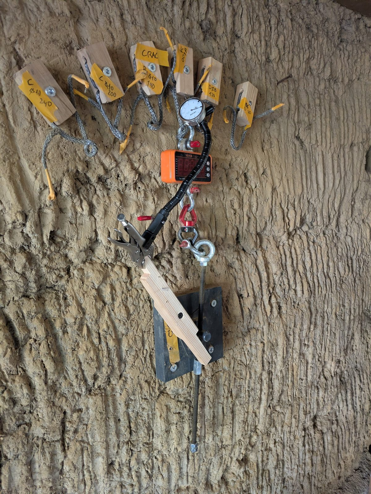
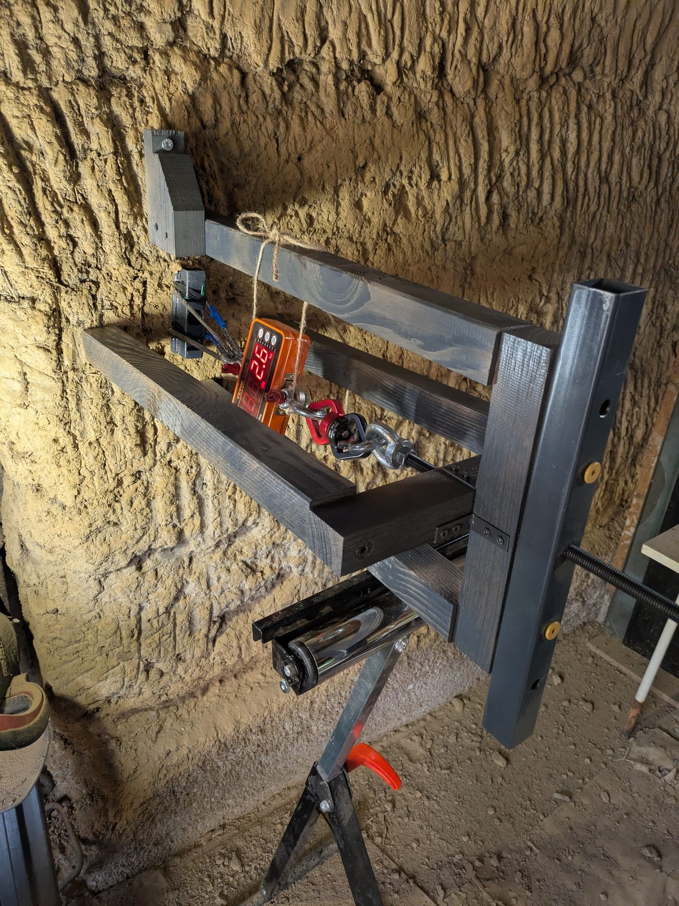
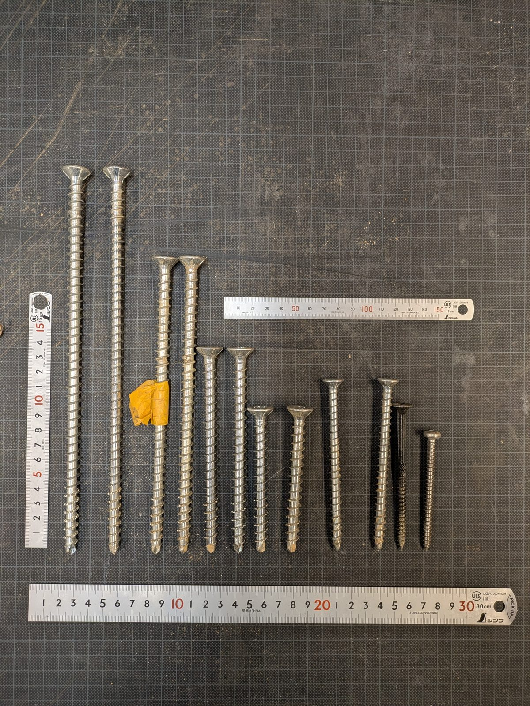
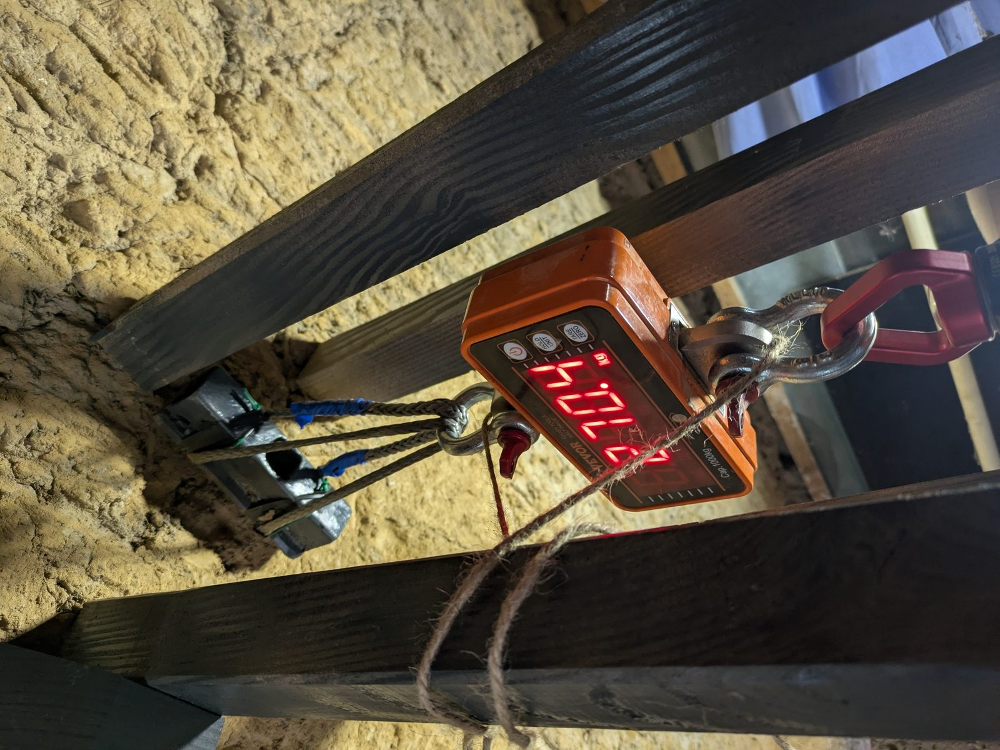
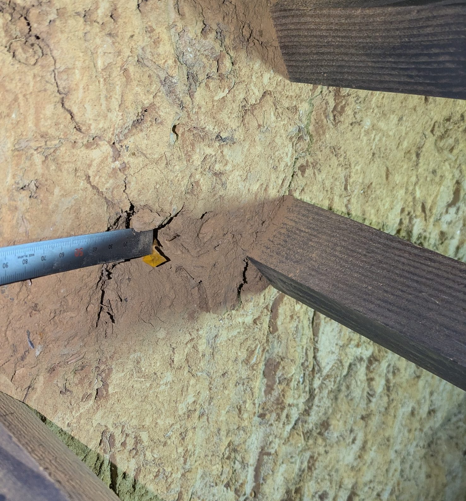
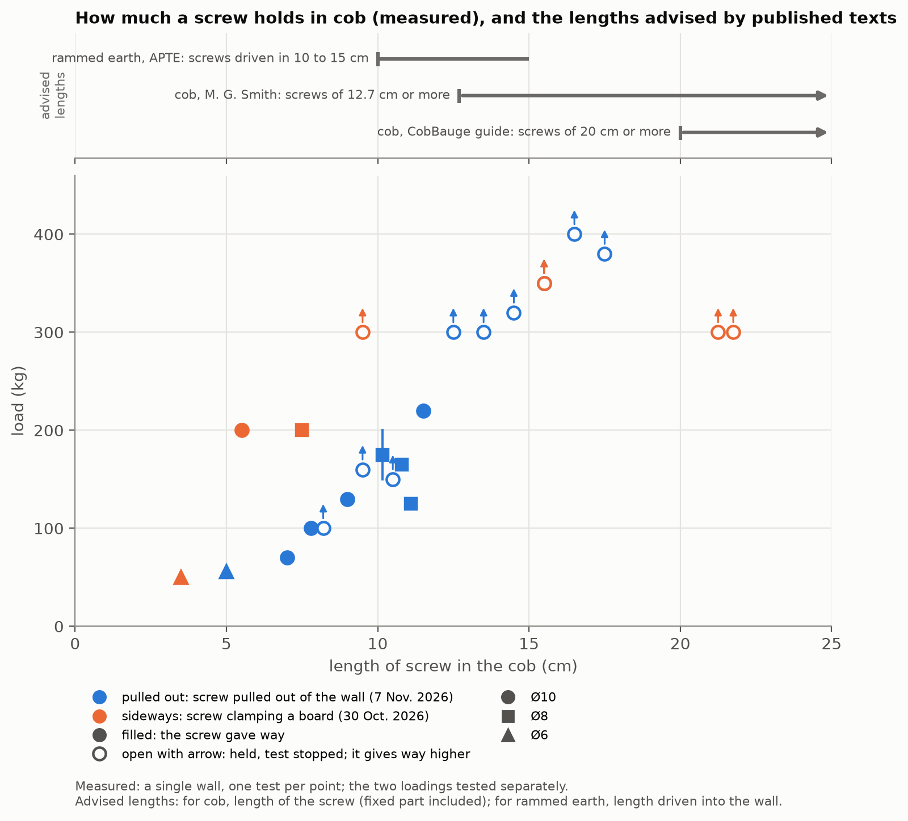
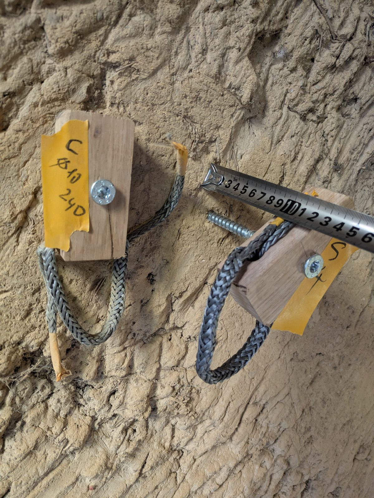
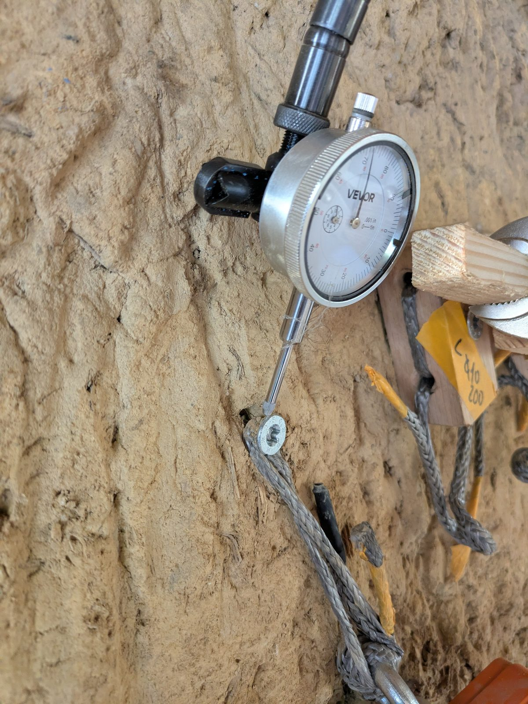
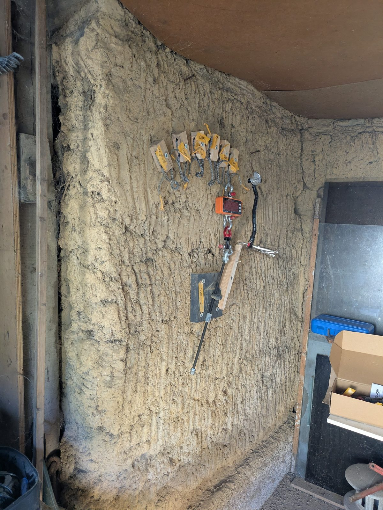

::: diptyque

:::

**Can you screw into cob?** Earth building guides say yes, but give no detail: no diameter, no length, no load. We
tested sixteen screws in an old cob wall, pulled sideways and pulled out of the wall, to give builders those reference
points.

## In short

- **It holds, especially if the screw goes deep into the cob.** The length of screw in the cob matters more than
  anything else.
- **Pulled out of the wall (pull-out), a screw holds much less than sideways.** Up to 11.5 cm in the cob at least,
  pull-out is the limit.
- **We give no safe load**: it depends on too many things (the cob of your wall, how the screw is loaded, knocks, what
  happens if it gives way).
- **Never rely on a single screw**: cob hides stones, pockets and cracks.

## Which screw?

Good-quality fully threaded structural timber screws, 8 or 10 mm in diameter. For the Ø10, a 5 to 6 mm pilot hole
clearly reduces the driving effort and avoids forcing the screw. A small Ø6 wood screw holds little: keep it for light
loads.

## How long?

The texts that give a length advise screws driven 10 to 15 cm into rammed earth, and screws of 12.7 cm or more, or of
20 cm or more, in cob. Our measurements point the same way: in pull-out, holding rises quickly with length up to about
12 cm. Count the length **in the cob**, without the fixed part or the plaster.

## How much did they hold?

One screw per cell, on a single wall. "Held": the test was stopped without the screw giving way; it holds more.

::: diptyque

:::

| Length in the cob | Pulled out of the wall (pull-out) | Sideways (screw clamping a board) |
|---|---|---|
| 3.5 to 5.5 cm | Ø6 at 5 cm: gave way at 56 kg | Ø6 at 3.5 cm: held 40 kg, slid at 50 kg; Ø10 at 5.5 cm: gave way at 200 kg |
| 7 to 9 cm | Ø10: gave way at 70 kg (7 cm), 100 kg (8 cm), 130 kg (9 cm) | Ø8 at 7.5 cm: gave way at 200 kg |
| 9.5 to 11.5 cm | Ø10 at 11.5 cm: gave way at 220 kg; Ø8 at 10.5 cm: gave way between 120 and 200 kg | Ø10 at 9.5 cm: held 300 kg |
| 12.5 to 17.5 cm | Ø10: held 300 to 400 kg | Ø10 at 15.5 cm: held 350 kg |
| 21.5 cm | — | Ø10: held 300 kg |

Table: What the screws carried, by length in the cob.

The two loadings were tested separately: the figure puts them side by side, without combining them.

## How much to hang on it?

- **No safe load**: these figures are what one screw carried, once, in one wall. What your screw can carry without
  risk depends on your cob and your use.
- **Take the weaker of the two**: a screw always works a little sideways and a little in pull-out; under 12 cm,
  pull-out is the limit.
- **Clamp the piece against the wall**: sideways, the clamped board stiffens the whole; a piece standing off the wall
  loses that help.
- **Spread over several screws**, so that the work still holds if one falls in a flaw. A screw that goes in too easily
  or spins in a void: put another one beside it.
- **For heavy loads**, use more screws, or embed a piece of timber in the cob.

::: diptyque

:::

## Limits

A single wall, of dry cob, and one test per configuration; loads held only briefly, nothing on long-term loading or on
damp cob. These are reference points to check on your own wall, not design values.

## Going further

The paper gives the details: the two test rigs, driving and the pilot hole, what published texts say and nearby
measurements, the margins used elsewhere, the readings and how we interpret them.

{{boutons}}

## Feedback

You have run similar tests, you see a mistake, you fix screws into earth walls: tell us
([GitHub issues]({{depot}}/issues)){{contact}}.
