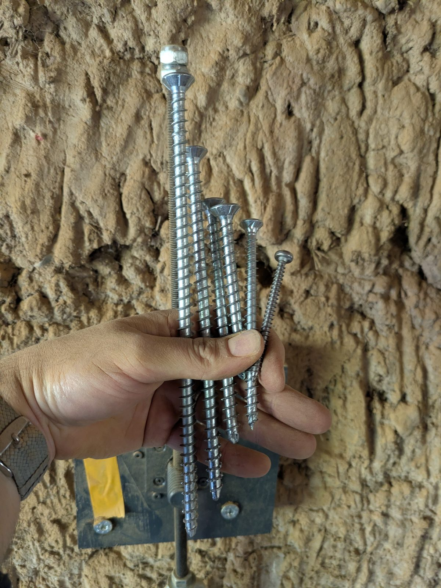
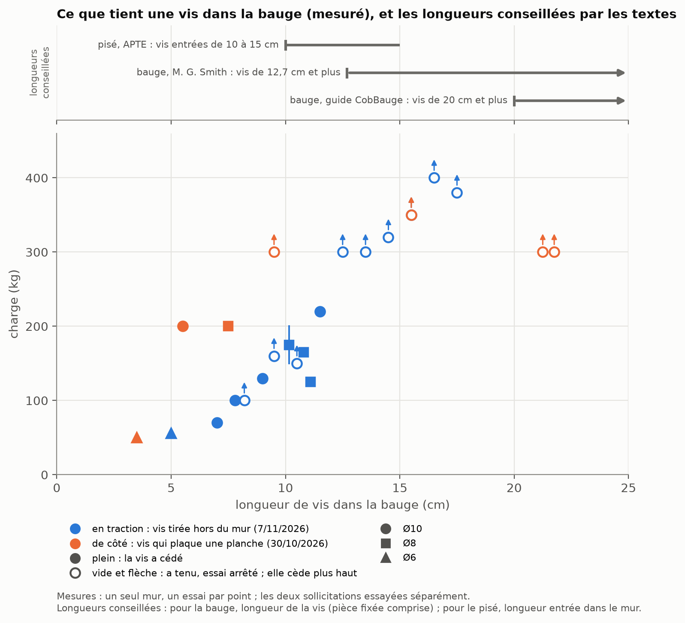

::: diptyque

:::

**Peut-on visser dans la bauge ?** Les guides de la construction en terre crue disent oui, mais sans détail : ni
diamètre, ni longueur, ni charge. Nous avons fait des essais sur un mur pour donner ces repères.

## Ce qu'on a trouvé

- **Les vis** : des vis de charpente à filetage total, de qualité, en diamètre 8 et 10 mm. Pour la Ø10, un pré-trou
  de 5 à 6 mm réduit nettement l'effort de pose.
- **De côté (en cisaillement), on atteint facilement 300 kg.** Ce qui compte surtout, c'est la longueur de vis dans la
  bauge :
  - 200 kg dès 5,5 cm en Ø10, et dès 7,5 cm en Ø8 ;
  - au moins 300 kg dès 9,5 cm en Ø10 ;
  - une petite vis Ø6 sur 3,5 cm tient déjà 40 kg.
- **Ces chiffres valent pour une vis qui fixe un montant en bois contre le mur.** Le montant rend l'ensemble plus
  rigide qu'une vis seule.
- **En traction (vis tirée hors du mur), une vis tient moins** : une Ø10 a cédé à 70 kg entrée de 7 cm, à 220 kg à
  11,5 cm, et tenu 300 à 400 kg de 12,5 à 17,5 cm.
- **Pas de charge sûre** : elle dépend de trop de choses (la bauge du mur, la façon de charger, les chocs). Les textes
  conseillent des vis de 10 à 20 cm ; pour d'autres murs de terre, 3 à 50 kg par fixation ; aucun ne donne de charge
  pour la bauge. Pour plus, multiplier les vis, ou noyer une pièce de bois dans la bauge.
- **Prévoir de la redondance** : même si une vis tient 300 kg, répartir la charge sur plusieurs vis, pour qu'un défaut
  local de la bauge (caillou, poche, fissure) ne compromette pas l'ouvrage.

## Le montage

De côté : une planche de bois, comme un montant, est vissée contre le mur par une seule vis ; on la tire vers le bas,
le long du mur, comme une charge suspendue. En traction : on tire la vis hors du mur, dans son axe. Dans les deux cas,
on lit l'effort au peson. Seize essais, les 30 octobre et 7 novembre 2026, sur le mur en bauge sèche d'un cabanon de
jardin d'au moins 50 ans, au Clos Poulain, région de Rennes, avec du matériel courant.

## Tenue selon la longueur de vis

Les points sont des mesures, une vis par point. Les deux sollicitations ont été essayées séparément : la figure les
met côte à côte, sans les combiner. Une vis travaille toujours un peu des deux façons : pour situer une fixation,
l'auteur retient la plus faible des deux tenues. En haut, les longueurs de vis que conseillent les textes publiés.

## Les limites

Un seul mur, de bauge sèche, et un essai par configuration ; des charges tenues peu de temps, rien sur la durée
ni sur une bauge humide. Ce sont des repères à vérifier sur votre mur, pas des valeurs de calcul.

## Pour aller plus loin

Le papier donne le détail : la pose et le pré-trou, ce que conseillent les textes, les marges pratiquées ailleurs,
les limites, les relevés et leur interprétation.

{{boutons}}

## Vos retours

Vous avez fait des essais comparables, vous voyez une erreur, vous posez des vis dans la terre crue : dites-le-nous
([issues GitHub]({{depot}}/issues)){{contact}}.
