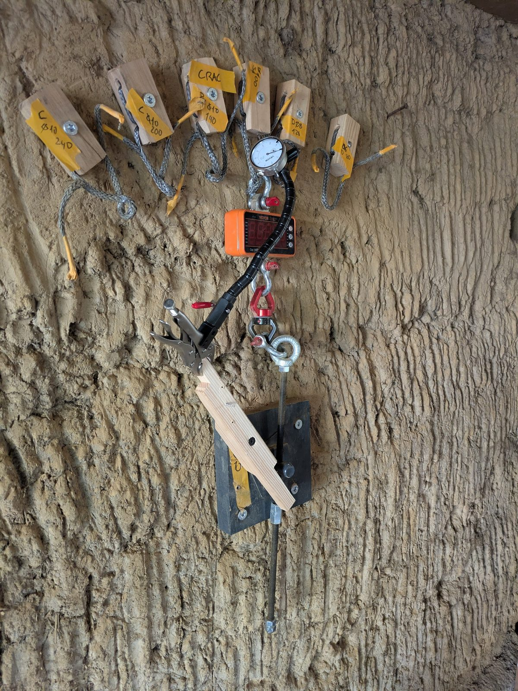
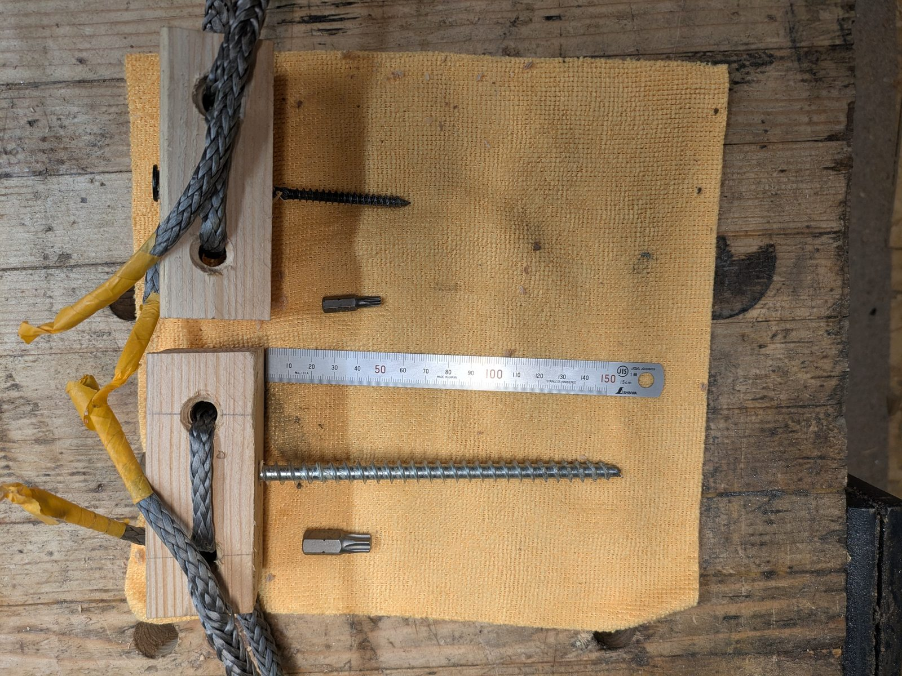

::: diptyque
{.portrait}

{.paysage}
:::

**Peut-on visser dans la bauge ?** Les guides de la construction en terre crue disent oui, mais sans détail : ni
diamètre, ni longueur, ni charge. Nous avons fait des essais sur un mur pour donner ces repères.

## Ce qu'on a trouvé

- **Les vis** : des vis de charpente à filetage total, de qualité, en diamètre 8 et 10 mm, posées avec un pré-trou de
  5 à 6 mm.
- **De côté (en cisaillement), on atteint facilement 300 kg.** Ce qui compte surtout, c'est la longueur de vis dans la
  bauge :
  - 200 kg dès 5,5 cm en Ø10, et dès 7,5 cm en Ø8 ;
  - au moins 300 kg dès 9,5 cm en Ø10 ;
  - une petite vis Ø6 sur 3,5 cm tient déjà 40 kg.
- **Ces chiffres valent pour une vis qui fixe un montant en bois contre le mur.** Le montant rend l'ensemble plus
  rigide qu'une vis seule.

## Le montage

Une planche de bois, comme un montant, est vissée contre le mur par une seule vis. On la tire vers le bas, le long du
mur, comme une charge suspendue, et on lit l'effort au peson. Huit essais, le 30 octobre 2026, sur le mur en bauge
sèche d'un cabanon de jardin d'au moins 50 ans, au Clos Poulain, région de Rennes, avec du matériel courant.

## Résistance selon la longueur de vis

Les points sont des mesures. Les tirets prolongent les mesures en supposant que l'effort croît comme la longueur de
vis dans la bauge : c'est une **extrapolation**, pas une mesure. Au-delà de 350 kg, rien n'a été mesuré.

## Pour aller plus loin

Le papier donne le détail : la pose et le pré-trou, les conseils, les limites, les relevés et leur interprétation. À
venir : les essais d'arrachement (vis tirées hors du mur), en novembre 2026.

{{boutons}}

## Vos retours

Vous avez fait des essais comparables, vous voyez une erreur, vous posez des vis dans la terre crue : dites-le-nous
([issues GitHub]({{depot}}/issues)){{contact}}.
